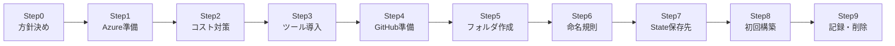
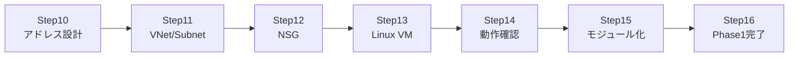

# Getting Started - プロジェクト開始手順

Azure Common Platform を開始するために、最初に実施することを Step ごとにまとめた手順書です。
- **Step 0 〜 Step 9**：準備編（Terraform で最初のリソースを作れる状態にする）
- **Step 10 〜 Step 16**：Phase1 構築編（VNet / Subnet / NSG / Linux VM を構築し、モジュール化する）





---

## 進捗チェックリスト

- [ ] Step0：プロジェクトの方針を決める
- [ ] Step1：Azure アカウント・サブスクリプションを準備する
- [ ] Step2：予算アラートを設定する（最重要）
- [ ] Step3：ローカル PC に必要なツールを導入する
- [ ] Step4：GitHub リポジトリを作成する
- [ ] Step5：ディレクトリ構成と .gitignore を作成する
- [ ] Step6：命名規則・タグ規則を決める
- [ ] Step7：Terraform State の保存先を作成する
- [ ] Step8：Phase1 の最初のリソースを Terraform で構築する
- [ ] Step9：作業を記録し、不要なリソースを削除する
- [ ] Step10：アドレス設計とファイル構成を整理する
- [ ] Step11：VNet・Subnet を構築する
- [ ] Step12：NSG を構築し Subnet に関連付ける
- [ ] Step13：SSH 鍵を作成し Linux VM を構築する
- [ ] Step14：VM に接続して動作確認する
- [ ] Step15：コードをモジュール化する
- [ ] Step16：Phase1 を完了させる（記録・PR・削除）

---

## Step0：プロジェクトの方針を決める

いきなり構築せず、まずは「何を・どこまで・いくらで」やるかを決めます。

| 項目 | 決める内容 | 例 |
| --- | --- | --- |
| ゴール | このPJで達成したいこと | AZ-104 / AZ-305 レベルの基盤を IaC で構築・運用できる |
| リージョン | 利用する Azure リージョン | Japan East |
| 環境 | 作成する環境 | まずは dev のみ → test → prod |
| 予算 | 月額コスト | 目標 5,000円 / 上限 10,000円 |
| 作業ルール | 構築方法 | **Portal は確認のみ、作成は Terraform で行う** |

> 💡 決めた内容は `ProjectOverAll/01_Architecture/` に設計メモとして残しておくと、後から振り返れます。

---

## Step1：Azure アカウント・サブスクリプションを準備する

1. Azure アカウントを用意する（無料アカウント or 従量課金）
2. サブスクリプション ID を確認する
3. **アカウントの多要素認証（MFA）を有効にする**

> ⚠️ 無料アカウントは VM サイズや作成できるリソースに制限がある場合があります。
> 30日の無料クレジット終了後は「従量課金」へのアップグレードが必要です。

---

## Step2：予算アラートを設定する（最重要）

学習用 PJ で一番怖いのは「消し忘れによる高額請求」です。**構築を始める前に必ず設定**します。

Azure Portal →「コストの管理と請求」→「コスト管理」→「予算」→「追加」

| 設定項目 | 値 |
| --- | --- |
| スコープ | 対象のサブスクリプション |
| 予算額 | 5,000円 |
| リセット期間 | 毎月 |
| アラート条件 | 50% / 80% / 100%（実績）、100%（予測） |
| 通知先 | 自分のメールアドレス |

> 💡 上限の 10,000円 でも別の予算を作っておくと二重の安全策になります。

---

## Step3：ローカル PC に必要なツールを導入する

PowerShell で以下を実行します（Windows の場合）。

```powershell
winget install --id Git.Git
winget install --id Microsoft.VisualStudioCode
winget install --id Microsoft.AzureCLI
winget install --id Hashicorp.Terraform
winget install --id GitHub.cli
```

インストール後、**PowerShell を開き直して**バージョンを確認します。

```powershell
git --version
az --version
terraform -version
gh --version
```

### VS Code の推奨拡張機能

| 拡張機能 | 用途 |
| --- | --- |
| HashiCorp Terraform | Terraform の補完・構文チェック |
| Azure Account / Azure Resources | Azure リソースの確認 |
| GitHub Actions | ワークフローの編集支援 |
| Draw.io Integration | 構成図を VS Code 上で作成 |
| Markdown All in One | ドキュメント作成 |

### Azure / GitHub にログイン

PC から**コマンドで Azure と GitHub を操作できるようにするためのログイン作業**です。

Azure Portal を使うときに画面でログインするのと同じように、PowerShell から Terraform や Azure CLI で Azure を操作するときも、**「誰が」「どのサブスクリプションに対して」操作するのか**を PC に登録しておく必要があります。
これをしていないと、Step7 以降の `az` コマンドや `terraform apply` が「認証されていません」というエラーで動きません。

```powershell
az login
az account show --output table
# 複数サブスクリプションがある場合
az account set --subscription "<サブスクリプションID>"

gh auth login
```

| コマンド | していること |
| --- | --- |
| `az login` | ブラウザが開き、Azure アカウントでサインインします。ログイン情報が PC に保存され、**Terraform もこの情報を使って Azure を操作します** |
| `az account show --output table` | **今どのサブスクリプションが操作対象になっているか**を表示します。意図したサブスクリプションかを確認します |
| `az account set --subscription "<ID>"` | 操作対象のサブスクリプションを切り替えます。サブスクリプションが1つだけなら**不要**です |
| `gh auth login` | GitHub CLI（`gh`）で GitHub にサインインします。Step16 で PR をコマンドで作る（`gh pr create`）ために使います |

> ⚠️ **サブスクリプションの確認が大事な理由**
> 会社のアカウントなどで複数のサブスクリプションを持っている場合、確認せずに進めると
> **意図しないサブスクリプション（会社の環境など）にリソースを作ってしまう**おそれがあります。
> 個人アカウントでサブスクリプションが1つだけなら、`az login` と `az account show` で確認するだけで十分です。

> 💡 `gh auth login` は今すぐでなくても構いません。GitHub の画面で PR を作るなら不要です。
> なお、Step4 の `git push` で認証を求められた場合は、ブラウザの認証画面が自動で表示されます。

Git の初期設定も行います。

```powershell
git config --global user.name "<GitHubのユーザー名>"
git config --global user.email "<GitHubに登録したメールアドレス>"
```

---

## Step4：GitHub リポジトリを作成する

1. GitHub で新規リポジトリ `Azure-Common-Platform` を作成
   - 公開範囲：ポートフォリオにするなら Public（最初は Private でも可）
   - 「Add a README file」はチェックを外す
2. ローカルにクローンし、作成済みの `README.md` を配置して初回コミット

```powershell
git clone https://github.com/<ユーザー名>/Azure-Common-Platform.git
cd Azure-Common-Platform
# README.md をこのフォルダにコピーしてから
git add README.md
git commit -m "docs: README を追加"
git push origin main
```

### ブランチ運用ルール（おすすめ）

| ブランチ | 用途 |
| --- | --- |
| `main` | 構築済み・動作確認済みのコード |
| `feature/phase1-vnet` など | 作業用。完了したら Pull Request で `main` にマージ |

> 💡 1人でも Pull Request を使うと、作業履歴がポートフォリオとして見やすくなります。

---

## Step5：ディレクトリ構成と .gitignore を作成する

README のディレクトリ構成どおりにフォルダを作成します。

> 📍 **実施場所：Step4 でクローンした `Azure-Common-Platform` フォルダの直下（ローカル PC 上）**
> GitHub の Web 画面ではなく、自分の PC の PowerShell で実施します。
> 作成したフォルダやファイルは、最後の `git push` で GitHub に反映されます。

実行前に、現在地が `Azure-Common-Platform` フォルダの直下になっているかを確認します。

```powershell
cd <クローンした場所>\Azure-Common-Platform   # Step4 の続きなら移動済みのため不要
Get-Location     # パスの末尾が Azure-Common-Platform になっていること
Get-ChildItem -Force   # README.md と .git フォルダが表示されること
```

> ⚠️ 別の場所で実行すると、リポジトリの外にフォルダが作られ、GitHub に反映されません。

```powershell
$dirs = @(
  "ProjectOverAll/01_Architecture",
  "ProjectOverAll/02_Lecture",
  "ProjectOverAll/03_RunBook",
  "ProjectOverAll/04_CostManagement",
  "environments/dev",
  "environments/test",
  "environments/prod",
  "modules/rg",
  "modules/vnet",
  "modules/subnet",
  "modules/nsg",
  "modules/vm",
  "modules/storage",
  "modules/keyvault",
  "modules/private_dns",
  "modules/log_analytics",
  ".github/workflows"
)
foreach ($d in $dirs) {
  New-Item -ItemType Directory -Force $d | Out-Null
  New-Item -ItemType File -Force "$d/.gitkeep" | Out-Null  # 空フォルダを Git 管理するため
}
```

### .gitignore（必須）

State ファイルや変数ファイルには**機密情報が含まれる**ため、絶対に GitHub に上げないようにします。
リポジトリ直下（`Azure-Common-Platform` フォルダの直下、`README.md` と同じ場所）に `.gitignore` を作成し、以下の内容を貼り付けます。

```powershell
code .gitignore   # VS Code で新規ファイルとして開く
```

```gitignore
# Terraform
.terraform/
*.tfstate
*.tfstate.*
crash.log
crash.*.log
*.tfplan
override.tf
override.tf.json
*_override.tf
*_override.tf.json
.terraformrc
terraform.rc

# 変数ファイル（サンプルのみ管理する）
*.tfvars
*.tfvars.json
!*.tfvars.example

# OS / Editor
.DS_Store
Thumbs.db
.vscode/
```

> 💡 `.terraform.lock.hcl` は**コミットする**ファイルです（Provider のバージョン固定のため）。

### ステージングの確認（コミット前に毎回実施）

`git add` の後、**`git commit` の前に「何がコミットされるか」を必ず確認**します。
機密情報を一度 GitHub に push すると、ファイルを消しても履歴に残ってしまうためです。

```powershell
git add .
git status
```

出力例：

```text
On branch main
Changes to be committed:
  (use "git restore --staged <file>..." to unstage)
        new file:   .gitignore
        new file:   environments/dev/.gitkeep
        new file:   modules/rg/.gitkeep

Untracked files:
  (use "git add <file>..." to include in what will be committed)
        memo.txt
```

| 表示 | 意味 |
| --- | --- |
| `Changes to be committed`（緑） | **ステージング済み**。次の `git commit` に含まれる |
| `Changes not staged for commit`（赤） | 変更はあるが、まだ `git add` していない |
| `Untracked files`（赤） | Git がまだ管理していない新しいファイル |

#### その他の確認方法

| コマンド | 用途 |
| --- | --- |
| `git status -s` | 短く一覧表示。左の列に記号（`A`=追加 / `M`=変更 / `D`=削除）があればステージング済み、`??` は未管理 |
| `git diff --cached --name-only` | ステージング済みの**ファイル名だけ**を表示 |
| `git diff --cached` | ステージング済みの**変更内容（差分）**まで表示 |

#### コミット前チェックリスト

`Changes to be committed` に以下が**含まれていないこと**を確認します。

- [ ] `terraform.tfvars`（サブスクリプション ID・自宅 IP などが入っている）
- [ ] `*.tfstate` / `*.tfstate.backup`
- [ ] `.terraform/` フォルダ
- [ ] 秘密鍵（`acp_dev_rsa`）

> ⚠️ これらが表示された場合は、`.gitignore` が `README.md` と同じ場所にあるか、ファイル名が `.gitignore`（`.txt` が付いていない）になっているかを確認してください。

`.gitignore` が効いているかは、以下でも確認できます（無視されるファイルなら、該当する `.gitignore` の行が表示されます）。

```powershell
git check-ignore -v environments/dev/terraform.tfvars
```

#### 間違えて add したときの取り消し

```powershell
git restore --staged <ファイル名>
```

ステージングから外れるだけで、ファイル自体は消えません。

### コミットと push

確認できたらコミットします。

```powershell
git commit -m "chore: ディレクトリ構成と .gitignore を追加"
git push origin main
```

---

## Step6：命名規則・タグ規則を決める

最初に決めておくと、リソースが増えても管理しやすくなります。
Microsoft の推奨（Cloud Adoption Framework）に沿った例です。

**形式：`<種類>-<PJ名>-<環境>-<リージョン>-<連番>`**

| リソース | 略称 | 例 |
| --- | --- | --- |
| Resource Group | rg | `rg-acp-dev-jpe-001` |
| Virtual Network | vnet | `vnet-acp-hub-jpe-001` |
| Subnet | snet | `snet-acp-dev-app-001` |
| NSG | nsg | `nsg-acp-dev-app-001` |
| Virtual Machine | vm | `vm-acp-dev-001` |
| Key Vault | kv | `kv-acp-dev-jpe-001` |
| Log Analytics | log | `log-acp-hub-jpe-001` |
| Storage Account | st | `stacpdevjpe001`（記号不可・小文字英数字のみ・3〜24文字） |

### 共通タグ

| タグ名 | 値の例 | 用途 |
| --- | --- | --- |
| `Project` | `AzureCommonPlatform` | PJ単位のコスト集計 |
| `Environment` | `dev` / `test` / `prod` | 環境の識別 |
| `Owner` | 自分の名前 | 管理者の明確化 |
| `ManagedBy` | `Terraform` | 手動作成リソースとの区別 |

> 💡 決めた内容は `ProjectOverAll/01_Architecture/naming-convention.md` に残しておきます。

---

## Step7：Terraform State の保存先を作成する

Terraform の State（構築状態の記録）を Azure Storage に保存します。
ローカル保存だと PC 故障で消えたり、GitHub Actions から使えないためです。

> State 保存用のリソースは「Terraform 自身を動かすための土台」なので、**ここだけは Azure CLI で作成**します。

```powershell
$RG       = "rg-acp-tfstate-jpe-001"
$LOCATION = "japaneast"
$SA       = "stacptfstate<ランダムな数字>"   # 全世界で一意な名前にする
$CONTAINER = "tfstate"

az group create --name $RG --location $LOCATION
az storage account create --name $SA --resource-group $RG --location $LOCATION `
  --sku Standard_LRS --kind StorageV2 --min-tls-version TLS1_2 `
  --allow-blob-public-access false
az storage container create --name $CONTAINER --account-name $SA --auth-mode login
```

> ⚠️ `--auth-mode login` でエラーになる場合は、自分のアカウントにストレージアカウントの
> 「ストレージ BLOB データ共同作成者」ロールを付与してください。

### 作成後：タグを付ける

State 用リソースも、タグ規則に沿ってタグを付けます。Terraform 管理ではないため、`ManagedBy` は `AzureCLI` にします。
タグはリソースごとに付ける必要があります（Resource Group に付けても、中のリソースには引き継がれません）。

```powershell
az group update --name $RG --tags Project=AzureCommonPlatform Environment=dev Owner=Taiyaki64 ManagedBy=AzureCLI
az storage account update --name $SA --resource-group $RG --tags Project=AzureCommonPlatform Environment=dev Owner=Taiyaki64 ManagedBy=AzureCLI
```

> 💡 `--tags` は既存のタグを置き換えます。付いたかは `az group show --name $RG --query tags` で確認できます。

> 📝 作成した Storage Account 名（`$SA`）は Step8 の backend 設定で使います。控えておいてください。
> 忘れた場合は `az storage account list --resource-group $RG --output table` で確認できます。

### トラブルシュート：`SubscriptionNotFound` が出る

**症状**：`az storage account check-name --name $SA` を実行すると、サブスクリプションは `Enabled` なのに次のエラーになる。

```text
(SubscriptionNotFound) Subscription xxxxxxxx-xxxx-... was not found.
```

**原因**：Resource Provider `Microsoft.Storage` が、このサブスクリプションで未登録だった。
`check-name` のような確認系のコマンドは、作成時のような自動登録が働かないため、実際の原因とは違う分かりにくいエラーになる。

> 💡 **Resource Provider とは**：Azure の各サービス（Storage / VM / ネットワークなど）の提供窓口です。
> 新しいサブスクリプションでは、使いたいサービスの Provider を先に「登録」する必要があります。登録に費用はかかりません。

**切り分けの手順**（すべて確認系で、何も変更しない）

| 順番 | コマンド | 分かること |
| --- | --- | --- |
| 1 | `az --version` | Azure CLI が使えるか。`az` が見つからない場合は **VSCode を完全に再起動**する（インストール前に起動した VSCode は古い PATH を使い続けるため） |
| 2 | `az account list --all --output table` | サブスクリプションが `Enabled` か、`IsDefault` が `True` か |
| 3 | `az group list --output table` | サブスクリプションに問い合わせできるか（空の表なら正常） |
| 4 | `az provider show --namespace Microsoft.Storage --query registrationState --output tsv` | `NotRegistered` なら未登録が原因 |

**対処**：Provider を登録する（Azure の設定変更なので、実行前に内容を確認する）。

```powershell
az provider register --namespace Microsoft.Storage

# Registered になるまで待つ（1〜数分。Registering → Registered と変わる）
az provider show --namespace Microsoft.Storage --query registrationState --output tsv
```

登録後に `az storage account check-name --name $SA` を打ち直し、`"nameAvailable": true` と出れば解決です。

> ⚠️ 今回の切り分けでは、`az logout` → `az login` のやり直しや、ポータルでの支払い方法の確認も行いましたが、原因ではありませんでした。
> 同じエラーが出たら、まず上の表の 4 番（Provider の登録状態）を確認すると早いです。
> Step8 以降でも、`Microsoft.Network`（VNet・NSG）や `Microsoft.Compute`（VM）で同様のエラーが出た場合は、同じ方法で登録します。

---

## Step8：Phase1 の最初のリソースを Terraform で構築する

最初は **Resource Group 1つだけ**を作り、Terraform の一連の流れ（init → plan → apply → destroy）を体験します。
慣れてから VNet → Subnet → NSG → VM と増やし、モジュール化していきます。

### `environments/dev/main.tf`

```hcl
terraform {
  required_version = ">= 1.9.0"

  required_providers {
    azurerm = {
      source  = "hashicorp/azurerm"
      version = "~> 4.0"
    }
  }

  backend "azurerm" {
    resource_group_name  = "rg-acp-tfstate-jpe-001"
    storage_account_name = "stacptfstate<Step7で作成した名前>"
    container_name       = "tfstate"
    key                  = "dev.terraform.tfstate"
    use_azuread_auth     = true
  }
}

provider "azurerm" {
  features {}
  subscription_id = var.subscription_id
}

resource "azurerm_resource_group" "main" {
  name     = "rg-acp-dev-jpe-001"
  location = "japaneast"

  tags = {
    Project     = "AzureCommonPlatform"
    Environment = "dev"
    Owner       = "<自分の名前>"
    ManagedBy   = "Terraform"
  }
}
```

### `environments/dev/variables.tf`

```hcl
variable "subscription_id" {
  description = "Azure サブスクリプション ID"
  type        = string
}
```

### `environments/dev/terraform.tfvars`（GitHub には上げない）

```hcl
subscription_id = "<サブスクリプションID>"
```

> 💡 `terraform.tfvars.example` に値を伏せたサンプルを作り、そちらをコミットします。

### コードの解説

#### `main.tf` の3つのブロック

| ブロック | 役割 |
| --- | --- |
| `terraform` | 使う Terraform / Provider のバージョン、State の保存先（backend）を宣言する |
| `provider` | どの Azure（サブスクリプション）に接続するかを指定する |
| `resource` | 実際に作るリソースを宣言する |

- `required_version = ">= 1.9.0"`：Terraform 本体が 1.9.0 以上であることを要求する
- `version = "~> 4.0"`：azurerm Provider は 4.x の最新を使う（5.0 以上にはならない）。実際に使った版は `.terraform.lock.hcl` に記録され、コミットする
- State：Terraform が「何を作ったか」を記録する台帳。ローカルに置くと PC 故障で失うため、Step7 の Storage に保存する
- `use_azuread_auth = true`：アクセスキーを使わず `az login` の権限で Storage に接続する（キー漏えいの心配がない）
- `key`：State のファイル名。環境ごとに分ける（`dev.terraform.tfstate` など）
- backend ブロックには**変数が使えない**ため、ストレージアカウント名は直接書く
- `features {}`：azurerm で必須の空ブロック。省略するとエラーになる
- `resource "azurerm_resource_group" "main"`：`main` は Terraform 内だけで使うローカル名。Azure 上の名前は `name` で決まる。他から参照するときは `azurerm_resource_group.main.name` と書く

#### `variables.tf` と `terraform.tfvars` の関係

`main.tf` は他のファイルを「呼び出して」いません。Terraform は**同じフォルダの `.tf` ファイルをすべてまとめて1つの設定として読む**ため、ファイルを分けるのは人間の整理のためです。`terraform.tfvars` は、この名前のファイルがあれば自動で値が読み込まれます。

| ファイル | 役割 | 例 | GitHub |
| --- | --- | --- | --- |
| `variables.tf` | 変数の宣言（受け取り口＝空の箱） | `variable "subscription_id" { ... }` | 上げる |
| `terraform.tfvars` | 変数に入れる実際の値 | `subscription_id = "..."` | **上げない** |
| `main.tf` | 変数の中身を使う | `var.subscription_id` | 上げる |

つなぎ役は**名前の一致**です。3か所の `subscription_id` が同じ名前だからつながります（違うとエラー）。

`terraform plan` 実行時の流れ：

1. `.tf` ファイルをすべて読み、`variables.tf` で「`subscription_id` という変数がある」と知る
2. `terraform.tfvars` から同じ名前の変数に値を入れる
3. `main.tf` の `var.subscription_id` が、入った値に置き換わる

- `var.` は variable の略で「変数を使う」という合図
- `tfvars` に値がない変数は、`plan` のときに入力を求められる
- コード（設計図）は公開し、秘密の値（ID・自宅 IP）は手元に置くために分けている

#### タグは `locals.tf` で共通化する（上のコード例からの変更点）

上の `main.tf` の `tags` はタグを直接書いていますが、リソースが増えるたびに同じ4行をコピーすることになります。そのため、本プロジェクトでは `locals.tf` に1回だけ定義し、各リソースは `local.common_tags` で呼び出します。

```hcl
# locals.tf
locals {
  common_tags = {
    Project     = "AzureCommonPlatform"
    Environment = "dev"
    Owner       = "Taiyaki64"
    ManagedBy   = "Terraform"
  }
}
```

```hcl
# main.tf の Resource Group
resource "azurerm_resource_group" "main" {
  name     = "rg-acp-dev-jpe-001"
  location = "japaneast"
  tags     = local.common_tags
}
```

- `Owner` は `<自分の名前>` のままにせず `Taiyaki64` にする
- タグを変えたいときは `locals.tf` の1か所だけ直せば全リソースに反映される
- `variable` は「外から値をもらう箱」、`locals` は「内側で名前を付けた値」

### 作成するファイル一覧

`environments/dev/` に、次の5ファイルを作ってから実行します。

| ファイル | 内容 | コミット |
| --- | --- | --- |
| `main.tf` | terraform / backend / provider / Resource Group（`tags = local.common_tags`） | する |
| `variables.tf` | `subscription_id` 変数の宣言 | する |
| `locals.tf` | 共通タグ `common_tags`（上記の解説を参照） | する |
| `terraform.tfvars` | サブスクリプション ID の実値 | **しない** |
| `terraform.tfvars.example` | 値を伏せたサンプル（`subscription_id = "00000000-0000-0000-0000-000000000000"`） | する |

- サブスクリプション ID は `az account show --query id -o tsv` で確認できる（読み取りだけのコマンド）
- `terraform.tfvars` は `terraform.tfvars.example` をコピーして作り、値を書き換える
- 作業は `main` ではなく、ブランチ `feature/phase1-rg` を作ってから行う（`git checkout -b feature/phase1-rg`）

### 実行

```powershell
cd environments/dev
terraform init       # 初期化（Provider のダウンロード・Backend 接続）
terraform fmt        # コード整形
terraform validate   # 構文チェック
terraform plan       # 作成内容の確認（ここを必ず読む）
terraform apply      # 構築（yes を入力）
```

Azure Portal で Resource Group とタグが作成されていることを確認できたら成功です 🎉

### トラブルシュート：`terraform init` で `403 AuthorizationPermissionMismatch` が出る

```text
Error: Failed to get existing workspaces: listing blobs: executing request: unexpected status 403
(403 This request is not authorized to perform this operation using this permission.)
with AuthorizationPermissionMismatch
```

**原因**：State 保存用 Storage の**中身（Blob）を読み書きする権限**がないためです。プロバイダー未登録（`SubscriptionNotFound`）とは別の問題です。

Azure の権限は2種類に分かれています。

| 種類 | 対象 | 必要なロール |
| --- | --- | --- |
| 管理プレーン | Storage 自体の作成・削除 | 所有者 / 共同作成者 |
| データプレーン | Storage 内の Blob の読み書き | **ストレージ BLOB データ共同作成者** |

所有者でも、データプレーンのロールは自動では付きません。backend は `use_azuread_auth = true`（アクセスキーを使わず自分のログインで接続）なので、このロールが必須です。

**確認方法**（読み取りだけ）：Portal で Storage Account →「アクセス制御 (IAM)」→「ロールの割り当て」に「ストレージ BLOB データ共同作成者」があるかを見る。

**対処**：Azure CLI でロールを付与する（Azure を変更する操作なので、内容を確認してから実行）。

```powershell
$RG    = "rg-acp-tfstate-jpe-001"
$SA    = az storage account list --resource-group $RG --query "[0].name" -o tsv
$SCOPE = az storage account show --name $SA --resource-group $RG --query id -o tsv
$ME    = az ad signed-in-user show --query id -o tsv

az role assignment create --assignee $ME --role "Storage Blob Data Contributor" --scope $SCOPE

# 付与されたかの確認
az role assignment list --assignee $ME --scope $SCOPE --output table
```

- 付与の範囲は State 用 Storage Account **1つだけ**にする（最小権限の考え方。サブスクリプション全体には付けない）
- ロールの付与は無料。反映に数分かかることがあるため、すぐ失敗したら少し待って `terraform init` をやり直す
- State 用リソースは Terraform 管理外なので、Portal ではなく CLI で付与する

---

## Step9：作業を記録し、不要なリソースを削除する

### 学習ログを残す

`ProjectOverAll/02_Lecture/` に、作業ごとにメモを残します。

```text
ProjectOverAll/02_Lecture/
└─ 2026-10-24_Phase1_ResourceGroup.md
```

メモのテンプレート例：

```markdown
# 2026-10-24 Phase1 Resource Group 作成

## やったこと
## 学んだこと
## ハマったこと・解決方法
## 次にやること
```

### 使わないときは削除・停止する

```powershell
terraform destroy    # Terraform で作ったリソースを削除
```

- VM を作ったら**自動シャットダウン**を設定する
- 長期間使わない環境は `terraform destroy` で削除する（コードがあればすぐ再構築できるのが IaC の強み）
- Step7 の State 用ストレージは削除しない（月数円程度）

### コミット

```powershell
git checkout -b feature/phase1-rg
git add .
git status   # Step5 のコミット前チェックリストを確認（terraform.tfvars・*.tfstate が含まれていないこと）
git commit -m "feat: dev 環境の Resource Group を Terraform で作成"
git push origin feature/phase1-rg
# GitHub で Pull Request を作成して main にマージ
```

---

# Phase1 構築編

Step8 で作成した Resource Group に、VNet・Subnet・NSG・Linux VM を追加していきます。
**最初は「1ファイル＝1種類のリソース」で直接書き**、動作を理解してから Step15 でモジュール化します。

### Phase1 完成イメージ

```text
rg-acp-dev-jpe-001
└─ vnet-acp-dev-jpe-001 (10.1.0.0/16)
    └─ snet-acp-dev-app-001 (10.1.1.0/24)  ← nsg-acp-dev-app-001（SSH は自宅 IP のみ許可）
        └─ vm-acp-dev-001 (Ubuntu 24.04)
            ├─ nic-acp-dev-001
            ├─ pip-acp-dev-001（パブリック IP）
            └─ 自動シャットダウン 23:00
```

---

## Step10：アドレス設計とファイル構成を整理する

### アドレス設計

Phase3 で Hub and Spoke（VNet Peering）を行う際、**アドレスが重複すると接続できません**。
最初の VNet を作る前に、将来分も含めて決めておきます。

| VNet | アドレス空間 | 用途 | 作成する Phase |
| --- | --- | --- | --- |
| Hub-VNet | 10.0.0.0/16 | 共通サービス（Key Vault / DNS / 監視） | Phase3 |
| Dev-VNet | 10.1.0.0/16 | 開発環境 | **Phase1** |
| Test-VNet | 10.2.0.0/16 | テスト環境 | Phase3 |
| Prod-VNet | 10.3.0.0/16 | 本番環境（予約） | 未定 |

| Subnet（Dev-VNet 内） | アドレス | 用途 |
| --- | --- | --- |
| snet-acp-dev-app-001 | 10.1.1.0/24 | VM 配置用 |
| （予約） | 10.1.2.0/24 | Private Endpoint 用（Phase2 以降） |

> 💡 この表は `ProjectOverAll/01_Architecture/ip-address-design.md` として保存します。

### ファイル構成

`environments/dev/` を以下のように役割ごとに分けます。

```text
environments/dev/
├─ main.tf                  # terraform / backend / provider / Resource Group（Step8 で作成済み）
├─ locals.tf                # 共通タグなど（新規）
├─ variables.tf             # 変数定義（追記）
├─ network.tf               # VNet / Subnet / NSG（新規）
├─ compute.tf               # VM 関連（新規）
├─ outputs.tf               # 出力値（新規）
├─ terraform.tfvars         # 変数の値（GitHub に上げない）
└─ terraform.tfvars.example # 値を伏せたサンプル（GitHub に上げる）
```

### `locals.tf`（新規）

タグを1か所で管理し、全リソースで共通利用します。

```hcl
locals {
  common_tags = {
    Project     = "AzureCommonPlatform"
    Environment = "dev"
    Owner       = "<自分の名前>"
    ManagedBy   = "Terraform"
  }
}
```

### `main.tf`（Resource Group 部分を修正）

```hcl
resource "azurerm_resource_group" "main" {
  name     = "rg-acp-dev-jpe-001"
  location = var.location
  tags     = local.common_tags
}
```

### `variables.tf`（全体を置き換え）

```hcl
variable "subscription_id" {
  description = "Azure サブスクリプション ID"
  type        = string
}

variable "location" {
  description = "リソースを作成するリージョン"
  type        = string
  default     = "japaneast"
}

variable "allowed_ssh_source_ip" {
  description = "SSH を許可する接続元 IP（例: 203.0.113.10/32）"
  type        = string
}

variable "admin_username" {
  description = "VM の管理者ユーザー名"
  type        = string
  default     = "azureuser"
}

variable "ssh_public_key_path" {
  description = "VM に登録する SSH 公開鍵のパス"
  type        = string
  default     = "~/.ssh/acp_dev_rsa.pub"
}

variable "vm_size" {
  description = "VM のサイズ"
  type        = string
  default     = "Standard_B1s"
}

variable "auto_shutdown_time" {
  description = "自動シャットダウン時刻（HHmm 形式・日本時間）"
  type        = string
  default     = "2300"
}
```

### `terraform.tfvars`（追記）

自宅のグローバル IP を確認します。

```powershell
Invoke-RestMethod https://api.ipify.org
```

```hcl
subscription_id       = "<サブスクリプションID>"
allowed_ssh_source_ip = "<確認したIP>/32"
```

> ⚠️ 自宅の IP は回線の再接続などで変わることがあります。SSH できなくなったら IP を確認し、
> `terraform.tfvars` を更新して `terraform apply` し直してください。

---

## Step11：VNet・Subnet を構築する

### `network.tf`（新規）

```hcl
resource "azurerm_virtual_network" "main" {
  name                = "vnet-acp-dev-jpe-001"
  location            = azurerm_resource_group.main.location
  resource_group_name = azurerm_resource_group.main.name
  address_space       = ["10.1.0.0/16"]
  tags                = local.common_tags
}

resource "azurerm_subnet" "app" {
  name                 = "snet-acp-dev-app-001"
  resource_group_name  = azurerm_resource_group.main.name
  virtual_network_name = azurerm_virtual_network.main.name
  address_prefixes     = ["10.1.1.0/24"]
}
```

### 実行

```powershell
terraform fmt
terraform validate
terraform plan    # 「2 to add」になることを確認
terraform apply
```

**確認ポイント（Portal）**
- [ ] VNet のアドレス空間が `10.1.0.0/16` になっている
- [ ] Subnet が `10.1.1.0/24` で作成されている

> 💡 VNet・Subnet 自体は無料です。

---

## Step12：NSG を構築し Subnet に関連付ける

インターネットからの通信は **SSH（22番）を自宅 IP からのみ許可**し、それ以外は拒否します。
（NSG はデフォルトでインターネットからの受信をすべて拒否するため、許可ルールだけを追加します）

### `network.tf`（追記）

```hcl
resource "azurerm_network_security_group" "app" {
  name                = "nsg-acp-dev-app-001"
  location            = azurerm_resource_group.main.location
  resource_group_name = azurerm_resource_group.main.name
  tags                = local.common_tags
}

resource "azurerm_network_security_rule" "allow_ssh" {
  name                        = "Allow-SSH-From-MyIP"
  priority                    = 100
  direction                   = "Inbound"
  access                      = "Allow"
  protocol                    = "Tcp"
  source_port_range           = "*"
  destination_port_range      = "22"
  source_address_prefix       = var.allowed_ssh_source_ip
  destination_address_prefix  = "*"
  resource_group_name         = azurerm_resource_group.main.name
  network_security_group_name = azurerm_network_security_group.app.name
}

resource "azurerm_subnet_network_security_group_association" "app" {
  subnet_id                 = azurerm_subnet.app.id
  network_security_group_id = azurerm_network_security_group.app.id
}
```

### 実行

```powershell
terraform plan    # 「3 to add」になることを確認
terraform apply
```

**確認ポイント（Portal）**
- [ ] NSG の受信セキュリティ規則に `Allow-SSH-From-MyIP` がある
- [ ] ソースが自宅 IP（`/32`）になっている（`*` や `Any` になっていないこと）
- [ ] NSG の「サブネット」に `snet-acp-dev-app-001` が関連付けられている

> ⚠️ SSH を `*`（全世界）に開放すると、数分で不正ログインの試行が始まります。必ず IP を絞ってください。

---

## Step13：SSH 鍵を作成し Linux VM を構築する

### SSH 鍵の作成

パスワード認証は使わず、**SSH 鍵認証のみ**にします。

```powershell
ssh-keygen -t rsa -b 4096 -f "$HOME\.ssh\acp_dev_rsa" -C "acp-dev"
```

| ファイル | 内容 | 扱い |
| --- | --- | --- |
| `acp_dev_rsa` | 秘密鍵 | **絶対に他人に渡さない・GitHub に上げない** |
| `acp_dev_rsa.pub` | 公開鍵 | VM に登録する |

### `compute.tf`（新規）

```hcl
resource "azurerm_public_ip" "vm" {
  name                = "pip-acp-dev-001"
  location            = azurerm_resource_group.main.location
  resource_group_name = azurerm_resource_group.main.name
  allocation_method   = "Static"
  sku                 = "Standard"
  tags                = local.common_tags
}

resource "azurerm_network_interface" "vm" {
  name                = "nic-acp-dev-001"
  location            = azurerm_resource_group.main.location
  resource_group_name = azurerm_resource_group.main.name
  tags                = local.common_tags

  ip_configuration {
    name                          = "ipconfig1"
    subnet_id                     = azurerm_subnet.app.id
    private_ip_address_allocation = "Dynamic"
    public_ip_address_id          = azurerm_public_ip.vm.id
  }
}

resource "azurerm_linux_virtual_machine" "main" {
  name                            = "vm-acp-dev-001"
  location                        = azurerm_resource_group.main.location
  resource_group_name             = azurerm_resource_group.main.name
  size                            = var.vm_size
  admin_username                  = var.admin_username
  disable_password_authentication = true
  network_interface_ids           = [azurerm_network_interface.vm.id]
  tags                            = local.common_tags

  admin_ssh_key {
    username   = var.admin_username
    public_key = file(pathexpand(var.ssh_public_key_path))
  }

  os_disk {
    name                 = "osdisk-acp-dev-001"
    caching              = "ReadWrite"
    storage_account_type = "Standard_LRS"
    disk_size_gb         = 30
  }

  source_image_reference {
    publisher = "Canonical"
    offer     = "ubuntu-24_04-lts"
    sku       = "server"
    version   = "latest"
  }
}

# 毎日 23:00（日本時間）に自動停止（割り当て解除）してコストを抑える
resource "azurerm_dev_test_global_vm_shutdown_schedule" "main" {
  virtual_machine_id    = azurerm_linux_virtual_machine.main.id
  location              = azurerm_resource_group.main.location
  enabled               = true
  daily_recurrence_time = var.auto_shutdown_time
  timezone              = "Tokyo Standard Time"

  notification_settings {
    enabled = false
  }
}
```

### `outputs.tf`（新規）

```hcl
output "vm_public_ip" {
  description = "VM のパブリック IP"
  value       = azurerm_public_ip.vm.ip_address
}

output "vm_private_ip" {
  description = "VM のプライベート IP"
  value       = azurerm_network_interface.vm.private_ip_address
}

output "ssh_command" {
  description = "VM への SSH 接続コマンド"
  value       = "ssh -i ~/.ssh/acp_dev_rsa ${var.admin_username}@${azurerm_public_ip.vm.ip_address}"
}
```

### 実行

```powershell
terraform plan    # 「4 to add」になることを確認
terraform apply
terraform output  # パブリック IP と SSH コマンドが表示される
```

> ⚠️ `Standard_B1s` が「容量不足（SkuNotAvailable / AllocationFailed）」で作れない場合は、
> `terraform.tfvars` に `vm_size = "Standard_B2ats_v2"` などを指定して再実行してください。

### コストの目安（Japan East・月額）

| リソース | 24時間稼働 | 1日4時間程度の利用 |
| --- | --- | --- |
| VM（Standard_B1s） | 約 1,500円 | 約 250円 |
| OS ディスク（Standard HDD 30GB） | 約 250円 | 約 250円 |
| パブリック IP（Standard） | 約 550円 | 約 550円 |
| **合計** | **約 2,300円** | **約 1,050円** |

> 💡 金額は為替や価格改定で変わるため、正確な値は [Azure 料金計算ツール](https://azure.microsoft.com/ja-jp/pricing/calculator/) で確認してください。
> VM を停止しても**ディスクとパブリック IP は課金され続けます**。長期間使わないときは `terraform destroy` で削除します。

---

## Step14：VM に接続して動作確認する

### SSH 接続

```powershell
terraform output -raw ssh_command   # 表示されたコマンドを実行
ssh -i ~/.ssh/acp_dev_rsa azureuser@<パブリックIP>
```

### VM 内で確認するコマンド

```bash
hostname                  # vm-acp-dev-001 と表示される
cat /etc/os-release       # Ubuntu 24.04 であること
ip addr show eth0         # 10.1.1.x のプライベート IP
df -h                     # ディスク容量
free -h                   # メモリ
sudo apt update && sudo apt upgrade -y   # パッケージ更新
exit
```

### 確認チェックリスト

| # | 確認項目 | 期待結果 |
| --- | --- | --- |
| 1 | 自宅 PC から SSH 接続できる | 接続成功 |
| 2 | パスワードでログインできない | `Permission denied (publickey)` |
| 3 | 別回線（スマホのテザリング等）から SSH できない | タイムアウト |
| 4 | プライベート IP が Subnet 範囲内 | `10.1.1.4` など |
| 5 | Portal の VM「自動シャットダウン」 | 23:00 / 有効 |
| 6 | 全リソースにタグが付いている | Project / Environment / Owner / ManagedBy |
| 7 | Portal の「コスト分析」でタグ `Project` で絞り込める | 表示される（反映まで1日程度かかる） |

> 💡 2・3 の「できないこと」の確認も、セキュリティ設計が正しい証拠として学習ログに残しておきましょう。

### よく使う VM 操作

```powershell
az vm deallocate -g rg-acp-dev-jpe-001 -n vm-acp-dev-001   # 停止（VM の課金停止）
az vm start      -g rg-acp-dev-jpe-001 -n vm-acp-dev-001   # 起動
```

> ⚠️ OS 内で `sudo shutdown` しただけでは「停止済み（割り当て済み）」となり、**VM の課金が続きます**。
> 必ず Portal の「停止」か `az vm deallocate` を使ってください。

---

## Step15：コードをモジュール化する

Step11〜13 のコードを `modules/` に切り出し、test / prod 環境でも再利用できるようにします。

| モジュール | 含むリソース |
| --- | --- |
| `modules/rg` | Resource Group |
| `modules/vnet` | Virtual Network |
| `modules/subnet` | Subnet |
| `modules/nsg` | NSG・セキュリティ規則・Subnet への関連付け |
| `modules/vm` | パブリック IP・NIC・Linux VM・自動シャットダウン |

各モジュールは `main.tf` / `variables.tf` / `outputs.tf` の3ファイルで構成します。

```powershell
git checkout -b feature/phase1-modules
```

### `modules/rg`

```hcl
# main.tf
resource "azurerm_resource_group" "this" {
  name     = var.name
  location = var.location
  tags     = var.tags
}
```

```hcl
# variables.tf
variable "name" {
  type = string
}

variable "location" {
  type = string
}

variable "tags" {
  type    = map(string)
  default = {}
}
```

```hcl
# outputs.tf
output "id" {
  value = azurerm_resource_group.this.id
}

output "name" {
  value = azurerm_resource_group.this.name
}

output "location" {
  value = azurerm_resource_group.this.location
}
```

### `modules/vnet`

```hcl
# main.tf
resource "azurerm_virtual_network" "this" {
  name                = var.name
  location            = var.location
  resource_group_name = var.resource_group_name
  address_space       = var.address_space
  tags                = var.tags
}
```

```hcl
# variables.tf
variable "name" {
  type = string
}

variable "location" {
  type = string
}

variable "resource_group_name" {
  type = string
}

variable "address_space" {
  type = list(string)
}

variable "tags" {
  type    = map(string)
  default = {}
}
```

```hcl
# outputs.tf
output "id" {
  value = azurerm_virtual_network.this.id
}

output "name" {
  value = azurerm_virtual_network.this.name
}
```

### `modules/subnet`

```hcl
# main.tf
resource "azurerm_subnet" "this" {
  name                 = var.name
  resource_group_name  = var.resource_group_name
  virtual_network_name = var.virtual_network_name
  address_prefixes     = var.address_prefixes
}
```

```hcl
# variables.tf
variable "name" {
  type = string
}

variable "resource_group_name" {
  type = string
}

variable "virtual_network_name" {
  type = string
}

variable "address_prefixes" {
  type = list(string)
}
```

```hcl
# outputs.tf
output "id" {
  value = azurerm_subnet.this.id
}

output "name" {
  value = azurerm_subnet.this.name
}
```

### `modules/nsg`

規則をリストで受け取り、`for_each` で複数作成できるようにします。

```hcl
# main.tf
resource "azurerm_network_security_group" "this" {
  name                = var.name
  location            = var.location
  resource_group_name = var.resource_group_name
  tags                = var.tags
}

resource "azurerm_network_security_rule" "this" {
  for_each = { for rule in var.security_rules : rule.name => rule }

  name                        = each.value.name
  priority                    = each.value.priority
  direction                   = each.value.direction
  access                      = each.value.access
  protocol                    = each.value.protocol
  source_port_range           = each.value.source_port_range
  destination_port_range      = each.value.destination_port_range
  source_address_prefix       = each.value.source_address_prefix
  destination_address_prefix  = each.value.destination_address_prefix
  resource_group_name         = var.resource_group_name
  network_security_group_name = azurerm_network_security_group.this.name
}

resource "azurerm_subnet_network_security_group_association" "this" {
  subnet_id                 = var.subnet_id
  network_security_group_id = azurerm_network_security_group.this.id
}
```

```hcl
# variables.tf
variable "name" {
  type = string
}

variable "location" {
  type = string
}

variable "resource_group_name" {
  type = string
}

variable "subnet_id" {
  description = "関連付ける Subnet の ID"
  type        = string
}

variable "security_rules" {
  type = list(object({
    name                       = string
    priority                   = number
    direction                  = string
    access                     = string
    protocol                   = string
    source_port_range          = optional(string, "*")
    destination_port_range     = string
    source_address_prefix      = string
    destination_address_prefix = optional(string, "*")
  }))
  default = []
}

variable "tags" {
  type    = map(string)
  default = {}
}
```

```hcl
# outputs.tf
output "id" {
  value = azurerm_network_security_group.this.id
}

output "name" {
  value = azurerm_network_security_group.this.name
}
```

### `modules/vm`

VM 名（`vm-acp-dev-001`）から、NIC やパブリック IP の名前を自動で組み立てます。

```hcl
# main.tf
locals {
  base_name = trimprefix(var.name, "vm-") # 例: acp-dev-001
}

resource "azurerm_public_ip" "this" {
  count = var.enable_public_ip ? 1 : 0

  name                = "pip-${local.base_name}"
  location            = var.location
  resource_group_name = var.resource_group_name
  allocation_method   = "Static"
  sku                 = "Standard"
  tags                = var.tags
}

resource "azurerm_network_interface" "this" {
  name                = "nic-${local.base_name}"
  location            = var.location
  resource_group_name = var.resource_group_name
  tags                = var.tags

  ip_configuration {
    name                          = "ipconfig1"
    subnet_id                     = var.subnet_id
    private_ip_address_allocation = "Dynamic"
    public_ip_address_id          = var.enable_public_ip ? azurerm_public_ip.this[0].id : null
  }
}

resource "azurerm_linux_virtual_machine" "this" {
  name                            = var.name
  location                        = var.location
  resource_group_name             = var.resource_group_name
  size                            = var.vm_size
  admin_username                  = var.admin_username
  disable_password_authentication = true
  network_interface_ids           = [azurerm_network_interface.this.id]
  tags                            = var.tags

  admin_ssh_key {
    username   = var.admin_username
    public_key = var.ssh_public_key
  }

  os_disk {
    name                 = "osdisk-${local.base_name}"
    caching              = "ReadWrite"
    storage_account_type = "Standard_LRS"
    disk_size_gb         = var.os_disk_size_gb
  }

  source_image_reference {
    publisher = "Canonical"
    offer     = "ubuntu-24_04-lts"
    sku       = "server"
    version   = "latest"
  }
}

resource "azurerm_dev_test_global_vm_shutdown_schedule" "this" {
  virtual_machine_id    = azurerm_linux_virtual_machine.this.id
  location              = var.location
  enabled               = true
  daily_recurrence_time = var.auto_shutdown_time
  timezone              = "Tokyo Standard Time"

  notification_settings {
    enabled = false
  }
}
```

```hcl
# variables.tf
variable "name" {
  description = "VM 名（vm- で始める）"
  type        = string
}

variable "location" {
  type = string
}

variable "resource_group_name" {
  type = string
}

variable "subnet_id" {
  type = string
}

variable "vm_size" {
  type    = string
  default = "Standard_B1s"
}

variable "admin_username" {
  type    = string
  default = "azureuser"
}

variable "ssh_public_key" {
  description = "SSH 公開鍵の中身"
  type        = string
}

variable "os_disk_size_gb" {
  type    = number
  default = 30
}

variable "enable_public_ip" {
  type    = bool
  default = true
}

variable "auto_shutdown_time" {
  type    = string
  default = "2300"
}

variable "tags" {
  type    = map(string)
  default = {}
}
```

```hcl
# outputs.tf
output "id" {
  value = azurerm_linux_virtual_machine.this.id
}

output "private_ip" {
  value = azurerm_network_interface.this.private_ip_address
}

output "public_ip" {
  value = var.enable_public_ip ? azurerm_public_ip.this[0].ip_address : null
}
```

### `environments/dev` をモジュール呼び出しに書き換える

`network.tf` と `compute.tf` を**削除**し、`main.tf` を以下に置き換えます。
（`locals.tf` / `variables.tf` / `terraform.tfvars` はそのまま使います）

```hcl
# main.tf
terraform {
  required_version = ">= 1.9.0"

  required_providers {
    azurerm = {
      source  = "hashicorp/azurerm"
      version = "~> 4.0"
    }
  }

  backend "azurerm" {
    resource_group_name  = "rg-acp-tfstate-jpe-001"
    storage_account_name = "stacptfstate<Step7で作成した名前>"
    container_name       = "tfstate"
    key                  = "dev.terraform.tfstate"
    use_azuread_auth     = true
  }
}

provider "azurerm" {
  features {}
  subscription_id = var.subscription_id
}

module "rg" {
  source   = "../../modules/rg"
  name     = "rg-acp-dev-jpe-001"
  location = var.location
  tags     = local.common_tags
}

module "vnet" {
  source              = "../../modules/vnet"
  name                = "vnet-acp-dev-jpe-001"
  location            = module.rg.location
  resource_group_name = module.rg.name
  address_space       = ["10.1.0.0/16"]
  tags                = local.common_tags
}

module "subnet_app" {
  source               = "../../modules/subnet"
  name                 = "snet-acp-dev-app-001"
  resource_group_name  = module.rg.name
  virtual_network_name = module.vnet.name
  address_prefixes     = ["10.1.1.0/24"]
}

module "nsg_app" {
  source              = "../../modules/nsg"
  name                = "nsg-acp-dev-app-001"
  location            = module.rg.location
  resource_group_name = module.rg.name
  subnet_id           = module.subnet_app.id
  tags                = local.common_tags

  security_rules = [
    {
      name                   = "Allow-SSH-From-MyIP"
      priority               = 100
      direction              = "Inbound"
      access                 = "Allow"
      protocol               = "Tcp"
      destination_port_range = "22"
      source_address_prefix  = var.allowed_ssh_source_ip
    }
  ]
}

module "vm" {
  source              = "../../modules/vm"
  name                = "vm-acp-dev-001"
  location            = module.rg.location
  resource_group_name = module.rg.name
  subnet_id           = module.subnet_app.id
  vm_size             = var.vm_size
  admin_username      = var.admin_username
  ssh_public_key      = file(pathexpand(var.ssh_public_key_path))
  auto_shutdown_time  = var.auto_shutdown_time
  tags                = local.common_tags
}
```

```hcl
# outputs.tf（置き換え）
output "vm_public_ip" {
  value = module.vm.public_ip
}

output "vm_private_ip" {
  value = module.vm.private_ip
}

output "ssh_command" {
  value = "ssh -i ~/.ssh/acp_dev_rsa ${var.admin_username}@${module.vm.public_ip}"
}
```

### `moved.tf`（新規）— 既存リソースを作り直さずに移行する

コードの場所を変えると、Terraform は「古いリソースを削除して新しく作る」と判断します。
`moved` ブロックで「場所が変わっただけ」と伝えると、**既存リソースをそのまま引き継げます**。

```hcl
moved {
  from = azurerm_resource_group.main
  to   = module.rg.azurerm_resource_group.this
}

moved {
  from = azurerm_virtual_network.main
  to   = module.vnet.azurerm_virtual_network.this
}

moved {
  from = azurerm_subnet.app
  to   = module.subnet_app.azurerm_subnet.this
}

moved {
  from = azurerm_network_security_group.app
  to   = module.nsg_app.azurerm_network_security_group.this
}

moved {
  from = azurerm_network_security_rule.allow_ssh
  to   = module.nsg_app.azurerm_network_security_rule.this["Allow-SSH-From-MyIP"]
}

moved {
  from = azurerm_subnet_network_security_group_association.app
  to   = module.nsg_app.azurerm_subnet_network_security_group_association.this
}

moved {
  from = azurerm_public_ip.vm
  to   = module.vm.azurerm_public_ip.this[0]
}

moved {
  from = azurerm_network_interface.vm
  to   = module.vm.azurerm_network_interface.this
}

moved {
  from = azurerm_linux_virtual_machine.main
  to   = module.vm.azurerm_linux_virtual_machine.this
}

moved {
  from = azurerm_dev_test_global_vm_shutdown_schedule.main
  to   = module.vm.azurerm_dev_test_global_vm_shutdown_schedule.this
}
```

### 実行

```powershell
terraform init       # モジュールを追加したので再初期化が必要
terraform fmt -recursive
terraform validate
terraform plan
```

**`plan` の結果が以下になれば移行成功です。**

```text
Plan: 0 to add, 0 to change, 0 to destroy.
```

`has moved to` という表示が10件出ていることも確認し、`terraform apply` で State に反映します。

> ⚠️ `plan` に `destroy` や `must be replaced` が含まれる場合は **apply しないでください**。
> 名前や設定値がモジュール化前と違っていないか見直します。
> （VM を一度削除しても良い場合は、`terraform destroy` → モジュール版で `terraform apply` でも構いません）

> 💡 `apply` 後、`moved.tf` は削除しても問題ありません（移行の記録として残しておくのもおすすめです）。

---

## Step16：Phase1 を完了させる

### 完了チェックリスト

- [ ] `terraform plan` で差分が出ない（`No changes.`）
- [ ] Step14 の動作確認をモジュール化後も実施し、SSH 接続できる
- [ ] `terraform.tfvars`・秘密鍵・`*.tfstate` が GitHub に上がっていない（`git status` で確認）
- [ ] `terraform.tfvars.example` を更新した

```hcl
# terraform.tfvars.example
subscription_id       = "00000000-0000-0000-0000-000000000000"
allowed_ssh_source_ip = "203.0.113.10/32"
# vm_size             = "Standard_B1s"
```

### ドキュメントを残す

| 保存先 | 内容 |
| --- | --- |
| `ProjectOverAll/01_Architecture/` | Phase1 構成図（draw.io）・アドレス設計 |
| `ProjectOverAll/02_Lecture/` | 学習ログ（ハマったこと・`moved` ブロックの学びなど） |
| `ProjectOverAll/03_RunBook/` | VM の起動・停止・SSH 接続・IP 変更時の手順 |
| `ProjectOverAll/04_CostManagement/` | Phase1 の実績コスト（コスト分析の画面キャプチャ） |

### README を更新して Pull Request を作成

README の構築フェーズの Phase1 を `✅ 完了` に更新します。

```powershell
git add .
git status   # Step5 のコミット前チェックリストを確認（terraform.tfvars・*.tfstate・秘密鍵が含まれていないこと）
git commit -m "feat: Phase1 基本インフラをモジュール化して構築"
git push origin feature/phase1-modules
gh pr create --title "Phase1: 基本インフラ構築" --body "VNet / Subnet / NSG / Linux VM をモジュール化して構築"
```

GitHub で Pull Request の差分を確認し、`main` にマージします。

### 使わない期間はリソースを削除する

```powershell
cd environments/dev
terraform destroy
```

> 💡 Phase2 に進むときは `terraform apply` で同じ環境をすぐ再構築できます。

---

## 次のステップ

Phase1 が完了したら、README の構築フェーズに沿って進めます。

| 順番 | 内容 |
| --- | --- |
| 1 | Phase2：Storage Account / Key Vault / Managed Identity を追加 |
| 2 | Phase3：Hub-VNet・Test-VNet を作成し、VNet Peering / Private DNS で Hub and Spoke 構成にする |
| 3 | Phase4：Log Analytics / Azure Monitor で VM の監視を行う |
| 4 | Phase5：GitHub Actions で `terraform plan` / `apply` を自動化（OIDC 認証を利用） |

> 💡 各 Phase が完了したら、README の「構築フェーズ」の状況欄を ✅ に更新しましょう。
