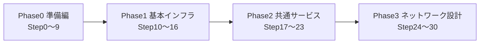

# Getting Started - プロジェクト開始手順

Azure Common Platform を進めるための手順書の目次です。手順は Phase ごとのファイルに分かれています。作業は Step 順に進めてください。

| Phase | 手順書 | Step | 内容 |
| --- | --- | --- | --- |
| Phase0 | [GETTING_STARTED_Phase0.md](GETTING_STARTED_Phase0.md) | Step0 〜 Step9 | 準備編：方針決め・Azure / ツール / GitHub の準備・Terraform State・Resource Group の初回構築 |
| Phase1 | [GETTING_STARTED_Phase1.md](GETTING_STARTED_Phase1.md) | Step10 〜 Step16 | 基本インフラ構築編：VNet / Subnet / NSG / Linux VM の構築とモジュール化 |
| Phase2 | [GETTING_STARTED_Phase2.md](GETTING_STARTED_Phase2.md) | Step17 〜 Step23 | 共通サービス編：Storage Account / Key Vault / Managed Identity / RBAC |
| Phase3 | [GETTING_STARTED_Phase3.md](GETTING_STARTED_Phase3.md) | Step24 〜 Step30 | ネットワーク設計編：Hub and Spoke / VNet Peering / Private DNS / Private Endpoint |

> 💡 Phase4 以降（監視・CI/CD）の手順書は、着手時に `GETTING_STARTED_Phase4.md` のように追加していきます。
