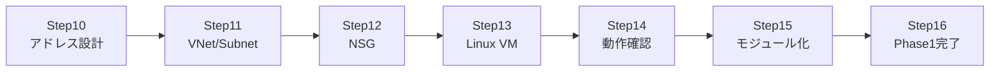

# Phase1 基本インフラ構築編 - VNet / Subnet / NSG / Linux VM

Phase0 で作成した Resource Group に、VNet・Subnet・NSG・Linux VM を追加し、最後にモジュール化する手順書です（Step10 〜 Step16）。

- 前の手順書：[Phase0 準備編](GETTING_STARTED_Phase0.md)（Step0 〜 Step9）
- 全体の目次：[GETTING_STARTED.md](GETTING_STARTED.md)

> 📌 本文中の「Step5 のコミット前チェックリスト」「Step7 の State 用ストレージ」「Step8 の backend 設定」は、[Phase0 準備編](GETTING_STARTED_Phase0.md)の内容を指します。



---

## 進捗チェックリスト

- [ ] Step10：アドレス設計とファイル構成を整理する
- [ ] Step11：VNet・Subnet を構築する
- [ ] Step12：NSG を構築し Subnet に関連付ける
- [ ] Step13：SSH 鍵を作成し Linux VM を構築する
- [ ] Step14：VM に接続して動作確認する
- [ ] Step15：コードをモジュール化する
- [ ] Step16：Phase1 を完了させる（記録・PR・削除）

---

Step8 で作成した Resource Group に、VNet・Subnet・NSG・Linux VM を追加していきます。
**最初は「1ファイル＝1種類のリソース」で直接書き**、動作を理解してから Step15 でモジュール化します。

### Phase1 完成イメージ

```text
rg-acp-dev-jpe-001
└─ vnet-acp-dev-jpe-001 (10.1.0.0/16)
    └─ snet-acp-dev-app-001 (10.1.1.0/24)  ← nsg-acp-dev-app-001（SSH は自宅 IP のみ許可）
        └─ vm-acp-dev-001 (Ubuntu 24.04)
            ├─ nic-acp-dev-001
            ├─ pip-acp-dev-001（パブリック IP）
            └─ 自動シャットダウン 23:00
```

---

## Step10：アドレス設計とファイル構成を整理する

### アドレス設計

Phase3 で Hub and Spoke（VNet Peering）を行う際、**アドレスが重複すると接続できません**。
最初の VNet を作る前に、将来分も含めて決めておきます。

| VNet | アドレス空間 | 用途 | 作成する Phase |
| --- | --- | --- | --- |
| Hub-VNet | 10.0.0.0/16 | 共通サービス（Key Vault / DNS / 監視） | Phase3 |
| Dev-VNet | 10.1.0.0/16 | 開発環境 | **Phase1** |
| Test-VNet | 10.2.0.0/16 | テスト環境 | Phase3 |
| Prod-VNet | 10.3.0.0/16 | 本番環境（予約） | 未定 |

| Subnet（Dev-VNet 内） | アドレス | 用途 |
| --- | --- | --- |
| snet-acp-dev-app-001 | 10.1.1.0/24 | VM 配置用 |
| （予約） | 10.1.2.0/24 | Private Endpoint 用（Phase2 以降） |

> 💡 この表は `ProjectOverAll/01_Architecture/ip-address-design.md` として保存します。

### ファイル構成

`environments/dev/` を以下のように役割ごとに分けます。

```text
environments/dev/
├─ main.tf                  # terraform / backend / provider / Resource Group（Step8 で作成済み）
├─ locals.tf                # 共通タグなど（新規）
├─ variables.tf             # 変数定義（追記）
├─ network.tf               # VNet / Subnet / NSG（新規）
├─ compute.tf               # VM 関連（新規）
├─ outputs.tf               # 出力値（新規）
├─ terraform.tfvars         # 変数の値（GitHub に上げない）
└─ terraform.tfvars.example # 値を伏せたサンプル（GitHub に上げる）
```

### `locals.tf`（新規）

タグを1か所で管理し、全リソースで共通利用します。

```hcl
locals {
  common_tags = {
    Project     = "AzureCommonPlatform"
    Environment = "dev"
    Owner       = "<自分の名前>"
    ManagedBy   = "Terraform"
  }
}
```

### `main.tf`（Resource Group 部分を修正）

```hcl
resource "azurerm_resource_group" "main" {
  name     = "rg-acp-dev-jpe-001"
  location = var.location
  tags     = local.common_tags
}
```

### `variables.tf`（全体を置き換え）

```hcl
variable "subscription_id" {
  description = "Azure サブスクリプション ID"
  type        = string
}

variable "location" {
  description = "リソースを作成するリージョン"
  type        = string
  default     = "japaneast"
}

variable "allowed_ssh_source_ip" {
  description = "SSH を許可する接続元 IP（例: 203.0.113.10/32）"
  type        = string
}

variable "admin_username" {
  description = "VM の管理者ユーザー名"
  type        = string
  default     = "azureuser"
}

variable "ssh_public_key_path" {
  description = "VM に登録する SSH 公開鍵のパス"
  type        = string
  default     = "~/.ssh/acp_dev_rsa.pub"
}

variable "vm_size" {
  description = "VM のサイズ"
  type        = string
  default     = "Standard_B1s"
}

variable "auto_shutdown_time" {
  description = "自動シャットダウン時刻（HHmm 形式・日本時間）"
  type        = string
  default     = "2300"
}
```

### `terraform.tfvars`（追記）

自宅のグローバル IP を確認します。

```powershell
Invoke-RestMethod https://api.ipify.org
```

```hcl
subscription_id       = "<サブスクリプションID>"
allowed_ssh_source_ip = "<確認したIP>/32"
```

> ⚠️ 自宅の IP は回線の再接続などで変わることがあります。SSH できなくなったら IP を確認し、
> `terraform.tfvars` を更新して `terraform apply` し直してください。

---

## Step11：VNet・Subnet を構築する

### `network.tf`（新規）

```hcl
resource "azurerm_virtual_network" "main" {
  name                = "vnet-acp-dev-jpe-001"
  location            = azurerm_resource_group.main.location
  resource_group_name = azurerm_resource_group.main.name
  address_space       = ["10.1.0.0/16"]
  tags                = local.common_tags
}

resource "azurerm_subnet" "app" {
  name                 = "snet-acp-dev-app-001"
  resource_group_name  = azurerm_resource_group.main.name
  virtual_network_name = azurerm_virtual_network.main.name
  address_prefixes     = ["10.1.1.0/24"]
}
```

### 実行

```powershell
terraform fmt
terraform validate
terraform plan    # 「2 to add」になることを確認
terraform apply
```

**確認ポイント（Portal）**
- [ ] VNet のアドレス空間が `10.1.0.0/16` になっている
- [ ] Subnet が `10.1.1.0/24` で作成されている

> 💡 VNet・Subnet 自体は無料です。

---

## Step12：NSG を構築し Subnet に関連付ける

インターネットからの通信は **SSH（22番）を自宅 IP からのみ許可**し、それ以外は拒否します。
（NSG はデフォルトでインターネットからの受信をすべて拒否するため、許可ルールだけを追加します）

### `network.tf`（追記）

```hcl
resource "azurerm_network_security_group" "app" {
  name                = "nsg-acp-dev-app-001"
  location            = azurerm_resource_group.main.location
  resource_group_name = azurerm_resource_group.main.name
  tags                = local.common_tags
}

resource "azurerm_network_security_rule" "allow_ssh" {
  name                        = "Allow-SSH-From-MyIP"
  priority                    = 100
  direction                   = "Inbound"
  access                      = "Allow"
  protocol                    = "Tcp"
  source_port_range           = "*"
  destination_port_range      = "22"
  source_address_prefix       = var.allowed_ssh_source_ip
  destination_address_prefix  = "*"
  resource_group_name         = azurerm_resource_group.main.name
  network_security_group_name = azurerm_network_security_group.app.name
}

resource "azurerm_subnet_network_security_group_association" "app" {
  subnet_id                 = azurerm_subnet.app.id
  network_security_group_id = azurerm_network_security_group.app.id
}
```

### 実行

```powershell
terraform plan    # 「3 to add」になることを確認
terraform apply
```

**確認ポイント（Portal）**
- [ ] NSG の受信セキュリティ規則に `Allow-SSH-From-MyIP` がある
- [ ] ソースが自宅 IP（`/32`）になっている（`*` や `Any` になっていないこと）
- [ ] NSG の「サブネット」に `snet-acp-dev-app-001` が関連付けられている

> ⚠️ SSH を `*`（全世界）に開放すると、数分で不正ログインの試行が始まります。必ず IP を絞ってください。

---

## Step13：SSH 鍵を作成し Linux VM を構築する

### SSH 鍵の作成

パスワード認証は使わず、**SSH 鍵認証のみ**にします。

```powershell
ssh-keygen -t rsa -b 4096 -f "$HOME\.ssh\acp_dev_rsa" -C "acp-dev"
```

| ファイル | 内容 | 扱い |
| --- | --- | --- |
| `acp_dev_rsa` | 秘密鍵 | **絶対に他人に渡さない・GitHub に上げない** |
| `acp_dev_rsa.pub` | 公開鍵 | VM に登録する |

### `compute.tf`（新規）

```hcl
resource "azurerm_public_ip" "vm" {
  name                = "pip-acp-dev-001"
  location            = azurerm_resource_group.main.location
  resource_group_name = azurerm_resource_group.main.name
  allocation_method   = "Static"
  sku                 = "Standard"
  tags                = local.common_tags
}

resource "azurerm_network_interface" "vm" {
  name                = "nic-acp-dev-001"
  location            = azurerm_resource_group.main.location
  resource_group_name = azurerm_resource_group.main.name
  tags                = local.common_tags

  ip_configuration {
    name                          = "ipconfig1"
    subnet_id                     = azurerm_subnet.app.id
    private_ip_address_allocation = "Dynamic"
    public_ip_address_id          = azurerm_public_ip.vm.id
  }
}

resource "azurerm_linux_virtual_machine" "main" {
  name                            = "vm-acp-dev-001"
  location                        = azurerm_resource_group.main.location
  resource_group_name             = azurerm_resource_group.main.name
  size                            = var.vm_size
  admin_username                  = var.admin_username
  disable_password_authentication = true
  network_interface_ids           = [azurerm_network_interface.vm.id]
  tags                            = local.common_tags

  admin_ssh_key {
    username   = var.admin_username
    public_key = file(pathexpand(var.ssh_public_key_path))
  }

  os_disk {
    name                 = "osdisk-acp-dev-001"
    caching              = "ReadWrite"
    storage_account_type = "Standard_LRS"
    disk_size_gb         = 30
  }

  source_image_reference {
    publisher = "Canonical"
    offer     = "ubuntu-24_04-lts"
    sku       = "server"
    version   = "latest"
  }
}

# 毎日 23:00（日本時間）に自動停止（割り当て解除）してコストを抑える
resource "azurerm_dev_test_global_vm_shutdown_schedule" "main" {
  virtual_machine_id    = azurerm_linux_virtual_machine.main.id
  location              = azurerm_resource_group.main.location
  enabled               = true
  daily_recurrence_time = var.auto_shutdown_time
  timezone              = "Tokyo Standard Time"

  notification_settings {
    enabled = false
  }
}
```

### `outputs.tf`（新規）

```hcl
output "vm_public_ip" {
  description = "VM のパブリック IP"
  value       = azurerm_public_ip.vm.ip_address
}

output "vm_private_ip" {
  description = "VM のプライベート IP"
  value       = azurerm_network_interface.vm.private_ip_address
}

output "ssh_command" {
  description = "VM への SSH 接続コマンド"
  value       = "ssh -i ~/.ssh/acp_dev_rsa ${var.admin_username}@${azurerm_public_ip.vm.ip_address}"
}
```

### 実行

```powershell
terraform plan    # 「4 to add」になることを確認
terraform apply
terraform output  # パブリック IP と SSH コマンドが表示される
```

> ⚠️ `Standard_B1s` が「容量不足（SkuNotAvailable / AllocationFailed）」で作れない場合は、
> `terraform.tfvars` に `vm_size = "Standard_B2ats_v2"` などを指定して再実行してください。

### コストの目安（Japan East・月額）

| リソース | 24時間稼働 | 1日4時間程度の利用 |
| --- | --- | --- |
| VM（Standard_B1s） | 約 1,500円 | 約 250円 |
| OS ディスク（Standard HDD 30GB） | 約 250円 | 約 250円 |
| パブリック IP（Standard） | 約 550円 | 約 550円 |
| **合計** | **約 2,300円** | **約 1,050円** |

> 💡 金額は為替や価格改定で変わるため、正確な値は [Azure 料金計算ツール](https://azure.microsoft.com/ja-jp/pricing/calculator/) で確認してください。
> VM を停止しても**ディスクとパブリック IP は課金され続けます**。長期間使わないときは `terraform destroy` で削除します。

---

## Step14：VM に接続して動作確認する

### SSH 接続

```powershell
terraform output -raw ssh_command   # 表示されたコマンドを実行
ssh -i ~/.ssh/acp_dev_rsa azureuser@<パブリックIP>
```

### VM 内で確認するコマンド

```bash
hostname                  # vm-acp-dev-001 と表示される
cat /etc/os-release       # Ubuntu 24.04 であること
ip addr show eth0         # 10.1.1.x のプライベート IP
df -h                     # ディスク容量
free -h                   # メモリ
sudo apt update && sudo apt upgrade -y   # パッケージ更新
exit
```

### 確認チェックリスト

| # | 確認項目 | 期待結果 |
| --- | --- | --- |
| 1 | 自宅 PC から SSH 接続できる | 接続成功 |
| 2 | パスワードでログインできない | `Permission denied (publickey)` |
| 3 | 別回線（スマホのテザリング等）から SSH できない | タイムアウト |
| 4 | プライベート IP が Subnet 範囲内 | `10.1.1.4` など |
| 5 | Portal の VM「自動シャットダウン」 | 23:00 / 有効 |
| 6 | 全リソースにタグが付いている | Project / Environment / Owner / ManagedBy |
| 7 | Portal の「コスト分析」でタグ `Project` で絞り込める | 表示される（反映まで1日程度かかる） |

> 💡 2・3 の「できないこと」の確認も、セキュリティ設計が正しい証拠として学習ログに残しておきましょう。

### よく使う VM 操作

```powershell
az vm deallocate -g rg-acp-dev-jpe-001 -n vm-acp-dev-001   # 停止（VM の課金停止）
az vm start      -g rg-acp-dev-jpe-001 -n vm-acp-dev-001   # 起動
```

> ⚠️ OS 内で `sudo shutdown` しただけでは「停止済み（割り当て済み）」となり、**VM の課金が続きます**。
> 必ず Portal の「停止」か `az vm deallocate` を使ってください。

---

## Step15：コードをモジュール化する

Step11〜13 のコードを `modules/` に切り出し、test / prod 環境でも再利用できるようにします。

| モジュール | 含むリソース |
| --- | --- |
| `modules/rg` | Resource Group |
| `modules/vnet` | Virtual Network |
| `modules/subnet` | Subnet |
| `modules/nsg` | NSG・セキュリティ規則・Subnet への関連付け |
| `modules/vm` | パブリック IP・NIC・Linux VM・自動シャットダウン |

各モジュールは `main.tf` / `variables.tf` / `outputs.tf` の3ファイルで構成します。

```powershell
git checkout -b feature/phase1-modules
```

### `modules/rg`

```hcl
# main.tf
resource "azurerm_resource_group" "this" {
  name     = var.name
  location = var.location
  tags     = var.tags
}
```

```hcl
# variables.tf
variable "name" {
  type = string
}

variable "location" {
  type = string
}

variable "tags" {
  type    = map(string)
  default = {}
}
```

```hcl
# outputs.tf
output "id" {
  value = azurerm_resource_group.this.id
}

output "name" {
  value = azurerm_resource_group.this.name
}

output "location" {
  value = azurerm_resource_group.this.location
}
```

### `modules/vnet`

```hcl
# main.tf
resource "azurerm_virtual_network" "this" {
  name                = var.name
  location            = var.location
  resource_group_name = var.resource_group_name
  address_space       = var.address_space
  tags                = var.tags
}
```

```hcl
# variables.tf
variable "name" {
  type = string
}

variable "location" {
  type = string
}

variable "resource_group_name" {
  type = string
}

variable "address_space" {
  type = list(string)
}

variable "tags" {
  type    = map(string)
  default = {}
}
```

```hcl
# outputs.tf
output "id" {
  value = azurerm_virtual_network.this.id
}

output "name" {
  value = azurerm_virtual_network.this.name
}
```

### `modules/subnet`

```hcl
# main.tf
resource "azurerm_subnet" "this" {
  name                 = var.name
  resource_group_name  = var.resource_group_name
  virtual_network_name = var.virtual_network_name
  address_prefixes     = var.address_prefixes
}
```

```hcl
# variables.tf
variable "name" {
  type = string
}

variable "resource_group_name" {
  type = string
}

variable "virtual_network_name" {
  type = string
}

variable "address_prefixes" {
  type = list(string)
}
```

```hcl
# outputs.tf
output "id" {
  value = azurerm_subnet.this.id
}

output "name" {
  value = azurerm_subnet.this.name
}
```

### `modules/nsg`

規則をリストで受け取り、`for_each` で複数作成できるようにします。

```hcl
# main.tf
resource "azurerm_network_security_group" "this" {
  name                = var.name
  location            = var.location
  resource_group_name = var.resource_group_name
  tags                = var.tags
}

resource "azurerm_network_security_rule" "this" {
  for_each = { for rule in var.security_rules : rule.name => rule }

  name                        = each.value.name
  priority                    = each.value.priority
  direction                   = each.value.direction
  access                      = each.value.access
  protocol                    = each.value.protocol
  source_port_range           = each.value.source_port_range
  destination_port_range      = each.value.destination_port_range
  source_address_prefix       = each.value.source_address_prefix
  destination_address_prefix  = each.value.destination_address_prefix
  resource_group_name         = var.resource_group_name
  network_security_group_name = azurerm_network_security_group.this.name
}

resource "azurerm_subnet_network_security_group_association" "this" {
  subnet_id                 = var.subnet_id
  network_security_group_id = azurerm_network_security_group.this.id
}
```

```hcl
# variables.tf
variable "name" {
  type = string
}

variable "location" {
  type = string
}

variable "resource_group_name" {
  type = string
}

variable "subnet_id" {
  description = "関連付ける Subnet の ID"
  type        = string
}

variable "security_rules" {
  type = list(object({
    name                       = string
    priority                   = number
    direction                  = string
    access                     = string
    protocol                   = string
    source_port_range          = optional(string, "*")
    destination_port_range     = string
    source_address_prefix      = string
    destination_address_prefix = optional(string, "*")
  }))
  default = []
}

variable "tags" {
  type    = map(string)
  default = {}
}
```

```hcl
# outputs.tf
output "id" {
  value = azurerm_network_security_group.this.id
}

output "name" {
  value = azurerm_network_security_group.this.name
}
```

### `modules/vm`

VM 名（`vm-acp-dev-001`）から、NIC やパブリック IP の名前を自動で組み立てます。

```hcl
# main.tf
locals {
  base_name = trimprefix(var.name, "vm-") # 例: acp-dev-001
}

resource "azurerm_public_ip" "this" {
  count = var.enable_public_ip ? 1 : 0

  name                = "pip-${local.base_name}"
  location            = var.location
  resource_group_name = var.resource_group_name
  allocation_method   = "Static"
  sku                 = "Standard"
  tags                = var.tags
}

resource "azurerm_network_interface" "this" {
  name                = "nic-${local.base_name}"
  location            = var.location
  resource_group_name = var.resource_group_name
  tags                = var.tags

  ip_configuration {
    name                          = "ipconfig1"
    subnet_id                     = var.subnet_id
    private_ip_address_allocation = "Dynamic"
    public_ip_address_id          = var.enable_public_ip ? azurerm_public_ip.this[0].id : null
  }
}

resource "azurerm_linux_virtual_machine" "this" {
  name                            = var.name
  location                        = var.location
  resource_group_name             = var.resource_group_name
  size                            = var.vm_size
  admin_username                  = var.admin_username
  disable_password_authentication = true
  network_interface_ids           = [azurerm_network_interface.this.id]
  tags                            = var.tags

  admin_ssh_key {
    username   = var.admin_username
    public_key = var.ssh_public_key
  }

  os_disk {
    name                 = "osdisk-${local.base_name}"
    caching              = "ReadWrite"
    storage_account_type = "Standard_LRS"
    disk_size_gb         = var.os_disk_size_gb
  }

  source_image_reference {
    publisher = "Canonical"
    offer     = "ubuntu-24_04-lts"
    sku       = "server"
    version   = "latest"
  }
}

resource "azurerm_dev_test_global_vm_shutdown_schedule" "this" {
  virtual_machine_id    = azurerm_linux_virtual_machine.this.id
  location              = var.location
  enabled               = true
  daily_recurrence_time = var.auto_shutdown_time
  timezone              = "Tokyo Standard Time"

  notification_settings {
    enabled = false
  }
}
```

```hcl
# variables.tf
variable "name" {
  description = "VM 名（vm- で始める）"
  type        = string
}

variable "location" {
  type = string
}

variable "resource_group_name" {
  type = string
}

variable "subnet_id" {
  type = string
}

variable "vm_size" {
  type    = string
  default = "Standard_B1s"
}

variable "admin_username" {
  type    = string
  default = "azureuser"
}

variable "ssh_public_key" {
  description = "SSH 公開鍵の中身"
  type        = string
}

variable "os_disk_size_gb" {
  type    = number
  default = 30
}

variable "enable_public_ip" {
  type    = bool
  default = true
}

variable "auto_shutdown_time" {
  type    = string
  default = "2300"
}

variable "tags" {
  type    = map(string)
  default = {}
}
```

```hcl
# outputs.tf
output "id" {
  value = azurerm_linux_virtual_machine.this.id
}

output "private_ip" {
  value = azurerm_network_interface.this.private_ip_address
}

output "public_ip" {
  value = var.enable_public_ip ? azurerm_public_ip.this[0].ip_address : null
}
```

### `environments/dev` をモジュール呼び出しに書き換える

`network.tf` と `compute.tf` を**削除**し、`main.tf` を以下に置き換えます。
（`locals.tf` / `variables.tf` / `terraform.tfvars` はそのまま使います）

```hcl
# main.tf
terraform {
  required_version = ">= 1.9.0"

  required_providers {
    azurerm = {
      source  = "hashicorp/azurerm"
      version = "~> 4.0"
    }
  }

  backend "azurerm" {
    resource_group_name  = "rg-acp-tfstate-jpe-001"
    storage_account_name = "stacptfstate<Step7で作成した名前>"
    container_name       = "tfstate"
    key                  = "dev.terraform.tfstate"
    use_azuread_auth     = true
  }
}

provider "azurerm" {
  features {}
  subscription_id = var.subscription_id
}

module "rg" {
  source   = "../../modules/rg"
  name     = "rg-acp-dev-jpe-001"
  location = var.location
  tags     = local.common_tags
}

module "vnet" {
  source              = "../../modules/vnet"
  name                = "vnet-acp-dev-jpe-001"
  location            = module.rg.location
  resource_group_name = module.rg.name
  address_space       = ["10.1.0.0/16"]
  tags                = local.common_tags
}

module "subnet_app" {
  source               = "../../modules/subnet"
  name                 = "snet-acp-dev-app-001"
  resource_group_name  = module.rg.name
  virtual_network_name = module.vnet.name
  address_prefixes     = ["10.1.1.0/24"]
}

module "nsg_app" {
  source              = "../../modules/nsg"
  name                = "nsg-acp-dev-app-001"
  location            = module.rg.location
  resource_group_name = module.rg.name
  subnet_id           = module.subnet_app.id
  tags                = local.common_tags

  security_rules = [
    {
      name                   = "Allow-SSH-From-MyIP"
      priority               = 100
      direction              = "Inbound"
      access                 = "Allow"
      protocol               = "Tcp"
      destination_port_range = "22"
      source_address_prefix  = var.allowed_ssh_source_ip
    }
  ]
}

module "vm" {
  source              = "../../modules/vm"
  name                = "vm-acp-dev-001"
  location            = module.rg.location
  resource_group_name = module.rg.name
  subnet_id           = module.subnet_app.id
  vm_size             = var.vm_size
  admin_username      = var.admin_username
  ssh_public_key      = file(pathexpand(var.ssh_public_key_path))
  auto_shutdown_time  = var.auto_shutdown_time
  tags                = local.common_tags
}
```

```hcl
# outputs.tf（置き換え）
output "vm_public_ip" {
  value = module.vm.public_ip
}

output "vm_private_ip" {
  value = module.vm.private_ip
}

output "ssh_command" {
  value = "ssh -i ~/.ssh/acp_dev_rsa ${var.admin_username}@${module.vm.public_ip}"
}
```

### `moved.tf`（新規）— 既存リソースを作り直さずに移行する

コードの場所を変えると、Terraform は「古いリソースを削除して新しく作る」と判断します。
`moved` ブロックで「場所が変わっただけ」と伝えると、**既存リソースをそのまま引き継げます**。

```hcl
moved {
  from = azurerm_resource_group.main
  to   = module.rg.azurerm_resource_group.this
}

moved {
  from = azurerm_virtual_network.main
  to   = module.vnet.azurerm_virtual_network.this
}

moved {
  from = azurerm_subnet.app
  to   = module.subnet_app.azurerm_subnet.this
}

moved {
  from = azurerm_network_security_group.app
  to   = module.nsg_app.azurerm_network_security_group.this
}

moved {
  from = azurerm_network_security_rule.allow_ssh
  to   = module.nsg_app.azurerm_network_security_rule.this["Allow-SSH-From-MyIP"]
}

moved {
  from = azurerm_subnet_network_security_group_association.app
  to   = module.nsg_app.azurerm_subnet_network_security_group_association.this
}

moved {
  from = azurerm_public_ip.vm
  to   = module.vm.azurerm_public_ip.this[0]
}

moved {
  from = azurerm_network_interface.vm
  to   = module.vm.azurerm_network_interface.this
}

moved {
  from = azurerm_linux_virtual_machine.main
  to   = module.vm.azurerm_linux_virtual_machine.this
}

moved {
  from = azurerm_dev_test_global_vm_shutdown_schedule.main
  to   = module.vm.azurerm_dev_test_global_vm_shutdown_schedule.this
}
```

### 実行

```powershell
terraform init       # モジュールを追加したので再初期化が必要
terraform fmt -recursive
terraform validate
terraform plan
```

**`plan` の結果が以下になれば移行成功です。**

```text
Plan: 0 to add, 0 to change, 0 to destroy.
```

`has moved to` という表示が10件出ていることも確認し、`terraform apply` で State に反映します。

> ⚠️ `plan` に `destroy` や `must be replaced` が含まれる場合は **apply しないでください**。
> 名前や設定値がモジュール化前と違っていないか見直します。
> （VM を一度削除しても良い場合は、`terraform destroy` → モジュール版で `terraform apply` でも構いません）

> 💡 `apply` 後、`moved.tf` は削除しても問題ありません（移行の記録として残しておくのもおすすめです）。

---

## Step16：Phase1 を完了させる

### 完了チェックリスト

- [ ] `terraform plan` で差分が出ない（`No changes.`）
- [ ] Step14 の動作確認をモジュール化後も実施し、SSH 接続できる
- [ ] `terraform.tfvars`・秘密鍵・`*.tfstate` が GitHub に上がっていない（`git status` で確認）
- [ ] `terraform.tfvars.example` を更新した

```hcl
# terraform.tfvars.example
subscription_id       = "00000000-0000-0000-0000-000000000000"
allowed_ssh_source_ip = "203.0.113.10/32"
# vm_size             = "Standard_B1s"
```

### ドキュメントを残す

| 保存先 | 内容 |
| --- | --- |
| `ProjectOverAll/01_Architecture/` | Phase1 構成図（draw.io）・アドレス設計 |
| `ProjectOverAll/02_Lecture/` | 学習ログ（ハマったこと・`moved` ブロックの学びなど） |
| `ProjectOverAll/03_RunBook/` | VM の起動・停止・SSH 接続・IP 変更時の手順 |
| `ProjectOverAll/04_CostManagement/` | Phase1 の実績コスト（コスト分析の画面キャプチャ） |

### README を更新して Pull Request を作成

README の構築フェーズの Phase1 を `✅ 完了` に更新します。

```powershell
git add .
git status   # Step5 のコミット前チェックリストを確認（terraform.tfvars・*.tfstate・秘密鍵が含まれていないこと）
git commit -m "feat: Phase1 基本インフラをモジュール化して構築"
git push origin feature/phase1-modules
gh pr create --title "Phase1: 基本インフラ構築" --body "VNet / Subnet / NSG / Linux VM をモジュール化して構築"
```

GitHub で Pull Request の差分を確認し、`main` にマージします。

### 使わない期間はリソースを削除する

```powershell
cd environments/dev
terraform destroy
```

> 💡 Phase2 に進むときは `terraform apply` で同じ環境をすぐ再構築できます。

---

## 次のステップ

Phase1 が完了したら、README の構築フェーズに沿って進めます。

| 順番 | 内容 |
| --- | --- |
| 1 | Phase2：Storage Account / Key Vault / Managed Identity を追加 |
| 2 | Phase3：Hub-VNet・Test-VNet を作成し、VNet Peering / Private DNS で Hub and Spoke 構成にする |
| 3 | Phase4：Log Analytics / Azure Monitor で VM の監視を行う |
| 4 | Phase5：GitHub Actions で `terraform plan` / `apply` を自動化（OIDC 認証を利用） |

> 💡 各 Phase が完了したら、README の「構築フェーズ」の状況欄を ✅ に更新しましょう。
