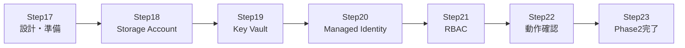

# Phase2 共通サービス編 - Storage Account / Key Vault / Managed Identity

Phase1 で作成した Dev 環境に、**共通サービス**（Storage Account・Key Vault）と、それらに**パスワードなしで安全にアクセスする仕組み**（Managed Identity + RBAC）を追加する手順書です（Step17 〜 Step23）。

- 前の手順書：[Phase1 基本インフラ構築編](GETTING_STARTED_Phase1.md)（Step10 〜 Step16）
- 全体の目次：[GETTING_STARTED.md](GETTING_STARTED.md)

> 📌 本文中の「Step5 のコミット前チェックリスト」は、[Phase0 準備編](GETTING_STARTED_Phase0.md)の内容を指します。



---

## 進捗チェックリスト

- [ ] Step17：Phase2 の設計を理解し、作業ブランチを作成する
- [ ] Step18：Subnet にサービスエンドポイントを追加し、Storage Account を構築する
- [ ] Step19：Key Vault とテスト用シークレットを構築する
- [ ] Step20：Managed Identity を作成し、VM に割り当てる
- [ ] Step21：RBAC（ロール割り当て）で必要最小限の権限を付与する
- [ ] Step22：VM からパスワードなしで Key Vault / Storage にアクセスして確認する
- [ ] Step23：Phase2 を完了させる（記録・PR・削除）

---

### Phase2 完成イメージ

```text
rg-acp-dev-jpe-001
├─ vnet-acp-dev-jpe-001 (10.1.0.0/16)
│   └─ snet-acp-dev-app-001 (10.1.1.0/24)   ← サービスエンドポイント（Storage / KeyVault）を追加
│       └─ vm-acp-dev-001  ──(割り当て)──┐
├─ id-acp-dev-jpe-001（Managed Identity）◀┘
│      ├─ 「Storage Blob Data Contributor」 → stacpdevjpe001
│      └─ 「Key Vault Secrets User」        → kv-acp-dev-jpe-001
├─ stacpdevjpe001（Storage Account）  … ファイアウォール：自宅 IP と app Subnet のみ許可
└─ kv-acp-dev-jpe-001（Key Vault）    … ファイアウォール：自宅 IP と app Subnet のみ許可
```

### Phase2 で学ぶこと

| 概念 | 一言で言うと | なぜ必要か |
| --- | --- | --- |
| Storage Account | ファイル（Blob）などを置く場所 | ログ・成果物・バックアップの保管先になる |
| Key Vault | パスワードや証明書の金庫 | 秘密情報をコードや `tfvars` に書かずに済む |
| Managed Identity | Azure リソース専用の「ID」 | VM がパスワードを持たずに他サービスへ認証できる |
| RBAC | 「誰が・何に・何をしてよいか」の割り当て | 必要最小限の権限だけを渡せる（最小権限の原則） |

> 💡 **この Phase の肝は「秘密情報をどこにも書かない」ことです。**
> VM → Managed Identity で身元を証明 → RBAC で許可された範囲だけアクセス、という流れを体験します。

---

## Step17：Phase2 の設計を理解し、作業ブランチを作成する

### 作るリソース

| リソース | 名前 | 備考 |
| --- | --- | --- |
| Storage Account | `stacpdevjpe001` | 小文字英数字のみ・3〜24文字・**全世界で一意** |
| Blob コンテナ | `app-data` | 動作確認で使う非公開コンテナ |
| Key Vault | `kv-acp-dev-jpe-001` | 3〜24文字・**全世界で一意**（`vault.azure.net` の名前になる） |
| Key Vault シークレット | `sample-secret` | 動作確認用のダミー値 |
| Managed Identity | `id-acp-dev-jpe-001` | ユーザー割り当て（User-assigned） |
| ロール割り当て | 計3つ | 自分 → Key Vault、ID → Key Vault、ID → Storage |

> ⚠️ **名前が他の人と重複していると作成できません**（`StorageAccountAlreadyTaken` など）。
> その場合は `stacpdevjpe001` の末尾を `stacpdevjpe55814` のように数字に変えてください（Step7 の State 用ストレージと同じ要領です）。

### 設計の判断（なぜこの構成か）

| 判断 | 内容 | 理由 |
| --- | --- | --- |
| 認証 | Key Vault は**アクセスポリシーではなく RBAC** で制御 | 現在の推奨方式。Storage も同じロールの仕組みで統一できる |
| ネットワーク | 両サービスとも**ファイアウォールを既定で拒否**、自宅 IP と app Subnet のみ許可 | CLAUDE.md の方針「PaaS は可能な範囲でネットワーク制限」に従う |
| 接続経路 | **サービスエンドポイント**を使う（無料） | Private Endpoint は月 1,000 円前後かかるため、Phase3（Private DNS とセット）で扱う |
| ID の種類 | **ユーザー割り当て**の Managed Identity | VM を作り直しても ID と権限が残り、複数リソースで共有できる |
| 削除保護 | Key Vault の Purge Protection は**無効** | 学習用で `destroy` と再構築を繰り返すため。本番では有効にする |

> 💡 **サービスエンドポイントと Private Endpoint の違い**
> - サービスエンドポイント：Subnet から PaaS への通信を Azure の内部網に通し、「この Subnet から来た通信だけ許可」と指定できる。PaaS 側の宛先 IP は公開のまま。**無料**。
> - Private Endpoint：PaaS に VNet 内のプライベート IP を割り当てる。より閉じた構成だが**有料**で、Private DNS も必要。Phase3 で実施する。

### コストの目安（Japan East・月額）

| リソース | 月額の目安 | 備考 |
| --- | --- | --- |
| Storage Account（Standard LRS） | 数円〜数十円 | 保存量と操作回数に応じた従量課金。ほぼ容量ゼロなので微小 |
| Key Vault（Standard） | 数円程度 | 1 万回の操作ごとに数円。学習用途ならほぼ無料 |
| Managed Identity | 無料 | |
| ロール割り当て・サービスエンドポイント | 無料 | |
| **Phase2 で増える合計** | **約 100 円未満** | 目標（月 5,000 円以内）に影響なし |

> 💡 金額は為替や価格改定で変わるため、正確な値は [Azure 料金計算ツール](https://azure.microsoft.com/ja-jp/pricing/calculator/) で確認してください。
> Phase2 のリソース自体は安価ですが、**Phase1 の VM・Public IP の課金は引き続き発生**します。使わない間は `deallocate` や `destroy` を忘れずに。

### 作業ブランチを作成

```powershell
git checkout main
git pull origin main
git checkout -b feature/phase2-common-services
```

### ファイル構成（Phase2 完了時）

```text
modules/
├─ rg/ vnet/ nsg/                 # Phase1 のまま
├─ subnet/                        # 変更：service_endpoints を追加
├─ vm/                            # 変更：Managed Identity の割り当てを追加
├─ storage/                       # 新規
├─ keyvault/                      # 新規
└─ managed_identity/              # 新規

environments/dev/
├─ main.tf        # 変更：module 呼び出しを追加
├─ roles.tf       # 新規：ロール割り当て（RBAC）
├─ secrets.tf     # 新規：Key Vault のテスト用シークレット
└─ outputs.tf     # 変更：出力を追加
```

---

## Step18：Subnet にサービスエンドポイントを追加し、Storage Account を構築する

### 1. `modules/subnet` を拡張する

Subnet に「Storage / Key Vault へはサービスエンドポイント経由で通信する」という設定を持たせます。
**既定値を空リストにする**ことで、既存の呼び出し（他の Subnet）に影響を与えません。

`modules/subnet/main.tf`

```hcl
resource "azurerm_subnet" "this" {
  name                 = var.name
  resource_group_name  = var.resource_group_name
  virtual_network_name = var.virtual_network_name
  address_prefixes     = var.address_prefixes
  service_endpoints    = var.service_endpoints
}
```

`modules/subnet/variables.tf`（追記）

```hcl
variable "service_endpoints" {
  description = "有効にするサービスエンドポイント（例: [\"Microsoft.Storage\", \"Microsoft.KeyVault\"]）"
  type        = list(string)
  default     = []
}
```

### 2. `modules/storage`（新規）

`main.tf`

```hcl
resource "azurerm_storage_account" "this" {
  name                = var.name
  location            = var.location
  resource_group_name = var.resource_group_name
  tags                = var.tags

  account_tier             = "Standard"
  account_replication_type = "LRS"
  account_kind             = "StorageV2"

  # セキュリティの基本設定
  min_tls_version                 = "TLS1_2"
  https_traffic_only_enabled      = true
  allow_nested_items_to_be_public = false # 匿名アクセスを禁止

  # ファイアウォール：既定は拒否し、許可した接続元だけ通す
  network_rules {
    default_action             = "Deny"
    bypass                     = ["AzureServices"]
    ip_rules                   = var.allowed_ip_addresses
    virtual_network_subnet_ids = var.allowed_subnet_ids
  }
}

resource "azurerm_storage_container" "this" {
  for_each = toset(var.container_names)

  name                  = each.value
  storage_account_id    = azurerm_storage_account.this.id
  container_access_type = "private"
}
```

`variables.tf`

```hcl
variable "name" {
  description = "Storage Account 名（小文字英数字のみ・3〜24文字・全世界で一意）"
  type        = string

  validation {
    condition     = can(regex("^[a-z0-9]{3,24}$", var.name))
    error_message = "Storage Account 名は小文字英数字のみ、3〜24文字にしてください。"
  }
}

variable "location" {
  description = "リージョン"
  type        = string
}

variable "resource_group_name" {
  description = "所属する Resource Group 名"
  type        = string
}

variable "allowed_ip_addresses" {
  description = "ファイアウォールで許可する接続元 IP（/32 は付けない）"
  type        = list(string)
  default     = []
}

variable "allowed_subnet_ids" {
  description = "ファイアウォールで許可する Subnet の ID（サービスエンドポイントが必要）"
  type        = list(string)
  default     = []
}

variable "container_names" {
  description = "作成する Blob コンテナ名のリスト"
  type        = list(string)
  default     = []
}

variable "tags" {
  description = "リソースに付けるタグ"
  type        = map(string)
  default     = {}
}
```

`outputs.tf`

```hcl
output "id" {
  description = "Storage Account の ID"
  value       = azurerm_storage_account.this.id
}

output "name" {
  description = "Storage Account 名"
  value       = azurerm_storage_account.this.name
}

output "primary_blob_endpoint" {
  description = "Blob サービスのエンドポイント URL"
  value       = azurerm_storage_account.this.primary_blob_endpoint
}
```

> 💡 **主な設定の意味**
> - `account_replication_type = "LRS"`：同一データセンター内で3重コピー。最も安価（CLAUDE.md のコスト方針）。
> - `allow_nested_items_to_be_public = false`：コンテナを誤って「匿名で誰でも読める」設定にできなくする保険。
> - `network_rules` の `Deny`：許可リストにない接続元からの通信は、キーを知っていても拒否される。
> - `bypass = ["AzureServices"]`：Azure の信頼されたサービス（バックアップ等）は通す。
> - **`ip_rules` に `/32` は付けられません**（`203.0.113.10` の形式）。次の手順で `trimsuffix` で取り除きます。

### 3. `environments/dev/main.tf` を変更する

既存の `module "subnet_app"` に `service_endpoints` を追加し、`module "storage"` を追記します。

```hcl
module "subnet_app" {
  source               = "../../modules/subnet"
  name                 = "snet-acp-dev-app-001"
  resource_group_name  = module.rg.name
  virtual_network_name = module.vnet.name
  address_prefixes     = ["10.1.1.0/24"]
  service_endpoints    = ["Microsoft.Storage", "Microsoft.KeyVault"] # 追加
}

# （module "nsg_app" / module "vm" は変更なし）

module "storage" {
  source              = "../../modules/storage"
  name                = "stacpdevjpe001"
  location            = module.rg.location
  resource_group_name = module.rg.name
  tags                = local.common_tags

  # 自宅 IP（Terraform を実行する PC）と app Subnet（VM）のみ許可。
  # ip_rules には /32 を付けられないため取り除く
  allowed_ip_addresses = [trimsuffix(var.allowed_ssh_source_ip, "/32")]
  allowed_subnet_ids   = [module.subnet_app.id]
  container_names      = ["app-data"]
}
```

`environments/dev/outputs.tf`（追記）

```hcl
output "storage_account_name" {
  description = "Storage Account 名"
  value       = module.storage.name
}
```

### 実行

```powershell
cd environments/dev
terraform fmt -recursive
terraform validate
terraform plan    # 「2 to add, 1 to change, 0 to destroy」になることを確認
```

`plan` の内容：

| 区分 | 内容 |
| --- | --- |
| 追加（2） | Storage Account、Blob コンテナ `app-data` |
| 変更（1） | `snet-acp-dev-app-001` に `service_endpoints` が追加される（**その場で更新、再作成ではない**） |

> ⚠️ Subnet が `must be replaced`（再作成）になっていたら **apply しないでください**。VM の NIC が接続されているため失敗します。
> 変更内容が `service_endpoints` のみであることを確認します。

内容を確認したら `terraform apply` を実行します（課金は微小ですが、Azure に作成されます）。

**確認ポイント（Portal）**
- [ ] Storage Account が作成され、「ネットワーク」で「選択された仮想ネットワークと IP アドレスから有効」になっている
- [ ] ファイアウォールに自宅 IP と `snet-acp-dev-app-001` が登録されている
- [ ] コンテナ `app-data` が存在し、アクセスレベルが「プライベート」

> ⚠️ **コンテナ作成で `403 AuthorizationFailure` が出たら**：ファイアウォールの反映待ちか、自宅 IP が変わっている可能性があります。
> 1〜2分待って `terraform apply` を再実行するか、`terraform.tfvars` の `allowed_ssh_source_ip` が現在の IP か確認してください。

---

## Step19：Key Vault とテスト用シークレットを構築する

### 1. `modules/keyvault`（新規）

`main.tf`

```hcl
data "azurerm_client_config" "current" {}

resource "azurerm_key_vault" "this" {
  name                = var.name
  location            = var.location
  resource_group_name = var.resource_group_name
  tenant_id           = data.azurerm_client_config.current.tenant_id
  sku_name            = "standard"
  tags                = var.tags

  # アクセス制御は RBAC で行う（アクセスポリシーは使わない）
  rbac_authorization_enabled = true

  # 誤削除対策。削除しても 7 日間は復元できる（学習用なので Purge Protection は無効）
  soft_delete_retention_days = 7
  purge_protection_enabled   = false

  # ファイアウォール：既定は拒否し、許可した接続元だけ通す
  network_acls {
    default_action             = "Deny"
    bypass                     = "AzureServices"
    ip_rules                   = var.allowed_ip_addresses
    virtual_network_subnet_ids = var.allowed_subnet_ids
  }
}
```

`variables.tf`

```hcl
variable "name" {
  description = "Key Vault 名（3〜24文字・全世界で一意）"
  type        = string
}

variable "location" {
  description = "リージョン"
  type        = string
}

variable "resource_group_name" {
  description = "所属する Resource Group 名"
  type        = string
}

variable "allowed_ip_addresses" {
  description = "ファイアウォールで許可する接続元 IP（/32 は付けない）"
  type        = list(string)
  default     = []
}

variable "allowed_subnet_ids" {
  description = "ファイアウォールで許可する Subnet の ID（サービスエンドポイントが必要）"
  type        = list(string)
  default     = []
}

variable "tags" {
  description = "リソースに付けるタグ"
  type        = map(string)
  default     = {}
}
```

`outputs.tf`

```hcl
output "id" {
  description = "Key Vault の ID"
  value       = azurerm_key_vault.this.id
}

output "name" {
  description = "Key Vault 名"
  value       = azurerm_key_vault.this.name
}

output "vault_uri" {
  description = "Key Vault の URI"
  value       = azurerm_key_vault.this.vault_uri
}
```

> 💡 **Key Vault の権限は「2階層」** と覚えてください。
> - 管理プレーン：Key Vault 自体の作成・削除（Terraform は Azure サブスクリプションの権限で実行できる）
> - **データプレーン：シークレットの読み書き**（RBAC モデルでは、**別途ロールの付与が必要**）
>
> 自分がサブスクリプションの所有者でも、Key Vault を作っただけでは**シークレットを読み書きできません**。次の手順で自分にロールを付与します。

### 2. `environments/dev/main.tf` を変更する

**(a)** `provider "azurerm"` に Key Vault の `destroy` 時の挙動を追加します。

```hcl
provider "azurerm" {
  features {
    key_vault {
      # destroy 時に論理削除（ソフトデリート）状態の Key Vault も完全削除する。
      # これがないと、同じ名前で再作成できず（名前が 7 日間予約される）、学習中の再構築で詰まる
      purge_soft_delete_on_destroy = true
    }
  }
  subscription_id = var.subscription_id
}
```

**(b)** `module "keyvault"` を追記します。

```hcl
module "keyvault" {
  source              = "../../modules/keyvault"
  name                = "kv-acp-dev-jpe-001"
  location            = module.rg.location
  resource_group_name = module.rg.name
  tags                = local.common_tags

  allowed_ip_addresses = [trimsuffix(var.allowed_ssh_source_ip, "/32")]
  allowed_subnet_ids   = [module.subnet_app.id]
}
```

**(c)** 現在ログインしているユーザー情報を取得します（`main.tf` の先頭付近に追記）。

```hcl
# 現在 Terraform を実行しているユーザーの情報（ロール割り当てで使う）
data "azurerm_client_config" "current" {}
```

### 3. 自分に「シークレットの管理者」ロールを付与する — `roles.tf`（新規）

```hcl
# Terraform を実行する自分に、シークレットの読み書き権限を付与する。
# Key Vault（RBAC モデル）では、所有者でもこのロールがないとシークレットを作成できない
resource "azurerm_role_assignment" "me_kv_secrets_officer" {
  scope                = module.keyvault.id
  role_definition_name = "Key Vault Secrets Officer"
  principal_id         = data.azurerm_client_config.current.object_id
}
```

### 4. テスト用シークレットを作成する — `secrets.tf`（新規）

```hcl
# 動作確認用のダミー値。実際のパスワードや API キーは、コードに書かず Portal や CLI で登録する
resource "azurerm_key_vault_secret" "sample" {
  name         = "sample-secret"
  value        = "hello-from-key-vault"
  key_vault_id = module.keyvault.id

  # ロールが付与されてからシークレットを作る（付与前だと 403 になる）
  depends_on = [azurerm_role_assignment.me_kv_secrets_officer]
}
```

> ⚠️ **本物の秘密情報を Terraform のコードに書かないでください。**
> シークレットの値は **State ファイルに平文で保存**されます。ここは「Managed Identity で読めること」の確認用ダミー値です。

`environments/dev/outputs.tf`（追記）

```hcl
output "key_vault_name" {
  description = "Key Vault 名"
  value       = module.keyvault.name
}

output "key_vault_uri" {
  description = "Key Vault の URI"
  value       = module.keyvault.vault_uri
}
```

### 実行

```powershell
terraform init       # provider 設定やモジュールを追加したため
terraform fmt -recursive
terraform validate
terraform plan       # 「3 to add」になることを確認（Key Vault・ロール割り当て・シークレット）
```

内容を確認したら `terraform apply` を実行します。

**確認ポイント（Portal）**
- [ ] Key Vault が作成され、「アクセス許可モデル」が「Azure ロールベースのアクセス制御」になっている
- [ ] 「ネットワーク」で自宅 IP と `snet-acp-dev-app-001` が許可されている
- [ ] 「アクセス制御（IAM）」で、自分に「Key Vault Secrets Officer」が付いている
- [ ] 「シークレット」に `sample-secret` がある

> ⚠️ **シークレット作成が `403 Forbidden` で失敗したら**：ロール割り当ての反映に数分かかることがあります。2〜3分待って `terraform apply` を再実行してください（作成済みのものは再作成されません）。

---

## Step20：Managed Identity を作成し、VM に割り当てる

### Managed Identity とは

VM が Key Vault や Storage にアクセスするとき、**パスワードやアクセスキーを VM に置きたくありません**（漏えいリスクになるため）。
Managed Identity は、**Azure リソース自身が持つ「ID」**です。VM は Azure の内部（IMDS という専用エンドポイント）に問い合わせてトークンを受け取り、それで認証します。**秘密情報を保管する必要がありません。**

| 種類 | 特徴 | 今回の使い分け |
| --- | --- | --- |
| システム割り当て | VM と寿命が同じ。VM 削除で ID も消える | — |
| **ユーザー割り当て** | 独立したリソース。複数 VM で共有でき、VM を作り直しても残る | **こちらを採用** |

### 1. `modules/managed_identity`（新規）

`main.tf`

```hcl
resource "azurerm_user_assigned_identity" "this" {
  name                = var.name
  location            = var.location
  resource_group_name = var.resource_group_name
  tags                = var.tags
}
```

`variables.tf`

```hcl
variable "name" {
  description = "Managed Identity 名（例: id-acp-dev-jpe-001）"
  type        = string
}

variable "location" {
  description = "リージョン"
  type        = string
}

variable "resource_group_name" {
  description = "所属する Resource Group 名"
  type        = string
}

variable "tags" {
  description = "リソースに付けるタグ"
  type        = map(string)
  default     = {}
}
```

`outputs.tf`

```hcl
output "id" {
  description = "Managed Identity の リソース ID（VM への割り当てに使う）"
  value       = azurerm_user_assigned_identity.this.id
}

output "principal_id" {
  description = "ID の オブジェクト ID（ロール割り当てに使う）"
  value       = azurerm_user_assigned_identity.this.principal_id
}

output "client_id" {
  description = "ID の クライアント ID（トークン取得時の指定に使う）"
  value       = azurerm_user_assigned_identity.this.client_id
}
```

### 2. `modules/vm` に Managed Identity の割り当てを追加する

`variables.tf`（追記）

```hcl
variable "user_assigned_identity_ids" {
  description = "VM に割り当てる User-assigned Managed Identity の ID のリスト"
  type        = list(string)
  default     = []
}
```

`main.tf` の `azurerm_linux_virtual_machine.this` の中に追記

```hcl
  # Managed Identity を割り当てる（リストが空のときは identity ブロックを作らない）
  dynamic "identity" {
    for_each = length(var.user_assigned_identity_ids) > 0 ? [1] : []

    content {
      type         = "UserAssigned"
      identity_ids = var.user_assigned_identity_ids
    }
  }
```

### 3. `environments/dev/main.tf` を変更する

`module "managed_identity"` を追記し、`module "vm"` に ID を渡します。

```hcl
module "managed_identity" {
  source              = "../../modules/managed_identity"
  name                = "id-acp-dev-jpe-001"
  location            = module.rg.location
  resource_group_name = module.rg.name
  tags                = local.common_tags
}

module "vm" {
  # （既存の設定はそのまま）
  user_assigned_identity_ids = [module.managed_identity.id] # 追加
}
```

`environments/dev/outputs.tf`（追記）

```hcl
output "managed_identity_client_id" {
  description = "Managed Identity のクライアント ID（VM 内でのトークン取得に使う）"
  value       = module.managed_identity.client_id
}
```

### 実行

```powershell
terraform fmt -recursive
terraform validate
terraform plan    # 「1 to add, 1 to change, 0 to destroy」になることを確認
```

| 区分 | 内容 |
| --- | --- |
| 追加（1） | Managed Identity |
| 変更（1） | VM に `identity` が追加される（**in-place 更新。VM は再作成されない**） |

> ⚠️ VM が `must be replaced` になっていたら **apply しないでください**。変更が `identity` のみになっているか確認します。

内容を確認したら `terraform apply` を実行します。

**確認ポイント（Portal）**
- [ ] `id-acp-dev-jpe-001`（マネージド ID）が作成されている
- [ ] VM の「ID」→「ユーザー割り当て済み」に `id-acp-dev-jpe-001` が表示されている

> 💡 この時点では、ID は「**身元の証明書を持っただけ**」で、何の権限もありません。次の Step で権限を与えます。

---

## Step21：RBAC（ロール割り当て）で必要最小限の権限を付与する

### RBAC の考え方

ロール割り当て ＝ **「誰に（principal）」「どの範囲で（scope）」「何を許可するか（role）」** の3点セットです。

| 割り当て | 誰に | 範囲（scope） | ロール | できること |
| --- | --- | --- | --- | --- |
| ① | `id-acp-dev-jpe-001` | Key Vault | **Key Vault Secrets User** | シークレットの**読み取りのみ** |
| ② | `id-acp-dev-jpe-001` | Storage Account | **Storage Blob Data Contributor** | Blob の読み書き・削除 |

> 💡 **最小権限の原則**：必要な操作だけを許可します。
> - VM は「シークレットを読む」だけでよいので、書き込みができる `Secrets Officer` ではなく **`Secrets User`** にします。
> - 範囲も、サブスクリプション全体ではなく**対象のリソース 1 つだけ**に絞ります。

> ⚠️ `Owner` や `Contributor` は、**管理操作用**のロールです。Blob やシークレットの**中身（データプレーン）は読めません**。データを扱うには `Storage Blob Data ～` や `Key Vault Secrets ～` といった**データ用のロール**が必要です。

### `roles.tf`（追記）

```hcl
# ① VM（の Managed Identity）に、Key Vault のシークレット読み取り権限を付与
resource "azurerm_role_assignment" "vm_kv_secrets_user" {
  scope                = module.keyvault.id
  role_definition_name = "Key Vault Secrets User"
  principal_id         = module.managed_identity.principal_id

  # 作成直後の ID は Entra ID への反映が遅れることがあるため、存在確認をスキップする
  skip_service_principal_aad_check = true
}

# ② VM（の Managed Identity）に、Storage の Blob 読み書き権限を付与
resource "azurerm_role_assignment" "vm_storage_blob_contributor" {
  scope                = module.storage.id
  role_definition_name = "Storage Blob Data Contributor"
  principal_id         = module.managed_identity.principal_id

  skip_service_principal_aad_check = true
}
```

### 実行

```powershell
terraform fmt -recursive
terraform validate
terraform plan    # 「2 to add, 0 to change, 0 to destroy」になることを確認
terraform apply
```

**確認ポイント（Portal）**
- [ ] Key Vault の「アクセス制御（IAM）」→「ロールの割り当て」に、`id-acp-dev-jpe-001` の **Key Vault Secrets User** がある
- [ ] Storage Account の「アクセス制御（IAM）」に、`id-acp-dev-jpe-001` の **Storage Blob Data Contributor** がある

> 💡 ロールの反映には **最大で数分**かかることがあります。次の Step で `403` になったら、少し待ってから再試行してください。

---

## Step22：VM からパスワードなしで Key Vault / Storage にアクセスして確認する

「VM にパスワードもキーも置いていないのに、秘密情報を取得できる」ことを確認します。

> ⚠️ VM が停止していたら、先に起動してください（Phase1 の Step14 参照）。
> 自宅 IP が変わっている場合は、NSG とファイアウォールの許可 IP を更新してから進めます。

### 準備：接続情報を確認する（PC 側）

```powershell
cd environments/dev
terraform output    # managed_identity_client_id と key_vault_name、storage_account_name を控える
```

SSH で VM に接続します（Phase1 の Step14 と同じ）。

```powershell
ssh -i ~/.ssh/acp_dev_rsa azureuser@<パブリックIP>
```

### VM 内での作業

JSON から値を取り出すために `jq` を入れます。

```bash
sudo apt update && sudo apt install -y jq
```

変数を設定します（`<...>` は上で控えた値に置き換え）。

```bash
CLIENT_ID="<managed_identity_client_id の値>"
KV_NAME="kv-acp-dev-jpe-001"
ST_NAME="stacpdevjpe001"
```

#### ① Managed Identity のトークンを取得して Key Vault のシークレットを読む

```bash
# IMDS（VM 内からだけ到達できる専用エンドポイント）に、Key Vault 用のトークンを要求する
TOKEN=$(curl -s -H "Metadata:true" \
  "http://169.254.169.254/metadata/identity/oauth2/token?api-version=2018-02-01&resource=https%3A%2F%2Fvault.azure.net&client_id=${CLIENT_ID}" \
  | jq -r .access_token)

# トークンを使ってシークレットを読む
curl -s -H "Authorization: Bearer ${TOKEN}" \
  "https://${KV_NAME}.vault.azure.net/secrets/sample-secret?api-version=7.4" | jq -r .value
```

`hello-from-key-vault` と表示されれば成功です。

#### ② Storage の Blob を書き込む・読む

```bash
# Storage 用のトークンを取得（resource が違う点に注意）
TOKEN=$(curl -s -H "Metadata:true" \
  "http://169.254.169.254/metadata/identity/oauth2/token?api-version=2018-02-01&resource=https%3A%2F%2Fstorage.azure.com%2F&client_id=${CLIENT_ID}" \
  | jq -r .access_token)

# Blob をアップロード（201 が返れば成功）
echo "hello from vm" > hello.txt
curl -s -o /dev/null -w "%{http_code}\n" -X PUT \
  -H "Authorization: Bearer ${TOKEN}" \
  -H "x-ms-version: 2022-11-02" \
  -H "x-ms-blob-type: BlockBlob" \
  --data-binary @hello.txt \
  "https://${ST_NAME}.blob.core.windows.net/app-data/hello.txt"

# Blob をダウンロード
curl -s -H "Authorization: Bearer ${TOKEN}" -H "x-ms-version: 2022-11-02" \
  "https://${ST_NAME}.blob.core.windows.net/app-data/hello.txt"
```

`hello from vm` と表示されれば成功です。

> 💡 **Azure CLI を使う場合**（任意）：次のほうが短く書けますが、CLI のインストール（約 500MB）が必要です。
> ```bash
> curl -sL https://aka.ms/InstallAzureCLIDeb | sudo bash
> az login --identity --username "${CLIENT_ID}"
> az keyvault secret show --vault-name "${KV_NAME}" --name sample-secret --query value -o tsv
> ```

### ③ 「権限がない操作は拒否される」ことも確認する

最小権限が効いていることを確かめます。Key Vault へ書き込みを試みます（`Secrets User` は読み取り専用です）。

```bash
TOKEN=$(curl -s -H "Metadata:true" \
  "http://169.254.169.254/metadata/identity/oauth2/token?api-version=2018-02-01&resource=https%3A%2F%2Fvault.azure.net&client_id=${CLIENT_ID}" \
  | jq -r .access_token)

curl -s -X PUT -H "Authorization: Bearer ${TOKEN}" -H "Content-Type: application/json" \
  -d '{"value":"hacked"}' \
  "https://${KV_NAME}.vault.azure.net/secrets/another-secret?api-version=7.4" | jq .error.code
```

`"Forbidden"` が表示されれば、**読み取りだけが許可されている**ことが確認できました。

### 確認結果のまとめ

- [ ] ① Key Vault のシークレット `hello-from-key-vault` を、パスワードなしで読めた
- [ ] ② Storage の `app-data` に Blob を書き込み・読み込みできた（`201`）
- [ ] ③ Key Vault への書き込みが `Forbidden` で拒否された

### トラブルシューティング

| 症状 | 原因と対処 |
| --- | --- |
| トークン取得で `identity not found` | VM に ID が割り当たっていない。Portal の VM →「ID」を確認。`client_id` の値も確認 |
| `403 Forbidden`（読み取りで） | ロールの反映待ち。数分待って再実行。ロール割り当ての範囲（scope）が正しいかも確認 |
| `403 ... not allowed by firewall` | VM の Subnet がファイアウォールに登録されていない、またはサービスエンドポイントが未設定 |
| PC からは見えるが VM からは拒否される | Step18 の `service_endpoints` と `allowed_subnet_ids` を確認 |
| `curl` の結果が空 | `-s` を外してエラー内容を確認する。`jq` を外して生の JSON を見る |

---

## Step23：Phase2 を完了させる

### 完了チェックリスト

- [ ] `terraform plan` で差分が出ない（`No changes.`）
- [ ] Step22 の動作確認（①②③）がすべて成功した
- [ ] シークレットの実値・`terraform.tfvars`・秘密鍵・`*.tfstate` が GitHub に上がっていない（`git status` で確認）
- [ ] `terraform.tfvars.example` を更新した（Phase2 では変数を追加していないため、変更不要ならそのまま）
- [ ] すべてのリソースにタグ（`local.common_tags`）が付いている

### ドキュメントを残す

| 保存先 | 内容 |
| --- | --- |
| `ProjectOverAll/01_Architecture/` | Phase2 構成図（draw.io）。Storage / Key Vault / Managed Identity と RBAC の関係 |
| `ProjectOverAll/02_Lecture/` | 学習ログ（例：`YYYY-MM-DD_Phase2_共通サービス.md`）。Managed Identity と RBAC の仕組み、ハマった点 |
| `ProjectOverAll/03_RunBook/` | VM から Key Vault / Storage にアクセスする手順、自宅 IP 変更時にファイアウォールを更新する手順 |
| `ProjectOverAll/04_CostManagement/` | Phase2 追加分の実績コスト（コスト分析の画面キャプチャ） |

> 💡 **学習ログに残したいこと**
> - 管理プレーンとデータプレーンの違い（所有者でもシークレットが読めない理由）
> - サービスエンドポイントと Private Endpoint の違い
> - `403` が出たときの切り分け（ロール反映待ち / ファイアウォール）

### README と進捗を更新して Pull Request を作成

1. `README.md` の「構築フェーズ」で Phase2 を `✅ 完了` に更新します。
2. `CLAUDE.md` の「現在の進捗」を更新します。
3. アドレス設計に変更はありませんが、`ProjectOverAll/01_Architecture/ip-address-design.md` に「サービスエンドポイント: app Subnet に Storage / KeyVault」を追記しておくと分かりやすくなります。

```powershell
git add .
git status   # Step5 のコミット前チェックリストを確認（terraform.tfvars・*.tfstate・秘密鍵が含まれていないこと）
git commit -m "feat: Phase2 Storage Account / Key Vault / Managed Identity を追加"
git push origin feature/phase2-common-services
gh pr create --title "Phase2: 共通サービス構築" --body "Storage Account / Key Vault / Managed Identity を追加し、RBAC でアクセス制御"
```

GitHub で Pull Request の差分を確認し、`main` にマージします。

### 使わない期間はリソースを削除する

```powershell
cd environments/dev
terraform destroy
```

> 💡 Key Vault は、`purge_soft_delete_on_destroy = true`（Step19）を設定しているため、`destroy` で完全に削除され、同じ名前ですぐ再作成できます。
> 設定していない場合は、削除後も名前が最大 7 日間予約され、再作成時に `already exists` エラーになります。

> ⚠️ `destroy` は Storage 内のデータ（`hello.txt` など）も削除します。残したいデータがある場合は、事前に別の場所へ退避してください。

---

## 次のステップ

Phase2 が完了したら、README の構築フェーズに沿って進めます。

| 順番 | 内容 |
| --- | --- |
| 1 | Phase3：Hub-VNet・Test-VNet を作成し、VNet Peering / Private DNS で Hub and Spoke 構成にする。**Storage / Key Vault を Private Endpoint 化**する（`10.1.2.0/24` を使用） |
| 2 | Phase4：Log Analytics / Azure Monitor で VM の監視を行う |
| 3 | Phase5：GitHub Actions で `terraform plan` / `apply` を自動化（OIDC 認証を利用） |

> 💡 Phase3 では、Phase2 で作った Storage / Key Vault を **サービスエンドポイントから Private Endpoint へ**切り替えます。両者の違いを体感するために、Phase2 の構成をそのまま残しておきましょう。
