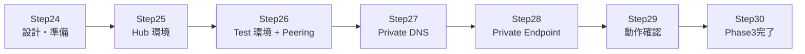

# Phase3 ネットワーク設計編 - Hub and Spoke / VNet Peering / Private DNS / Private Endpoint

Hub-VNet と Test-VNet を新設して **Hub and Spoke 構成**にし、VNet 同士を **VNet Peering** で接続します。さらに **Private DNS** と **Private Endpoint** を使い、Phase2 の Storage / Key Vault を「インターネット経由の公開エンドポイント」から「VNet 内のプライベート IP」で使えるようにする手順書です（Step24 〜 Step30）。

- 前の手順書：[Phase2 共通サービス編](GETTING_STARTED_Phase2.md)（Step17 〜 Step23）
- 全体の目次：[GETTING_STARTED.md](GETTING_STARTED.md)

> 📌 本文中の「Step5 のコミット前チェックリスト」「Step7 の State 用ストレージ」「Step8 の backend 設定」は、[Phase0 準備編](GETTING_STARTED_Phase0.md)の内容を指します。



---

## 進捗チェックリスト

- [ ] Step24：Phase3 の設計を理解し、作業ブランチを作成する
- [ ] Step25：Hub 環境（Resource Group / Hub-VNet / 共有 Subnet）を新設する
- [ ] Step26：Test 環境を新設し、VNet Peering で Hub と接続する（Dev も接続）
- [ ] Step27：Private DNS Zone を作成し、各 VNet にリンクする
- [ ] Step28：Storage / Key Vault に Private Endpoint を追加する
- [ ] Step29：VM から名前解決・疎通・ルートを確認する
- [ ] Step30：Phase3 を完了させる（記録・PR・削除）

---

### Phase3 完成イメージ

```text
rg-acp-hub-jpe-001
├─ vnet-acp-hub-jpe-001 (10.0.0.0/16)
│   └─ snet-acp-hub-shared-001 (10.0.1.0/24)   ← 将来の共通サービス用（空）
├─ privatelink.blob.core.windows.net           ← Private DNS Zone（Blob 用）
└─ privatelink.vaultcore.azure.net             ← Private DNS Zone（Key Vault 用）
        ▲ 各 VNet にリンク（Hub / Dev / Test）

   Hub-VNet ◀══ VNet Peering ══▶ Dev-VNet (10.1.0.0/16)
      ▲                              ├─ snet-acp-dev-app-001 (10.1.1.0/24)  … VM
      ║                              └─ snet-acp-dev-pe-001  (10.1.2.0/24)  … Private Endpoint ×2
      ╚═══ VNet Peering ═══▶ Test-VNet (10.2.0.0/16)
                                     └─ snet-acp-test-app-001 (10.2.1.0/24)

Dev ⇄ Test は直接つながない（Peering は「推移的ではない」。Step29 で確認）
```

### Phase3 で学ぶこと

| 概念 | 一言で言うと | なぜ必要か |
| --- | --- | --- |
| Hub and Spoke | 中心（Hub）に共通サービス、周り（Spoke）に環境を置く構成 | 共通サービスを 1 か所に集約でき、環境ごとに分離もできる |
| VNet Peering | 2 つの VNet を Azure 内部網で直接つなぐ | VPN なしで VNet 間を低遅延・安全に通信できる |
| Private Endpoint | PaaS に VNet 内の**プライベート IP** を割り当てる | 通信がインターネットを通らず、PaaS を VNet の一部のように使える |
| Private DNS | VNet 内だけで有効な名前解決 | `kv-xxx.vault.azure.net` を**プライベート IP に解決**させるために必須 |

> 💡 **この Phase の肝は「Private Endpoint は DNS とセットで動く」ことです。**
> Private Endpoint だけ作っても、名前解決が公開 IP のままだと意味がありません。
> 名前 → Private DNS → プライベート IP → Private Endpoint → PaaS、という流れを体験します。

---

## Step24：Phase3 の設計を理解し、作業ブランチを作成する

### 作るリソース

| リソース | 名前 | 環境 | 備考 |
| --- | --- | --- | --- |
| Resource Group | `rg-acp-hub-jpe-001` | hub | Hub 用 |
| Virtual Network | `vnet-acp-hub-jpe-001`（`10.0.0.0/16`） | hub | |
| Subnet | `snet-acp-hub-shared-001`（`10.0.1.0/24`） | hub | 将来の共通サービス用。今は空 |
| Private DNS Zone | `privatelink.blob.core.windows.net` / `privatelink.vaultcore.azure.net` | hub | **Azure の規定名**（変更不可） |
| Resource Group | `rg-acp-test-jpe-001` | test | Test 用 |
| Virtual Network | `vnet-acp-test-jpe-001`（`10.2.0.0/16`） | test | |
| Subnet | `snet-acp-test-app-001`（`10.2.1.0/24`） | test | |
| VNet Peering | `peer-dev-to-hub` / `peer-hub-to-dev`、`peer-test-to-hub` / `peer-hub-to-test` | dev / test | **双方向で 1 組ずつ**必要 |
| Subnet | `snet-acp-dev-pe-001`（`10.1.2.0/24`） | dev | Private Endpoint 用（Phase1 で予約済み） |
| Private Endpoint | `pep-acp-dev-blob-001` / `pep-acp-dev-kv-001` | dev | Storage（blob）と Key Vault（vault） |
| DNS VNet リンク | Hub / Dev / Test の VNet × Zone 2 つ | hub / dev / test | |

> ⚠️ **Private DNS Zone の名前は固定です。** `privatelink.blob.core.windows.net` のように、サービスごとに Azure が決めた名前を使わないと、名前解決が切り替わりません。

### 設計の判断（なぜこの構成か）

| 判断 | 内容 | 理由 |
| --- | --- | --- |
| 環境の分け方 | `environments/hub` と `environments/test` を**新設**し、State も別にする | CLAUDE.md の「環境ごとにルートモジュール」に従う。Hub を壊さずに Dev / Test だけ作り直せる |
| Peering の作り方 | **Spoke 側（dev / test）の State で、双方向 2 本とも作る** | Peering は両側に必要。Hub 側を Hub の State に置くと「Hub が Spoke の VNet を参照する」ことになり、適用順の循環が起きる |
| Private DNS Zone の置き場所 | **Hub** の Resource Group に 1 つだけ置き、各 VNet からリンク | 共通サービスは Hub に集約する、という Hub and Spoke の考え方どおり |
| Private Endpoint の置き場所 | PaaS を使う環境（Dev）の Subnet `10.1.2.0/24` | Phase1 で予約済み。VM と同じ VNet 内なので経路が単純 |
| Phase2 の設定 | サービスエンドポイントとファイアウォールは**そのまま残す** | 両方式の違いを比較するため。自宅 IP からの `terraform apply`（コンテナやシークレット作成）も引き続き必要 |
| 公開アクセスの無効化 | **しない**（`public_network_access_enabled` は既定のまま） | 無効にすると自宅 PC の Terraform が Key Vault / Storage のデータ操作で `403` になる。本番では Private Endpoint + 閉域の実行環境（self-hosted runner など）とセットで無効化する |
| Gateway | **作らない** | VPN Gateway は月 2 万円前後で、コスト上限を超える（下記） |

> 💡 **Peering は「推移的ではない」（A–B、B–C がつながっていても、A–C は通信できない）。**
> Dev ⇄ Hub、Test ⇄ Hub をつないでも、**Dev ⇄ Test は通信できません**。環境どうしを分離したいときには都合がよく、つなぎたい場合は Hub に Azure Firewall などの中継役が必要になります（高額なので今回は作りません）。

### コストの目安（Japan East・月額）

| リソース | 月額の目安 | 備考 |
| --- | --- | --- |
| VNet / Subnet / VNet Peering（作成自体） | 無料 | |
| VNet Peering の通信量 | 数円〜 | 同一リージョン内は 1GB あたり 1 円強。学習用途ならほぼゼロ |
| Private DNS Zone ×2 | 約 150 円 | 1 ゾーンあたり月 約 75 円 + クエリ課金（微小）。VNet リンクは無料 |
| **Private Endpoint ×2** | **約 2,200 円** | 1 つあたり月 約 1,100 円（時間課金で、約 1.5 円/時間）+ 通信量 |
| **Phase3 で増える合計** | **約 2,400 円** | 常時起動した場合。目標（月 5,000 円以内）の約半分 |

> ⚠️ **Private Endpoint は Phase2 と違い、放置すると効いてくる有料リソースです。**
> Phase1 の VM（約 1,000 円）などと合わせると目標を超える可能性があります。**動作確認が終わったら `destroy` する**運用にしてください（時間課金なので、数時間の検証なら 10 円未満です）。

> ❌ 参考：今回は作らない高額リソース
> - VPN Gateway（Hub に置いてオンプレと接続）：月 約 2 万円〜
> - Azure Firewall（Spoke 間・外部向け通信の中継）：月 約 9 万円〜
>
> 手順書では**概念の説明のみ**に留めます。

> 💡 金額は為替や価格改定で変わるため、正確な値は [Azure 料金計算ツール](https://azure.microsoft.com/ja-jp/pricing/calculator/) で確認してください。

### アドレス設計を更新する

`ProjectOverAll/01_Architecture/ip-address-design.md` に、Phase3 で確定する Subnet を追記します（CLAUDE.md のルール：Subnet 追加時は設計書も更新）。

| VNet | Subnet | アドレス | 用途 | 作成する Phase |
| --- | --- | --- | --- | --- |
| Hub-VNet (`10.0.0.0/16`) | `snet-acp-hub-shared-001` | `10.0.1.0/24` | 共通サービス（予約・空） | **Phase3** |
| Dev-VNet (`10.1.0.0/16`) | `snet-acp-dev-pe-001` | `10.1.2.0/24` | Private Endpoint | **Phase3** |
| Test-VNet (`10.2.0.0/16`) | `snet-acp-test-app-001` | `10.2.1.0/24` | アプリ（VM 用） | **Phase3** |
| Test-VNet (`10.2.0.0/16`) | （予約） | `10.2.2.0/24` | Private Endpoint 用 | 将来 |

### 作業ブランチを作成

```powershell
git checkout main
git pull origin main
git checkout -b feature/phase3-hub-and-spoke
```

### ファイル構成（Phase3 完了時）

```text
modules/
├─ rg/ vnet/ subnet/ nsg/ vm/             # 変更なし
├─ storage/ keyvault/ managed_identity/   # 変更なし
├─ private_dns/                           # 新規（Private DNS Zone）
├─ vnet_peering/                          # 新規（双方向 Peering）
└─ private_endpoint/                      # 新規

environments/
├─ hub/                                   # 新規
│   ├─ main.tf  locals.tf  variables.tf  outputs.tf
│   └─ terraform.tfvars（コミットしない）/ terraform.tfvars.example
├─ test/                                  # 新規
│   ├─ main.tf  locals.tf  variables.tf  outputs.tf
│   └─ terraform.tfvars（コミットしない）/ terraform.tfvars.example
└─ dev/
    ├─ main.tf        # 変更：Subnet / Peering / Private Endpoint を追加
    ├─ network.tf     # 新規：Hub との Peering と Private DNS のリンク
    ├─ variables.tf   # 変更：Hub の名前を受け取る変数を追加
    └─ locals.tf      # 変更：Private DNS Zone 名を追加
```

> 💡 **適用の順番は「hub → dev / test」** です。Spoke 側の State が Hub の VNet / Private DNS Zone を参照するため、Hub が先に存在している必要があります。削除は逆順（dev / test → hub）です。

---

## Step25：Hub 環境（Resource Group / Hub-VNet / 共有 Subnet）を新設する

Hub は新しいルートモジュール `environments/hub` として作ります。既存のモジュール（`rg` / `vnet` / `subnet`）を再利用するので、コード量は少なく済みます。

### 1. `environments/hub` を準備する

```powershell
mkdir environments/hub
copy environments/dev/variables.tf environments/hub/variables.tf
copy environments/dev/locals.tf environments/hub/locals.tf
copy environments/dev/terraform.tfvars.example environments/hub/terraform.tfvars.example
copy environments/dev/terraform.tfvars environments/hub/terraform.tfvars
```

コピーした後、次のように編集します。

`variables.tf`：Hub では VM を作らないため、**使わない変数は削除**します。`subscription_id` と `location` の 2 つだけ残せば十分です。

```hcl
variable "subscription_id" {
  description = "Azure サブスクリプション ID"
  type        = string
}

variable "location" {
  description = "リージョン"
  type        = string
  default     = "japaneast"
}
```

`locals.tf`：`Environment` タグを `hub` にします。

```hcl
locals {
  common_tags = {
    Project     = "AzureCommonPlatform"
    Environment = "hub"
    Owner       = "Taiyaki64"
    ManagedBy   = "Terraform"
  }
}
```

> ⚠️ `terraform.tfvars` の内容をチャットに貼らないこと。`terraform.tfvars.example` も、Hub で使う 2 変数だけに整え、値は伏せたままにしてください。

### 2. `environments/hub/main.tf`

```hcl
terraform {
  required_version = ">= 1.9.0"

  required_providers {
    azurerm = {
      source  = "hashicorp/azurerm"
      version = "~> 4.0"
    }
  }

  # Hub 専用の State（Dev とは別ファイルにして、互いの作業が影響しないようにする）
  backend "azurerm" {
    resource_group_name  = "rg-acp-tfstate-jpe-001"
    storage_account_name = "stacptfstate55814" # Step7 で作成した State 用ストレージ名
    container_name       = "tfstate"
    key                  = "hub.terraform.tfstate"
    use_azuread_auth     = true
  }
}

provider "azurerm" {
  features {}
  subscription_id = var.subscription_id
}

module "rg" {
  source   = "../../modules/rg"
  name     = "rg-acp-hub-jpe-001"
  location = var.location
  tags     = local.common_tags
}

module "vnet" {
  source              = "../../modules/vnet"
  name                = "vnet-acp-hub-jpe-001"
  location            = module.rg.location
  resource_group_name = module.rg.name
  address_space       = ["10.0.0.0/16"]
  tags                = local.common_tags
}

# 将来の共通サービス（DNS Resolver など）用。今はリソースを置かない
module "subnet_shared" {
  source               = "../../modules/subnet"
  name                 = "snet-acp-hub-shared-001"
  resource_group_name  = module.rg.name
  virtual_network_name = module.vnet.name
  address_prefixes     = ["10.0.1.0/24"]
}
```

> 💡 `stacptfstate55814` の部分は、**Step7 で実際に作成した State 用ストレージ名**（`environments/dev/main.tf` の `backend` と同じ値）にしてください。

`outputs.tf`

```hcl
output "resource_group_name" {
  description = "Hub の Resource Group 名"
  value       = module.rg.name
}

output "vnet_id" {
  description = "Hub-VNet の ID"
  value       = module.vnet.id
}

output "vnet_name" {
  description = "Hub-VNet 名"
  value       = module.vnet.name
}
```

### 実行

```powershell
cd environments/hub
terraform init       # backend（hub.terraform.tfstate）の初期化
terraform fmt -recursive
terraform validate
terraform plan       # 「3 to add, 0 to change, 0 to destroy」になることを確認
```

| 区分 | 内容 |
| --- | --- |
| 追加（3） | Resource Group、Hub-VNet、共有 Subnet |

内容を確認したら `terraform apply` を実行します（VNet・Subnet は無料です）。

**確認ポイント（Portal）**
- [ ] `rg-acp-hub-jpe-001` が作成され、タグ（`Environment = hub`）が付いている
- [ ] `vnet-acp-hub-jpe-001` のアドレス空間が `10.0.0.0/16`
- [ ] `snet-acp-hub-shared-001` が `10.0.1.0/24` で存在する

> ⚠️ **`terraform init` で `backend` のエラーが出たら**：Phase0 の Step8 と同様、`az login` 済みか、State 用ストレージ名が正しいかを確認します。

---

## Step26：Test 環境を新設し、VNet Peering で Hub と接続する（Dev も接続）

### VNet Peering とは

2 つの VNet を Azure のバックボーン網でつなぎ、**プライベート IP どうしで直接通信**できるようにする機能です。VPN のような暗号化装置や Gateway が不要で、遅延も小さく、**VNet 作成と同様に追加料金はかかりません**（通信量課金のみ）。

| 注意点 | 内容 |
| --- | --- |
| **両側に作る** | Hub → Spoke、Spoke → Hub の **2 本**が必要。片側だけだと状態が `Initiated` のままで通信できない（両側で `Connected` になる） |
| **アドレスが重複できない** | 重複していると作成に失敗する。Phase1 の Step10 でアドレス設計を先に決めたのはこのため |
| **推移的ではない** | Dev–Hub、Test–Hub がつながっても、Dev–Test は通信できない |

### 1. `modules/vnet_peering`（新規）

Spoke 側から「Spoke → Hub」と「Hub → Spoke」の 2 本をまとめて作るモジュールです。

`main.tf`

```hcl
# Spoke → Hub
resource "azurerm_virtual_network_peering" "spoke_to_hub" {
  name                      = "peer-${var.spoke_name}-to-hub"
  resource_group_name       = var.spoke_resource_group_name
  virtual_network_name      = var.spoke_vnet_name
  remote_virtual_network_id = var.hub_vnet_id

  allow_virtual_network_access = true
  # 通常は false。Hub に Azure Firewall などの中継役を置く場合に true にする
  allow_forwarded_traffic = false
}

# Hub → Spoke（Hub 側の Resource Group に作られる）
resource "azurerm_virtual_network_peering" "hub_to_spoke" {
  name                      = "peer-hub-to-${var.spoke_name}"
  resource_group_name       = var.hub_resource_group_name
  virtual_network_name      = var.hub_vnet_name
  remote_virtual_network_id = var.spoke_vnet_id

  allow_virtual_network_access = true
  allow_forwarded_traffic      = false
}
```

`variables.tf`

```hcl
variable "spoke_name" {
  description = "Spoke の短縮名（Peering 名に使う。例: dev / test）"
  type        = string
}

variable "spoke_resource_group_name" {
  description = "Spoke の Resource Group 名"
  type        = string
}

variable "spoke_vnet_name" {
  description = "Spoke-VNet 名"
  type        = string
}

variable "spoke_vnet_id" {
  description = "Spoke-VNet の ID"
  type        = string
}

variable "hub_resource_group_name" {
  description = "Hub の Resource Group 名"
  type        = string
}

variable "hub_vnet_name" {
  description = "Hub-VNet 名"
  type        = string
}

variable "hub_vnet_id" {
  description = "Hub-VNet の ID"
  type        = string
}
```

`outputs.tf`

```hcl
output "spoke_to_hub_id" {
  description = "Spoke → Hub の Peering ID"
  value       = azurerm_virtual_network_peering.spoke_to_hub.id
}

output "hub_to_spoke_id" {
  description = "Hub → Spoke の Peering ID"
  value       = azurerm_virtual_network_peering.hub_to_spoke.id
}
```

> 💡 `allow_gateway_transit` / `use_remote_gateways` は、Hub に VPN Gateway を置いて Spoke から使うための設定です。今回は Gateway を作らないので指定しません。

### 2. Test 環境を作る — `environments/test`

Step25 と同じ要領で準備します。

```powershell
mkdir environments/test
copy environments/hub/variables.tf environments/test/variables.tf
copy environments/hub/locals.tf environments/test/locals.tf
copy environments/hub/terraform.tfvars.example environments/test/terraform.tfvars.example
copy environments/hub/terraform.tfvars environments/test/terraform.tfvars
```

`locals.tf` の `Environment` を `test` に変更します。`variables.tf` に、Hub の場所を受け取る変数を追記します。

```hcl
variable "hub_resource_group_name" {
  description = "Hub の Resource Group 名"
  type        = string
  default     = "rg-acp-hub-jpe-001"
}

variable "hub_vnet_name" {
  description = "Hub-VNet 名"
  type        = string
  default     = "vnet-acp-hub-jpe-001"
}
```

> 💡 Hub の名前は秘密情報ではないので `default` に書いています。環境ごとに変わる値は変数にする、という CLAUDE.md の方針にも沿っています。

`main.tf`

```hcl
terraform {
  required_version = ">= 1.9.0"

  required_providers {
    azurerm = {
      source  = "hashicorp/azurerm"
      version = "~> 4.0"
    }
  }

  backend "azurerm" {
    resource_group_name  = "rg-acp-tfstate-jpe-001"
    storage_account_name = "stacptfstate55814" # Step7 で作成した State 用ストレージ名
    container_name       = "tfstate"
    key                  = "test.terraform.tfstate"
    use_azuread_auth     = true
  }
}

provider "azurerm" {
  features {}
  subscription_id = var.subscription_id
}

# Hub-VNet は Hub 環境（別 State）で作成済み。名前を指定して情報だけ読み取る
data "azurerm_virtual_network" "hub" {
  name                = var.hub_vnet_name
  resource_group_name = var.hub_resource_group_name
}

module "rg" {
  source   = "../../modules/rg"
  name     = "rg-acp-test-jpe-001"
  location = var.location
  tags     = local.common_tags
}

module "vnet" {
  source              = "../../modules/vnet"
  name                = "vnet-acp-test-jpe-001"
  location            = module.rg.location
  resource_group_name = module.rg.name
  address_space       = ["10.2.0.0/16"]
  tags                = local.common_tags
}

module "subnet_app" {
  source               = "../../modules/subnet"
  name                 = "snet-acp-test-app-001"
  resource_group_name  = module.rg.name
  virtual_network_name = module.vnet.name
  address_prefixes     = ["10.2.1.0/24"]
}

module "peering" {
  source                    = "../../modules/vnet_peering"
  spoke_name                = "test"
  spoke_resource_group_name = module.rg.name
  spoke_vnet_name           = module.vnet.name
  spoke_vnet_id             = module.vnet.id
  hub_resource_group_name   = var.hub_resource_group_name
  hub_vnet_name             = data.azurerm_virtual_network.hub.name
  hub_vnet_id               = data.azurerm_virtual_network.hub.id
}
```

`outputs.tf`

```hcl
output "vnet_id" {
  description = "Test-VNet の ID"
  value       = module.vnet.id
}

output "vnet_name" {
  description = "Test-VNet 名"
  value       = module.vnet.name
}

output "resource_group_name" {
  description = "Test の Resource Group 名"
  value       = module.rg.name
}
```

> 💡 **`data` ブロック**は「既にあるリソースの情報を読み取る」仕組みです。別 State のリソースを、State を共有せずに名前だけで参照できます。

### 実行（Test）

```powershell
cd environments/test
terraform init
terraform fmt -recursive
terraform validate
terraform plan       # 「6 to add, 0 to change, 0 to destroy」になることを確認
```

| 区分 | 内容 |
| --- | --- |
| 追加（6） | Resource Group、Test-VNet、Subnet、Peering ×2（`peer-test-to-hub` / `peer-hub-to-test`） |

内容を確認したら `terraform apply` を実行します。

### 3. Dev にも Peering を追加する — `environments/dev/network.tf`（新規）

`variables.tf`（追記）

```hcl
variable "hub_resource_group_name" {
  description = "Hub の Resource Group 名"
  type        = string
  default     = "rg-acp-hub-jpe-001"
}

variable "hub_vnet_name" {
  description = "Hub-VNet 名"
  type        = string
  default     = "vnet-acp-hub-jpe-001"
}
```

`network.tf`

```hcl
# Hub-VNet は Hub 環境（別 State）で作成済み。名前を指定して情報だけ読み取る
data "azurerm_virtual_network" "hub" {
  name                = var.hub_vnet_name
  resource_group_name = var.hub_resource_group_name
}

module "peering" {
  source                    = "../../modules/vnet_peering"
  spoke_name                = "dev"
  spoke_resource_group_name = module.rg.name
  spoke_vnet_name           = module.vnet.name
  spoke_vnet_id             = module.vnet.id
  hub_resource_group_name   = var.hub_resource_group_name
  hub_vnet_name             = data.azurerm_virtual_network.hub.name
  hub_vnet_id               = data.azurerm_virtual_network.hub.id
}
```

### 実行（Dev）

```powershell
cd environments/dev
terraform init
terraform fmt -recursive
terraform validate
terraform plan       # 「2 to add, 0 to change, 0 to destroy」になることを確認
```

| 区分 | 内容 |
| --- | --- |
| 追加（2） | Peering ×2（`peer-dev-to-hub` / `peer-hub-to-dev`） |

> ⚠️ 既存リソース（VM・Storage など）に `change` や `destroy` が含まれていたら **apply しないでください**。今回の差分は Peering の追加のみのはずです。

内容を確認したら `terraform apply` を実行します。

**確認ポイント（Portal）**
- [ ] `vnet-acp-hub-jpe-001` →「ピアリング」に `peer-hub-to-dev` と `peer-hub-to-test` があり、状態が **Connected**
- [ ] `vnet-acp-dev-jpe-001` →「ピアリング」に `peer-dev-to-hub`（Connected）
- [ ] `vnet-acp-test-jpe-001` →「ピアリング」に `peer-test-to-hub`（Connected）

> ⚠️ **状態が `Initiated` のままの場合**：片側しか作られていません。数十秒待って画面を更新しても変わらなければ、`terraform plan` で差分を確認します。
> **`Disconnected` の場合**：片側が削除されています。Hub 側（`peer-hub-to-～`）が手動で消されていないか確認します。

---

## Step27：Private DNS Zone を作成し、各 VNet にリンクする

### なぜ Private DNS が必要か

Private Endpoint を作っても、`stacpdevjpe001.blob.core.windows.net` を調べると、既定では**公開 IP** が返ります。
Private DNS Zone `privatelink.blob.core.windows.net` を VNet に**リンク**すると、**その VNet の中だけ**、同じ名前がプライベート IP に解決されます。

```text
VM が stacpdevjpe001.blob.core.windows.net を問い合わせる
  → Azure の DNS が、リンクされた Private DNS Zone を確認
  → 10.1.2.4（Private Endpoint の IP）を返す   ← 公開 IP ではなくこちら
```

| 場所 | 同じ名前の解決結果 |
| --- | --- |
| リンクされた VNet 内（Dev の VM など） | **プライベート IP**（`10.1.2.x`） |
| インターネット / 自宅 PC | 公開 IP（従来どおり） |

> 💡 **Zone は 1 つだけ作り、複数の VNet からリンク**します。Hub に置いた Zone を Dev / Test からも使えるのは、これが理由です（リンクは無料）。

### 1. `modules/private_dns`（新規）

`main.tf`

```hcl
resource "azurerm_private_dns_zone" "this" {
  name                = var.name
  resource_group_name = var.resource_group_name
  tags                = var.tags
}

# 指定した VNet ごとに Zone へリンクする（キーはリンク名の一部になる）
resource "azurerm_private_dns_zone_virtual_network_link" "this" {
  for_each = var.linked_vnet_ids

  name                  = "link-${each.key}"
  resource_group_name   = var.resource_group_name
  private_dns_zone_name = azurerm_private_dns_zone.this.name
  virtual_network_id    = each.value
  registration_enabled  = false # 自動登録は不要（VM の名前は登録しない）
  tags                  = var.tags
}
```

`variables.tf`

```hcl
variable "name" {
  description = "Private DNS Zone 名（Azure の規定名。例: privatelink.blob.core.windows.net）"
  type        = string
}

variable "resource_group_name" {
  description = "所属する Resource Group 名"
  type        = string
}

variable "linked_vnet_ids" {
  description = "リンクする VNet の {リンク名の識別子 = VNet ID}（例: { hub = \"...\" }）"
  type        = map(string)
  default     = {}
}

variable "tags" {
  description = "リソースに付けるタグ"
  type        = map(string)
  default     = {}
}
```

`outputs.tf`

```hcl
output "id" {
  description = "Private DNS Zone の ID"
  value       = azurerm_private_dns_zone.this.id
}

output "name" {
  description = "Private DNS Zone 名"
  value       = azurerm_private_dns_zone.this.name
}
```

> 💡 `registration_enabled = false`：`true` にすると、VNet 内の VM の名前が自動で Zone に登録されます。今回は Private Endpoint 用の Zone なので不要です。
> `for_each` に `map` を渡すと、後から VNet を足しても既存のリンクが作り直されません。

### 2. Hub に Zone を作る — `environments/hub`

`locals.tf`（追記）

```hcl
locals {
  # Private Endpoint 用の Private DNS Zone（Azure の規定名。キーは用途の識別子）
  private_dns_zones = {
    blob  = "privatelink.blob.core.windows.net"
    vault = "privatelink.vaultcore.azure.net"
  }
}
```

`main.tf`（追記）

```hcl
module "private_dns" {
  source   = "../../modules/private_dns"
  for_each = local.private_dns_zones

  name                = each.value
  resource_group_name = module.rg.name
  tags                = local.common_tags

  # Hub-VNet 自身をリンク。Dev / Test のリンクは、それぞれの環境側で追加する
  linked_vnet_ids = {
    hub = module.vnet.id
  }
}
```

```powershell
cd environments/hub
terraform init       # モジュール追加のため
terraform fmt -recursive
terraform validate
terraform plan       # 「4 to add, 0 to change, 0 to destroy」になることを確認
```

| 区分 | 内容 |
| --- | --- |
| 追加（4） | Private DNS Zone ×2、Hub-VNet へのリンク ×2 |

内容を確認したら `terraform apply` を実行します。

### 3. Dev / Test の VNet をリンクする

Hub に作った Zone を、Dev / Test の VNet からも使えるようにします。`locals.tf` と `network.tf` に追記します。

`environments/dev/locals.tf`（追記。Test にも同じ内容を追記）

```hcl
locals {
  # Hub に作成済みの Private DNS Zone（Step27-2 の locals と同じ名前）
  private_dns_zones = {
    blob  = "privatelink.blob.core.windows.net"
    vault = "privatelink.vaultcore.azure.net"
  }
}
```

`environments/dev/network.tf`（追記）

```hcl
# Hub に作成済みの Private DNS Zone を読み取る
data "azurerm_private_dns_zone" "this" {
  for_each = local.private_dns_zones

  name                = each.value
  resource_group_name = var.hub_resource_group_name
}

# Dev-VNet を Zone にリンクする（リンク自体は Zone と同じ Hub の Resource Group に作られる）
resource "azurerm_private_dns_zone_virtual_network_link" "dev" {
  for_each = local.private_dns_zones

  name                  = "link-dev-${each.key}"
  resource_group_name   = var.hub_resource_group_name
  private_dns_zone_name = data.azurerm_private_dns_zone.this[each.key].name
  virtual_network_id    = module.vnet.id
  registration_enabled  = false
  tags                  = local.common_tags
}
```

`environments/test/network.tf`（新規）は、`link-test-${each.key}` / `module.vnet.id` / `var.hub_resource_group_name` に置き換えた同じ内容にします。

```powershell
cd environments/dev
terraform fmt -recursive
terraform validate
terraform plan       # 「2 to add, 0 to change, 0 to destroy」になることを確認
terraform apply
cd ../test
terraform fmt -recursive
terraform validate
terraform plan       # 同じく「2 to add」
terraform apply
```

> ⚠️ 毎回 `apply` の前に、`plan` の件数と内容を確認してください（CLAUDE.md の安全ルール）。

**確認ポイント（Portal）**
- [ ] `rg-acp-hub-jpe-001` に Private DNS Zone が 2 つある
- [ ] 各 Zone の「仮想ネットワークリンク」に `link-hub-*` / `link-dev-*` / `link-test-*` が表示されている（Zone ごとに 3 つ・**リンクの状態：完了**）

> 💡 **Private DNS Zone はまだ空**です。レコードは、次の Step で Private Endpoint を作ったとき**自動で登録**されます。

---

## Step28：Storage / Key Vault に Private Endpoint を追加する

### Private Endpoint とは

PaaS（Storage・Key Vault など）への入口として、**自分の VNet の Subnet に NIC（ネットワークカード）を作り、プライベート IP を割り当てる**機能です。
通信は VNet 内で完結し、インターネットを通りません。

| 比較 | サービスエンドポイント（Phase2） | Private Endpoint（Phase3） |
| --- | --- | --- |
| PaaS 側の宛先 IP | 公開 IP のまま | **VNet 内のプライベート IP** |
| 制御方法 | 「この Subnet から来た通信を許可」 | 専用の入口（NIC）を経由 |
| 他の VNet / オンプレから | 使えない | **Peering / VPN 経由で使える** |
| DNS の変更 | 不要 | **Private DNS が必要** |
| 料金 | 無料 | **有料**（1 つ 月 約 1,100 円） |

### 1. Private Endpoint 用 Subnet を追加する — `environments/dev/main.tf`

Phase1 で予約していた `10.1.2.0/24` を使います。

```hcl
module "subnet_pe" {
  source               = "../../modules/subnet"
  name                 = "snet-acp-dev-pe-001"
  resource_group_name  = module.rg.name
  virtual_network_name = module.vnet.name
  address_prefixes     = ["10.1.2.0/24"]
}
```

### 2. `modules/private_endpoint`（新規）

`main.tf`

```hcl
resource "azurerm_private_endpoint" "this" {
  name                = var.name
  location            = var.location
  resource_group_name = var.resource_group_name
  subnet_id           = var.subnet_id
  tags                = var.tags

  # 接続先 PaaS の指定
  private_service_connection {
    name                           = "psc-${var.name}"
    private_connection_resource_id = var.target_resource_id
    subresource_names              = [var.subresource_name]
    is_manual_connection           = false # 同じテナント内なので承認は自動
  }

  # Private DNS Zone に A レコード（名前 → プライベート IP）を自動登録する
  private_dns_zone_group {
    name                 = "default"
    private_dns_zone_ids = [var.private_dns_zone_id]
  }
}
```

`variables.tf`

```hcl
variable "name" {
  description = "Private Endpoint 名（例: pep-acp-dev-blob-001）"
  type        = string
}

variable "location" {
  description = "リージョン"
  type        = string
}

variable "resource_group_name" {
  description = "所属する Resource Group 名"
  type        = string
}

variable "subnet_id" {
  description = "Private Endpoint を置く Subnet の ID"
  type        = string
}

variable "target_resource_id" {
  description = "接続先リソース（Storage Account / Key Vault など）の ID"
  type        = string
}

variable "subresource_name" {
  description = "接続先のサブリソース名（Storage の Blob は blob、Key Vault は vault）"
  type        = string
}

variable "private_dns_zone_id" {
  description = "A レコードを登録する Private DNS Zone の ID"
  type        = string
}

variable "tags" {
  description = "リソースに付けるタグ"
  type        = map(string)
  default     = {}
}
```

`outputs.tf`

```hcl
output "id" {
  description = "Private Endpoint の ID"
  value       = azurerm_private_endpoint.this.id
}

output "private_ip_address" {
  description = "Private Endpoint のプライベート IP"
  value       = azurerm_private_endpoint.this.private_service_connection[0].private_ip_address
}
```

> 💡 **`subresource_names` と Private DNS Zone の対応**（組み合わせを間違えると名前解決が切り替わらない）
>
> | サービス | `subresource_names` | Private DNS Zone |
> | --- | --- | --- |
> | Storage（Blob） | `blob` | `privatelink.blob.core.windows.net` |
> | Key Vault | `vault` | `privatelink.vaultcore.azure.net` |

### 3. `environments/dev/main.tf`（追記）

```hcl
module "pep_blob" {
  source              = "../../modules/private_endpoint"
  name                = "pep-acp-dev-blob-001"
  location            = module.rg.location
  resource_group_name = module.rg.name
  subnet_id           = module.subnet_pe.id
  target_resource_id  = module.storage.id
  subresource_name    = "blob"
  private_dns_zone_id = data.azurerm_private_dns_zone.this["blob"].id
  tags                = local.common_tags

  # DNS のリンクが先にできていないと、名前解決が切り替わらない
  depends_on = [azurerm_private_dns_zone_virtual_network_link.dev]
}

module "pep_kv" {
  source              = "../../modules/private_endpoint"
  name                = "pep-acp-dev-kv-001"
  location            = module.rg.location
  resource_group_name = module.rg.name
  subnet_id           = module.subnet_pe.id
  target_resource_id  = module.keyvault.id
  subresource_name    = "vault"
  private_dns_zone_id = data.azurerm_private_dns_zone.this["vault"].id
  tags                = local.common_tags

  depends_on = [azurerm_private_dns_zone_virtual_network_link.dev]
}
```

`environments/dev/outputs.tf`（追記）

```hcl
output "private_endpoint_ips" {
  description = "Private Endpoint のプライベート IP（動作確認で名前解決の結果と比較する）"
  value = {
    blob  = module.pep_blob.private_ip_address
    vault = module.pep_kv.private_ip_address
  }
}
```

### 実行

```powershell
cd environments/dev
terraform init       # モジュール追加のため
terraform fmt -recursive
terraform validate
terraform plan       # 「3 to add, 0 to change, 0 to destroy」になることを確認
```

| 区分 | 内容 |
| --- | --- |
| 追加（3） | Subnet `snet-acp-dev-pe-001`、Private Endpoint ×2（各 DNS Zone Group を含む） |

> ⚠️ **Private Endpoint は月 約 1,100 円 × 2 の有料リソースです。** 内容を確認し、**動作確認が終わったら削除する前提**で `terraform apply` を実行してください。
> Storage / Key Vault / VM に `change` や `destroy` が含まれていたら **apply しないでください**。

**確認ポイント（Portal）**
- [ ] `pep-acp-dev-blob-001` / `pep-acp-dev-kv-001` の接続状態が **承認済み（Approved）**
- [ ] 各 Private Endpoint の「DNS 構成」に、FQDN とプライベート IP（`10.1.2.x`）が表示されている
- [ ] hub の Private DNS Zone の「レコード セット」に **A レコードが自動で追加されている**

---

## Step29：VM から名前解決・疎通・ルートを確認する

「同じ名前なのに、VM の中ではプライベート IP に解決される」ことと、Peering の通信範囲を確認します。

> ⚠️ VM が停止していたら、先に起動してください（Phase1 の Step14 参照）。

### 準備：接続情報を確認する（PC 側）

```powershell
cd environments/dev
terraform output    # private_endpoint_ips、key_vault_name、storage_account_name を控える
ssh -i ~/.ssh/acp_dev_rsa azureuser@<パブリックIP>
```

### ① 名前解決がプライベート IP になっている（VM 内）

```bash
nslookup stacpdevjpe001.blob.core.windows.net
nslookup kv-acp-dev-jpe-001.vault.azure.net
```

`Address:` が **`10.1.2.x`**（`terraform output` の値と一致）になっていれば成功です。

```text
stacpdevjpe001.blob.core.windows.net  canonical name = stacpdevjpe001.privatelink.blob.core.windows.net.
Address: 10.1.2.4
```

> 💡 名前が一度 `*.privatelink.～` という別名（CNAME）に変わり、そこが Private DNS Zone でプライベート IP に解決されます。これが「Private DNS とセット」の正体です。

### ② 比較：自宅 PC からは公開 IP のまま（PC 側）

```powershell
nslookup stacpdevjpe001.blob.core.windows.net
```

PC では**公開 IP** が返ります（PC は Private DNS にリンクされた VNet の中にいないため）。VM と PC で結果が違うことを確認します。

### ③ Private Endpoint 経由でも Phase2 の操作ができる（VM 内）

Phase2 Step22 の手順で、Key Vault のシークレットを読みます（`CLIENT_ID` などの変数を再設定してから実行）。

```bash
TOKEN=$(curl -s -H "Metadata:true" \
  "http://169.254.169.254/metadata/identity/oauth2/token?api-version=2018-02-01&resource=https%3A%2F%2Fvault.azure.net&client_id=${CLIENT_ID}" \
  | jq -r .access_token)

curl -s -H "Authorization: Bearer ${TOKEN}" \
  "https://${KV_NAME}.vault.azure.net/secrets/sample-secret?api-version=7.4" | jq -r .value
```

`hello-from-key-vault` が表示されれば成功です。今回の通信は **`10.1.2.x`（Private Endpoint）経由**で行われています。

> 💡 Private Endpoint 経由の通信は、PaaS 側のファイアウォール規則（IP / Subnet の許可）の対象外です。ネットワーク制限は、Private Endpoint の NIC がある VNet / Subnet に到達できるかどうかで決まります。

### ④ Peering が効いていること・Dev ⇄ Test が通じないことを、ルートで確認する（PC 側・読み取りのみ）

VM の NIC に適用されている「実際のルート」を確認します（VM 起動中のみ実行可能）。

```powershell
az network nic show-effective-route-table `
  --resource-group rg-acp-dev-jpe-001 `
  --name nic-acp-dev-001 `
  --output table
```

| 見るポイント | 期待される結果 |
| --- | --- |
| `10.0.0.0/16`（Hub） | Next Hop Type = **VNetPeering** |
| `10.2.0.0/16`（Test） | **表示されない**（Dev ⇄ Test は Peering がないため経路なし） |
| `0.0.0.0/0` | Next Hop Type = Internet |

> 💡 ここで `10.2.0.0/16` が出ていないことが、**「Peering は推移的ではない」** の証拠です。Dev から Test に通信したい場合は、Dev–Test 間に直接 Peering を追加するか、Hub に中継役（Azure Firewall など）を置く必要があります。

> ⚠️ NIC 名（`nic-acp-dev-001`）は実際の名前に合わせてください。`az network nic list -g rg-acp-dev-jpe-001 -o table` で確認できます（読み取りのみ）。

### 確認結果のまとめ

- [ ] ① VM からの名前解決が `10.1.2.x`（Private Endpoint の IP）になった（Blob / Key Vault の両方）
- [ ] ② 自宅 PC からの名前解決は公開 IP のままだった
- [ ] ③ Private Endpoint 経由で Key Vault のシークレットを読めた
- [ ] ④ 有効ルートで Hub は `VNetPeering`、Test は経路なしだった

### トラブルシューティング

| 症状 | 原因と対処 |
| --- | --- |
| `nslookup` が公開 IP を返す | Dev-VNet が Private DNS Zone にリンクされていない（Step27 の `link-dev-*`）。または A レコードが未登録（Private Endpoint の「DNS 構成」を確認） |
| `nslookup` が応答しない | VM の DNS 設定が Azure 既定のままか確認（VNet の DNS サーバーを独自指定していないこと） |
| 名前解決はできるが `curl` が `403` | RBAC の反映待ち、または Private Endpoint の接続状態が Approved でない |
| Peering が `Initiated` のまま | 片側しか作られていない。Step26 の `terraform plan` を確認 |
| `terraform apply` が `403`（コンテナ / シークレット作成） | 公開アクセスを無効にしていないか確認。無効だと自宅 PC からのデータ操作はできない（設計の判断を参照） |
| `AddressSpaceOverlap` で Peering 作成に失敗 | アドレス空間が重複している。Step24 のアドレス設計を再確認 |

---

## Step30：Phase3 を完了させる

### 完了チェックリスト

- [ ] hub / dev / test の各ディレクトリで `terraform plan` の差分が出ない（`No changes.`）
- [ ] Step29 の動作確認（①〜④）がすべて成功した
- [ ] `terraform.tfvars`・秘密鍵・`*.tfstate` が GitHub に上がっていない（`git status` で確認）
- [ ] `environments/hub` と `environments/test` に `terraform.tfvars.example` がある（値は伏せてある）
- [ ] すべてのリソースにタグ（`local.common_tags`）が付いている
- [ ] `ip-address-design.md` に Phase3 の Subnet を追記した（Step24）

### ドキュメントを残す

| 保存先 | 内容 |
| --- | --- |
| `ProjectOverAll/01_Architecture/` | Phase3 構成図（draw.io）。Hub and Spoke、Peering、Private Endpoint と Private DNS の関係。アドレス設計の更新。命名規則に Private Endpoint（`pep`）を追記 |
| `ProjectOverAll/02_Lecture/` | 学習ログ（例：`YYYY-MM-DD_Phase3_ネットワーク設計.md`）。Peering が推移的でない理由、Private Endpoint と Private DNS の関係、ハマった点 |
| `ProjectOverAll/03_RunBook/` | Hub → Dev / Test の起動・削除順、VM から名前解決を確認する手順 |
| `ProjectOverAll/04_CostManagement/` | Phase3 追加分の実績コスト。Private Endpoint を残した場合と削除した場合の差 |

> 💡 **学習ログに残したいこと**
> - サービスエンドポイントと Private Endpoint の違い（Phase2 との比較）
> - なぜ DNS がセットで必要か（`privatelink` の CNAME の流れ）
> - Peering は両側が必要で、推移的ではないこと
> - 公開アクセスを無効化できなかった理由（Terraform の実行場所の問題）

### README と進捗を更新して Pull Request を作成

1. `README.md` の「構築フェーズ」で Phase3 を `✅ 完了` に更新します。
2. `CLAUDE.md` の「現在の進捗」を更新します。
3. `CLAUDE.md` の命名規則に `Private Endpoint | pep | pep-acp-dev-blob-001` と `VNet Peering | peer | peer-dev-to-hub` を追記します。

```powershell
git add .
git status   # Step5 のコミット前チェックリストを確認（terraform.tfvars・*.tfstate・秘密鍵が含まれていないこと）
git commit -m "feat: Phase3 Hub and Spoke / VNet Peering / Private Endpoint を追加"
git push origin feature/phase3-hub-and-spoke
gh pr create --title "Phase3: Hub and Spoke 構成とプライベート接続" --body "Hub / Test 環境の新設、VNet Peering、Private DNS、Private Endpoint を追加"
```

GitHub で Pull Request の差分を確認し、`main` にマージします。

### 使わない期間はリソースを削除する

**削除は適用と逆の順番（dev → test → hub）** で行います。Hub の Zone や VNet を先に消すと、Dev / Test のリンクや Peering が残って失敗します。

```powershell
cd environments/dev
terraform destroy
cd ../test
terraform destroy
cd ../hub
terraform destroy
```

> ⚠️ 費用が最も大きいのは Private Endpoint ×2（dev の State）です。「Phase3 の学習は終わったが Phase2 のリソースは残したい」場合は、`environments/dev` のコードで `module "pep_blob"` / `module "pep_kv"` だけを削除して `terraform apply` する方法もあります（`plan` で Private Endpoint の `destroy` のみであることを確認）。
>
> 💡 `destroy` 後に再開するときは、**hub → dev / test** の順で `apply` します。

---

## 次のステップ

Phase3 が完了したら、README の構築フェーズに沿って進めます。

| 順番 | 内容 |
| --- | --- |
| 1 | Phase4：Hub に Log Analytics を作成し、Azure Monitor で VM の監視を行う（`log-acp-hub-jpe-001`） |
| 2 | Phase5：GitHub Actions で `terraform plan` / `apply` を自動化（OIDC 認証を利用）。環境が hub / dev / test に分かれたため、環境ごとのワークフローを用意する |

> 💡 Phase4 の Log Analytics は Hub に置きます。Phase3 で作った `snet-acp-hub-shared-001` と Hub の State を、監視の共通基盤として活用します。
