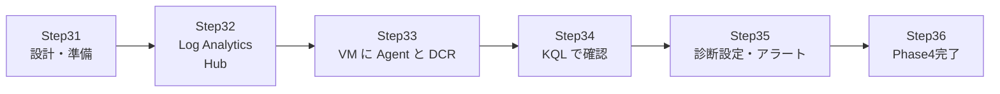

# Phase4 監視編 - Log Analytics / Azure Monitor Agent / KQL / アラート

Hub に **Log Analytics ワークスペース**（ログの保管庫）を作り、Dev の VM と Key Vault のログ・メトリックを集めて、**KQL で検索**し、**アラートでメール通知**できるようにする手順書です（Step31 〜 Step36）。

- 前の手順書：[Phase3 ネットワーク設計編](GETTING_STARTED_Phase3.md)（Step24 〜 Step30）
- 全体の目次：[GETTING_STARTED.md](GETTING_STARTED.md)

> 📌 本文中の「Step5 のコミット前チェックリスト」「Step7 の State 用ストレージ」は、[Phase0 準備編](GETTING_STARTED_Phase0.md)の内容を指します。



---

## 進捗チェックリスト

- [ ] Step31：Phase4 の設計を理解し、作業ブランチを作成する
- [ ] Step32：Hub に Log Analytics ワークスペースを作成する
- [ ] Step33：Dev の VM に Azure Monitor Agent を入れ、Data Collection Rule でログを集める
- [ ] Step34：KQL でログを検索して、データが届いていることを確認する
- [ ] Step35：Key Vault の診断設定と、CPU 使用率のアラート（メール通知）を追加する
- [ ] Step36：Phase4 を完了させる（記録・PR・削除）

---

### Phase4 完成イメージ

```text
rg-acp-hub-jpe-001
└─ log-acp-hub-jpe-001  (Log Analytics ワークスペース)  ← すべてのログの集約先
        ▲                         ▲
        │ Perf / Syslog / Heartbeat │ AuditEvent（監査ログ）
        │                         │
rg-acp-dev-jpe-001
├─ vm-acp-dev-001 ── Azure Monitor Agent（拡張機能）
│      └─ dcr-acp-dev-linux-001（Data Collection Rule：何を集めるか）
├─ kv-acp-dev-jpe-001 ── 診断設定（diag-acp-dev-kv-001）
├─ ag-acp-dev-jpe-001  (Action Group：通知先メール)
└─ alert-acp-dev-vm-cpu-001  (メトリックアラート：CPU 80% 超で通知)
```

### Phase4 で学ぶこと

| 概念 | 一言で言うと | なぜ必要か |
| --- | --- | --- |
| Log Analytics ワークスペース | ログを貯めて検索できる保管庫 | VM・PaaS のログを 1 か所に集めて横断的に調べられる |
| Azure Monitor Agent（AMA） | VM の中で動き、ログを送る拡張機能 | VM の OS 内部（CPU・メモリ・Syslog）は、外から見えないため |
| Data Collection Rule（DCR） | 「何を・どこへ送るか」の設定 | Agent に集めるデータを指示する。VM とは別リソースで、関連付け（Association）で結びつく |
| 診断設定（Diagnostic setting） | PaaS のログをワークスペースへ送る設定 | Key Vault など PaaS には Agent を入れられないため、この方式で送る |
| KQL（Kusto Query Language） | ログを検索・集計する言語 | 集めたログから「知りたいこと」を取り出す |
| Action Group / アラートルール | 条件を満たしたら通知する仕組み | 異常に自分で気づけるようにする（見に行かなくてよい） |

> 💡 **メトリックとログの違い**
> - **メトリック**：数値の時系列（CPU 使用率など）。Azure が自動で取っていて、**Agent は不要**。軽くて、アラートに向いている
> - **ログ**：イベントの記録（Syslog、監査ログなど）。**ワークスペースに送って初めて検索できる**
>
> この Phase では、メトリックは「アラート」に、ログは「KQL での調査」に使います。

> 💡 **この Phase の肝は「監視は、データを送る設定（Agent / DCR / 診断設定）がセットで動く」ことです。**
> ワークスペースを作っただけでは、何も届きません。「誰が・何を・どこへ送るのか」を 1 つずつ設定する流れを体験します。

---

## Step31：Phase4 の設計を理解し、作業ブランチを作成する

### 作るリソース

| リソース | 名前 | 環境 | 備考 |
| --- | --- | --- | --- |
| Log Analytics ワークスペース | `log-acp-hub-jpe-001` | hub | CLAUDE.md の命名規則どおり。Hub に 1 つだけ置く |
| VM 拡張機能 | `AzureMonitorLinuxAgent` | dev | Azure Monitor Agent（Linux 用）。名前は Azure の規定名 |
| Data Collection Rule | `dcr-acp-dev-linux-001` | dev | Perf（CPU・メモリ・ディスク）と Syslog を集める |
| DCR の関連付け | `assoc-dcr-acp-dev-linux-001` | dev | VM と DCR を結びつける |
| 診断設定 | `diag-acp-dev-kv-001` | dev | Key Vault の監査ログ（`AuditEvent`）を送る |
| Action Group | `ag-acp-dev-jpe-001` | dev | 通知先（メール） |
| メトリックアラート | `alert-acp-dev-vm-cpu-001` | dev | VM の CPU 使用率が 80% を超えたら通知 |

> ⚠️ CAF（Cloud Adoption Framework）の略称に明確な定義がないリソースがあります（診断設定・アラートルール・DCR の関連付け）。上記の `diag` / `alert` / `assoc` は**暫定の命名**です。Step36 で CLAUDE.md の命名規則に追記します。

### 設計の判断（なぜこの構成か）

| 判断 | 内容 | 理由 |
| --- | --- | --- |
| ワークスペースの置き場所 | **Hub** の Resource Group に 1 つだけ | 「監視は共通サービス」として Hub に集約する（README の構成どおり）。Spoke が増えても送り先は同じ |
| Spoke からの参照 | Dev は `data` ブロックで**名前を指定して読み取る** | Phase3 の Private DNS Zone と同じ方法。適用順は **hub → dev** |
| Agent の種類 | **Azure Monitor Agent（AMA）** を使う | 旧 Log Analytics Agent（MMA）は 2024 年 8 月にサポート終了。新規構築は AMA が前提 |
| Agent の認証 | Phase2 で作った **User-assigned Managed Identity** を使う | 新しい鍵やパスワードを作らずに済む。VM には既に割り当て済み |
| 集めるデータ | CPU・メモリ・ディスク使用率、Syslog（警告以上）、Heartbeat | 取りすぎると課金が増える。まずは最小限にして、必要になったら足す |
| 通信経路 | **インターネット経由**（Azure Monitor Private Link Scope は使わない） | 設定が複雑で、学習範囲を超える。AMA からの送信は HTTPS（443）のみ。Phase5 以降で検討 |
| アラートの種類 | **メトリックアラート（CPU）** にする。「Heartbeat が来ない」ログアラートは作らない | VM は毎晩 23:00 に自動停止するため、Heartbeat 途絶のアラートだと**毎晩誤検知**になる |
| Test 環境 | **今回は対象外** | Test には VM がない（Subnet のみ）。VM を置く Phase で、同じ `vm_monitoring` モジュールを呼べばよい |
| コスト対策 | ワークスペースに**1 日の取り込み上限（`daily_quota_gb`）** と**保持期間 30 日**を設定 | 想定外のログ流入で課金が膨らむのを防ぐ |

> 💡 **Hub の State に入れるもの / Dev の State に入れるもの**
> - Hub：ワークスペース（共通の受け皿）
> - Dev：DCR・診断設定・アラートなど、**Dev のリソースに紐づく設定**
>
> 「リソースが消えるときに一緒に消えるべきものは、そのリソースと同じ State に置く」と考えると分かりやすいです。

### コストの目安（Japan East・月額）

| リソース | 月額の目安 | 備考 |
| --- | --- | --- |
| Log Analytics ワークスペース（取り込み） | 約 0 円〜 | 取り込みは 約 400 円/GB 程度。**月 5GB まで無料枠**があり、今回のデータ量（VM 1 台分）は数十 MB 程度なので無料枠内の見込み |
| データ保持 | 0 円 | 30 日までは無料 |
| Azure Monitor Agent / DCR / 診断設定 | 無料 | 課金対象は「取り込んだログの量」 |
| Action Group（メール通知） | 無料 | 月 1,000 通まで無料 |
| メトリックアラート ×1 | 約 15 円 | 監視する時系列 1 つあたり月 約 10 セント。頻度を上げると高くなる（今回は 5 分間隔） |
| **Phase4 で増える合計** | **約 0〜50 円** | 目標（月 5,000 円以内）への影響はほぼなし |

> ✅ 今回は、VPN Gateway / Azure Firewall / Bastion のような高額リソースは作りません。
>
> ⚠️ ただし **ログの取り込み量は、設定次第で急に増えます**（Syslog の `info` / `debug` まで集める、Perf を 10 秒間隔にするなど）。Step36 で、Log Analytics の「使用量と推定コスト」を確認する習慣をつけます。

> 💡 金額は為替や価格改定で変わるため、正確な値は [Azure 料金計算ツール](https://azure.microsoft.com/ja-jp/pricing/calculator/) で確認してください。

### 作業ブランチを作成

```powershell
git checkout main
git pull origin main
git checkout -b feature/phase4-monitoring
```

### ファイル構成（Phase4 完了時）

```text
modules/
├─ rg/ vnet/ subnet/ nsg/ vm/ ...        # 変更なし
├─ log_analytics/                        # 新規（ワークスペース）
└─ vm_monitoring/                        # 新規（AMA + DCR + 関連付け）

environments/
├─ hub/
│   ├─ main.tf        # 変更：provider の features と log_analytics を追加
│   └─ outputs.tf     # 変更：ワークスペース名を出力
├─ test/              # 変更なし
└─ dev/
    ├─ monitoring.tf  # 新規：ワークスペース参照 / vm_monitoring / 診断設定 / アラート
    ├─ variables.tf   # 変更：ワークスペース名・通知先メールの変数を追加
    └─ terraform.tfvars（コミットしない）/ terraform.tfvars.example  # 変更：alert_email を追加
```

> 💡 **適用の順番は「hub → dev」** です。Dev がワークスペースを参照するため、Hub が先に存在している必要があります。削除は逆順（dev → hub）です。

---

## Step32：Hub に Log Analytics ワークスペースを作成する

### なぜ必要か

ログは「送り先」がないと残りません。ワークスペースは、Agent や診断設定が送ったログを貯めて、KQL で検索できるようにする**受け皿**です。まず受け皿だけを作り、送る側は次の Step 以降で作ります。

### 1. `modules/log_analytics`（新規）

`main.tf`

```hcl
resource "azurerm_log_analytics_workspace" "this" {
  name                = var.name
  location            = var.location
  resource_group_name = var.resource_group_name
  sku                 = "PerGB2018" # 取り込んだ量（GB）に応じた従量課金。現在の標準プラン
  retention_in_days   = var.retention_in_days
  daily_quota_gb      = var.daily_quota_gb
  tags                = var.tags
}
```

`variables.tf`

```hcl
variable "name" {
  description = "Log Analytics ワークスペース名"
  type        = string
}

variable "location" {
  description = "リージョン"
  type        = string
}

variable "resource_group_name" {
  description = "所属する Resource Group 名"
  type        = string
}

variable "retention_in_days" {
  description = "ログの保持日数（30 日までは無料）"
  type        = number
  default     = 30
}

variable "daily_quota_gb" {
  description = "1 日の取り込み上限（GB）。超えるとその日の残りのログは取り込まれない"
  type        = number
  default     = 0.5
}

variable "tags" {
  description = "リソースに付けるタグ"
  type        = map(string)
  default     = {}
}
```

`outputs.tf`

```hcl
output "id" {
  description = "ワークスペースの ID（DCR や診断設定の送り先に使う）"
  value       = azurerm_log_analytics_workspace.this.id
}

output "name" {
  description = "ワークスペース名"
  value       = azurerm_log_analytics_workspace.this.name
}
```

> 💡 `daily_quota_gb`：上限に達すると**その日はログが捨てられます**（アラートも届かなくなる）。学習用では「課金の安全装置」として有効ですが、本番では慎重に決めます。
> `sku = "PerGB2018"`：旧プランは新規作成できないため、ほぼ固定の値です。

### 2. Hub に作る — `environments/hub`

`main.tf`：`provider` の `features` を変更し、`module` を追記します。

```hcl
provider "azurerm" {
  features {
    log_analytics_workspace {
      # destroy 時にワークスペースを完全削除する。
      # これがないと、論理削除（14 日間）の間は同じ名前で再作成できず、学習中の再構築で詰まる
      permanently_delete_on_destroy = true
    }
  }
  subscription_id = var.subscription_id
}
```

```hcl
module "log_analytics" {
  source              = "../../modules/log_analytics"
  name                = "log-acp-hub-jpe-001"
  location            = module.rg.location
  resource_group_name = module.rg.name
  retention_in_days   = 30
  daily_quota_gb      = 0.5
  tags                = local.common_tags
}
```

`outputs.tf`（追記）

```hcl
output "log_analytics_workspace_name" {
  description = "Log Analytics ワークスペース名"
  value       = module.log_analytics.name
}
```

```powershell
cd environments/hub
terraform init       # モジュール追加のため
terraform fmt -recursive
terraform validate
terraform plan       # 「1 to add, 0 to change, 0 to destroy」になることを確認
```

| 区分 | 内容 |
| --- | --- |
| 追加（1） | Log Analytics ワークスペース |

> ⚠️ `provider` の `features` を変えただけでは、既存リソースに差分は出ません。もし `plan` に Hub の既存リソースの `change` / `destroy` が出たら、`apply` せずに内容を確認してください。

内容を確認したら `terraform apply` を実行します。

**確認ポイント（Portal）**
- [ ] `rg-acp-hub-jpe-001` に `log-acp-hub-jpe-001` がある
- [ ] ワークスペースの「使用量と推定コスト」で、**日次上限が 0.5 GB** になっている
- [ ] 「ログ」を開いても、まだテーブルは空（まだ誰も送っていない）

---

## Step33：Dev の VM に Azure Monitor Agent を入れ、Data Collection Rule でログを集める

### なぜ必要か

VM の中の情報（CPU・メモリ・ディスク・Syslog）は、Azure の外側からは見えません。VM の中に **Agent（Azure Monitor Agent）** を入れて、**DCR（Data Collection Rule）** で「何を集めて、どこへ送るか」を指示します。

```text
VM（vm-acp-dev-001）
 └─ AMA（拡張機能）──── DCR に従って収集 ────▶ log-acp-hub-jpe-001
        ▲ 認証：User-assigned Managed Identity（Phase2 で作成済み）
```

| 部品 | 役割 |
| --- | --- |
| AMA（`azurerm_virtual_machine_extension`） | VM の中で動くプログラム。収集して送る係 |
| DCR（`azurerm_monitor_data_collection_rule`） | 収集の設定書。「Perf と Syslog を、このワークスペースへ」 |
| 関連付け（`..._rule_association`） | 「この VM に、この DCR を適用する」という結びつけ |

> 💡 DCR は VM とは**別のリソース**です。1 つの DCR を複数の VM に関連付けられるので、VM が増えても設定は 1 つで済みます。

### 1. `modules/vm_monitoring`（新規）

`main.tf`

```hcl
# 何を集めて、どこへ送るか
resource "azurerm_monitor_data_collection_rule" "this" {
  name                = var.name
  location            = var.location
  resource_group_name = var.resource_group_name
  tags                = var.tags

  destinations {
    log_analytics {
      workspace_resource_id = var.log_analytics_workspace_id
      name                  = "law-destination"
    }
  }

  data_flow {
    streams      = ["Microsoft-Perf", "Microsoft-Syslog"]
    destinations = ["law-destination"]
  }

  data_sources {
    # CPU・メモリ・ディスクの使用率（60 秒ごと）
    performance_counter {
      name                          = "perf-basic"
      streams                       = ["Microsoft-Perf"]
      sampling_frequency_in_seconds = 60
      counter_specifiers = [
        "Processor(*)\\% Processor Time",
        "Memory(*)\\% Used Memory",
        "Logical Disk(*)\\% Used Space",
      ]
    }

    # 認証・システム関連の警告以上のログだけ集める（取りすぎると課金が増える）
    syslog {
      name           = "syslog-basic"
      streams        = ["Microsoft-Syslog"]
      facility_names = ["auth", "authpriv", "daemon", "syslog"]
      log_levels     = ["Warning", "Error", "Critical", "Alert", "Emergency"]
    }
  }
}

# VM の中で動く Agent。User-assigned Managed Identity で認証する
resource "azurerm_virtual_machine_extension" "ama" {
  name                       = "AzureMonitorLinuxAgent"
  virtual_machine_id         = var.vm_id
  publisher                  = "Microsoft.Azure.Monitor"
  type                       = "AzureMonitorLinuxAgent"
  type_handler_version       = "1.0"
  auto_upgrade_minor_version = true
  automatic_upgrade_enabled  = true
  tags                       = var.tags

  # User-assigned の場合は、どの Identity を使うかを明示する必要がある
  settings = jsonencode({
    authentication = {
      managedIdentity = {
        "identifier-name"  = "mi_res_id"
        "identifier-value" = var.user_assigned_identity_id
      }
    }
  })
}

# VM に DCR を適用する
resource "azurerm_monitor_data_collection_rule_association" "this" {
  name                    = "assoc-${var.name}"
  target_resource_id      = var.vm_id
  data_collection_rule_id = azurerm_monitor_data_collection_rule.this.id

  # Agent が入ってから関連付ける（順序を明示）
  depends_on = [azurerm_virtual_machine_extension.ama]
}
```

`variables.tf`

```hcl
variable "name" {
  description = "Data Collection Rule 名（例: dcr-acp-dev-linux-001）"
  type        = string
}

variable "location" {
  description = "リージョン（ワークスペースと同じリージョンにする）"
  type        = string
}

variable "resource_group_name" {
  description = "DCR を作成する Resource Group 名"
  type        = string
}

variable "vm_id" {
  description = "監視対象の VM の ID"
  type        = string
}

variable "user_assigned_identity_id" {
  description = "Agent の認証に使う User-assigned Managed Identity の ID（VM に割り当て済みのもの）"
  type        = string
}

variable "log_analytics_workspace_id" {
  description = "送り先の Log Analytics ワークスペースの ID"
  type        = string
}

variable "tags" {
  description = "リソースに付けるタグ"
  type        = map(string)
  default     = {}
}
```

`outputs.tf`

```hcl
output "data_collection_rule_id" {
  description = "Data Collection Rule の ID"
  value       = azurerm_monitor_data_collection_rule.this.id
}
```

> 💡 `\\%`：HCL の文字列では `\\` が 1 文字の `\` を表します。Linux の Perf カウンター名は `Processor(*)\% Processor Time` という形式です。
> 💡 `automatic_upgrade_enabled = true`：Agent の新バージョンを Azure が自動で適用します。手動の更新作業が要りません。

### 2. Dev に組み込む — `environments/dev`

`variables.tf`（追記）

```hcl
variable "hub_log_analytics_name" {
  description = "Hub の Log Analytics ワークスペース名"
  type        = string
  default     = "log-acp-hub-jpe-001"
}
```

`monitoring.tf`（新規）

```hcl
# Hub に作成済みのワークスペースを読み取る
data "azurerm_log_analytics_workspace" "hub" {
  name                = var.hub_log_analytics_name
  resource_group_name = var.hub_resource_group_name
}

# VM に Agent を入れ、DCR を適用する
module "vm_monitoring" {
  source              = "../../modules/vm_monitoring"
  name                = "dcr-acp-dev-linux-001"
  location            = module.rg.location
  resource_group_name = module.rg.name
  tags                = local.common_tags

  vm_id                      = module.vm.id
  user_assigned_identity_id  = module.managed_identity.id
  log_analytics_workspace_id = data.azurerm_log_analytics_workspace.hub.id
}
```

> ⚠️ **VM を起動してから** `apply` してください（Phase1 の Step14 参照）。停止（割り当て解除）中だと、拡張機能のインストールに失敗します。

```powershell
cd environments/dev
terraform init       # モジュール追加のため
terraform fmt -recursive
terraform validate
terraform plan       # 「3 to add, 0 to change, 0 to destroy」になることを確認
```

| 区分 | 内容 |
| --- | --- |
| 追加（3） | Data Collection Rule、VM 拡張機能（AMA）、DCR の関連付け |

> ⚠️ `plan` に `module.vm` の `must be replaced`（VM の作り直し）が出ていないことを必ず確認してください。出ていたら `apply` せず、原因を確認します。

内容を確認したら `terraform apply` を実行します（Agent のインストールに数分かかります）。

### 3. Agent が動いていることを確認する

**PC 側（読み取りのみ）**

```powershell
az vm extension list `
  --resource-group rg-acp-dev-jpe-001 `
  --vm-name vm-acp-dev-001 `
  --output table
```

`AzureMonitorLinuxAgent` の `ProvisioningState` が **`Succeeded`** になっていれば成功です。

**VM 内**

```bash
sudo systemctl status azuremonitoragent --no-pager
```

`active (running)` と表示されれば、Agent が動いています。

**確認ポイント（Portal）**
- [ ] VM の「拡張機能とアプリケーション」に `AzureMonitorLinuxAgent` がある（プロビジョニング成功）
- [ ] DCR `dcr-acp-dev-linux-001` の「リソース」に `vm-acp-dev-001` が表示される

---

## Step34：KQL でログを検索して、データが届いていることを確認する

### KQL とは

**KQL（Kusto Query Language）** は、Log Analytics のログを検索・集計する言語です。「テーブル名 → `|`（パイプ）→ 絞り込み → 集計」と、処理をつなげて書きます。

```kusto
Heartbeat                              // テーブルを選ぶ
| where Computer == "vm-acp-dev-001"   // 条件で絞る
| top 5 by TimeGenerated desc          // 新しい順に 5 件
```

| テーブル | 中身 |
| --- | --- |
| `Heartbeat` | Agent が 1 分ごとに送る「生きています」の信号 |
| `Perf` | CPU・メモリ・ディスクなどの数値 |
| `Syslog` | Linux の Syslog（DCR で絞った重要度のもの） |

> ⚠️ データが届くまで **5〜10 分**かかります。`apply` の直後は、テーブルが空でもエラーではありません。

### ① Heartbeat：Agent がつながっている

Portal で `log-acp-hub-jpe-001` →「ログ」を開き、次を実行します（初回に出るクエリ選択画面は閉じて構いません）。

```kusto
Heartbeat
| where Computer == "vm-acp-dev-001"
| top 5 by TimeGenerated desc
```

行が表示されれば、Agent → ワークスペースの経路が通っています。

### ② Perf：CPU 使用率の推移

```kusto
Perf
| where ObjectName == "Processor" and CounterName == "% Processor Time" and InstanceName == "_Total"
| summarize avg(CounterValue) by bin(TimeGenerated, 5m)
| order by TimeGenerated desc
```

5 分ごとの平均 CPU 使用率が出ます。結果の「グラフ」タブで折れ線にもできます。

### ③ Syslog：ログを意図的に作って探す（VM 内で実行 → Portal で検索）

DCR は「警告（Warning）以上」だけ集める設定です。テスト用のログを 1 件書きます。

```bash
logger -p auth.warning "acp-test: monitoring check"
```

数分後、Portal で検索します。

```kusto
Syslog
| where SyslogMessage contains "acp-test"
| project TimeGenerated, Computer, Facility, SeverityLevel, SyslogMessage
```

> 💡 `auth.warning` の `auth` が facility（種類）、`warning` が重要度です。DCR の `facility_names` と `log_levels` に合致するので、集められます。
> 試しに `logger -p user.info "acp-test"` を書いて検索すると、**見つからない**はずです（DCR の対象外）。「DCR が集める範囲を決めている」ことが体験できます。

### 確認結果のまとめ

- [ ] ① `Heartbeat` に `vm-acp-dev-001` の行がある
- [ ] ② `Perf` で CPU 使用率が取れている
- [ ] ③ 自分で書いた Syslog が検索で見つかった（`user.info` のほうは見つからなかった）

---

## Step35：Key Vault の診断設定と、CPU 使用率のアラート（メール通知）を追加する

### 1. Key Vault の診断設定（誰がシークレットを読んだかを記録）

Key Vault などの PaaS には Agent を入れられません。代わりに**診断設定**で、ログをワークスペースへ送ります。

```text
Key Vault ── 診断設定 ──▶ log-acp-hub-jpe-001
   「誰が・いつ・何を読んだか」（AuditEvent）
```

### 2. アラート（CPU 使用率が高いときにメールで通知）

```text
VM の CPU 使用率（メトリック）→ アラートルール（80% 超）→ Action Group（メール）
```

| 部品 | 役割 |
| --- | --- |
| Action Group | 通知先の一覧（メールアドレスなど）。複数のアラートで使い回せる |
| メトリックアラートルール | 「どのメトリックが、どの条件になったら」の設定 |

### 3. コードを追加する — `environments/dev`

`variables.tf`（追記）

```hcl
variable "alert_email" {
  description = "アラートの通知先メールアドレス"
  type        = string
}
```

`terraform.tfvars`（追記。コミットしない）と `terraform.tfvars.example`（値を伏せて追記）

```hcl
# terraform.tfvars
alert_email = "自分のメールアドレス"

# terraform.tfvars.example
alert_email = "your-name@example.com"
```

`monitoring.tf`（追記）

```hcl
# Key Vault の監査ログをワークスペースへ送る
resource "azurerm_monitor_diagnostic_setting" "keyvault" {
  name                       = "diag-acp-dev-kv-001"
  target_resource_id         = module.keyvault.id
  log_analytics_workspace_id = data.azurerm_log_analytics_workspace.hub.id

  enabled_log {
    category = "AuditEvent" # シークレットの取得・作成などの操作記録
  }
}

# 通知先
resource "azurerm_monitor_action_group" "main" {
  name                = "ag-acp-dev-jpe-001"
  resource_group_name = module.rg.name
  short_name          = "acp-dev" # SMS・メールの表示用の短い名前（12 文字以内）
  tags                = local.common_tags

  email_receiver {
    name          = "owner"
    email_address = var.alert_email
  }
}

# VM の CPU 使用率が高いときに通知
resource "azurerm_monitor_metric_alert" "vm_cpu" {
  name                = "alert-acp-dev-vm-cpu-001"
  resource_group_name = module.rg.name
  scopes              = [module.vm.id]
  description         = "VM の CPU 使用率（5 分平均）が 80% を超えた"
  severity            = 2 # 0（重大）〜 4（情報）
  frequency           = "PT5M" # 5 分ごとに評価（頻度を上げると料金が上がる）
  window_size         = "PT5M" # 直近 5 分の平均で判定
  tags                = local.common_tags

  criteria {
    metric_namespace = "Microsoft.Compute/virtualMachines"
    metric_name      = "Percentage CPU"
    aggregation      = "Average"
    operator         = "GreaterThan"
    threshold        = 80
  }

  action {
    action_group_id = azurerm_monitor_action_group.main.id
  }
}
```

```powershell
cd environments/dev
terraform fmt -recursive
terraform validate
terraform plan       # 「3 to add, 0 to change, 0 to destroy」になることを確認
```

| 区分 | 内容 |
| --- | --- |
| 追加（3） | 診断設定、Action Group、メトリックアラート |

内容を確認したら `terraform apply` を実行します。

> 💡 メール通知の受信設定の確認メールが届くことがあります。迷惑メールフォルダも確認してください。

### 4. 動作確認

**① Key Vault の監査ログを確認する**

VM で Phase2 Step22 の手順（Key Vault のシークレット取得）を 1 回実行してから、数分後に Portal のログで検索します。

```kusto
AzureDiagnostics
| where ResourceProvider == "MICROSOFT.KEYVAULT"
| where OperationName == "SecretGet"
| project TimeGenerated, OperationName, CallerIPAddress, identity_claim_appid_g, ResultSignature
| order by TimeGenerated desc
```

シークレットを読んだ記録（呼び出し元の IP や結果コード）が残っていれば成功です。

> 💡 Phase3 の Private Endpoint 経由で読んだ場合は、`CallerIPAddress` が **`10.1.1.x`（VM のプライベート IP）** になります。「通信がインターネットを通っていない」ことが、監査ログの側からも確認できます。

**② アラートを意図的に発火させる（VM 内）**

CPU に負荷をかけます。

```bash
sudo apt-get update && sudo apt-get install -y stress-ng
stress-ng --cpu 1 --timeout 600s    # 10 分間、CPU を使い切る
```

10〜15 分後に、設定したメールアドレスへアラートが届けば成功です。Portal の「監視 → アラート」にも履歴が出ます。

> ⚠️ **負荷をかけたら、必ず止まるのを待つか `Ctrl + C` で中断してください。** 放置すると、アラートが鳴り続けます。
> 通知は「条件を満たした時」と「解決した時」の 2 回届くのが普通です。

### 確認結果のまとめ

- [ ] ① Key Vault の `SecretGet` の記録が `AzureDiagnostics` で検索できた
- [ ] ② CPU 負荷をかけて、アラートのメールが届いた

### トラブルシューティング

| 症状 | 原因と対処 |
| --- | --- |
| `Heartbeat` に何も出ない（10 分以上） | Agent の状態を確認：VM で `sudo systemctl status azuremonitoragent`。起動していなければ、拡張機能の `ProvisioningState` を確認 |
| 拡張機能のインストールが失敗する | VM が停止中。起動してから `terraform apply` を再実行 |
| Agent は動いているがデータが来ない | DCR の関連付けがない、または Managed Identity が VM に割り当てられていない。DCR の「リソース」に VM があるか確認。VM の外向き通信（443）が NSG で塞がれていないかも確認 |
| `Perf` は来るが `Syslog` が来ない | `logger` の facility / 重要度が DCR の条件外。`auth.warning` で試す |
| `data.azurerm_log_analytics_workspace` が見つからない | Hub を先に `apply` していない。**hub → dev の順**で実行する |
| アラートのメールが来ない | 迷惑メールを確認。Action Group の「テスト」ボタンで通知経路だけ確認できる。CPU が 5 分間 80% を超えているかをメトリックグラフで確認 |
| ログが急に取り込まれなくなった | ワークスペースの日次上限（`daily_quota_gb`）に達した可能性。「使用量と推定コスト」で確認 |
| `terraform destroy`（hub）の後、同じ名前でワークスペースを作れない | 論理削除の期間中。Step32 の `permanently_delete_on_destroy = true` を設定した状態で `destroy` する |

---

## Step36：Phase4 を完了させる

### 完了チェックリスト

- [ ] hub / dev の各ディレクトリで `terraform plan` の差分が出ない（`No changes.`）
- [ ] Step34・Step35 の動作確認がすべて成功した
- [ ] `terraform.tfvars`・秘密鍵・`*.tfstate` が GitHub に上がっていない（`git status` で確認）
- [ ] `environments/dev/terraform.tfvars.example` に `alert_email` が追記されている（値は伏せてある）
- [ ] すべてのリソースにタグ（`local.common_tags`）が付いている（診断設定・DCR の関連付けなど、タグを持てないリソースを除く）
- [ ] Log Analytics の「使用量と推定コスト」で、取り込み量が無料枠（月 5GB）の範囲内と確認した

### ドキュメントを残す

| 保存先 | 内容 |
| --- | --- |
| `ProjectOverAll/01_Architecture/` | Phase4 構成図（draw.io）。ログの流れ（VM → AMA → DCR → ワークスペース、Key Vault → 診断設定 → ワークスペース、メトリック → アラート → メール）を追記 |
| `ProjectOverAll/02_Lecture/` | 学習ログ（例：`YYYY-MM-DD_Phase4_監視設計.md`）。メトリックとログの違い、AMA / DCR / 関連付けの関係、ハマった点 |
| `ProjectOverAll/03_RunBook/` | 「VM が重いと通知が来たときの調べ方」「KQL の例」「ログが届かないときの確認順」 |
| `ProjectOverAll/04_CostManagement/` | Phase4 追加分の実績コスト。ワークスペースの取り込み量（GB）と推定コスト |

> 💡 **学習ログに残したいこと**
> - メトリック（数値・Agent 不要）とログ（イベント記録・送る設定が必要）の違い
> - AMA・DCR・関連付けの 3 点セットが必要な理由
> - 診断設定が、Agent を入れられない PaaS のための仕組みであること
> - 「VM の自動停止」と「Heartbeat 途絶アラート」が相性が悪い理由
> - 監査ログで、Private Endpoint 経由の通信が確認できたこと（Phase3 との接続）

### README と進捗を更新して Pull Request を作成

1. `README.md` の「構築フェーズ」で Phase4 を `✅ 完了` に更新します。
2. `CLAUDE.md` の「現在の進捗」を更新します。
3. `CLAUDE.md` の命名規則に、次を追記します。

   | リソース | 略称 | 例 |
   | --- | --- | --- |
   | Data Collection Rule | dcr | `dcr-acp-dev-linux-001` |
   | Action Group | ag | `ag-acp-dev-jpe-001` |
   | 診断設定 | diag | `diag-acp-dev-kv-001` |
   | アラートルール | alert | `alert-acp-dev-vm-cpu-001` |

```powershell
git add .
git status   # Step5 のコミット前チェックリストを確認（terraform.tfvars・*.tfstate・秘密鍵が含まれていないこと）
git commit -m "feat: Phase4 Log Analytics / Azure Monitor Agent / アラートを追加"
git push origin feature/phase4-monitoring
gh pr create --title "Phase4: Log Analytics による監視基盤" --body "Hub に Log Analytics を作成し、Dev の VM と Key Vault のログ収集、CPU アラートを追加"
```

GitHub で Pull Request の差分を確認し、`main` にマージします。

### 使わない期間はリソースを削除する

**削除は適用と逆の順番（dev → hub）** で行います。Hub のワークスペースを先に消すと、Dev の DCR や診断設定が送り先を失います。

```powershell
cd environments/dev
terraform destroy
cd ../hub
terraform destroy
```

> 💡 Phase4 のリソースは、ほとんど課金が発生しません。コストを抑えたいだけなら、**VM の停止（`az vm deallocate`）だけで十分**です。ワークスペースは、残しても取り込みがなければ無料です。
>
> 💡 `destroy` 後に再開するときは、**hub → dev** の順で `apply` します。ワークスペースを作り直すと、過去のログは消えています。

---

## 次のステップ

Phase4 が完了したら、README の構築フェーズに沿って進めます。

| 順番 | 内容 |
| --- | --- |
| 1 | Phase5：GitHub Actions で `terraform plan` / `apply` を自動化（OIDC 認証を利用）。環境が hub / dev / test に分かれたため、環境ごとのワークフローを用意する |

> 💡 Phase5 の自動化では、Azure 側の認証情報（パスワードやシークレット）を GitHub に置かない **OIDC 認証**を使います。Phase2 で学んだ Managed Identity と同じ「パスワードを持たない」考え方です。
