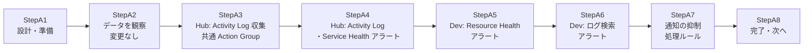

# 追加レクチャー 監視・アラート編 - Activity Log / Resource Health / メトリック / ログ / アラートルール / Action Group

Azure の**「データを集める → 条件で検知する → 通知する」** 仕組みを、1 本の流れとして学ぶ追加レクチャーです（StepA1 〜 StepA8）。Phase4 で作った Log Analytics・Action Group・CPU アラートを土台に、**検知できる範囲を広げます**。

- 前提の手順書：[Phase4 監視編](GETTING_STARTED_Phase4.md)（Log Analytics / AMA / KQL / CPU アラート）、[Phase5 CI/CD 編](GETTING_STARTED_Phase5.md)（hub は CI で apply）
- 全体の目次：[GETTING_STARTED.md](GETTING_STARTED.md)
- 関連資料：[権限設計一覧](../01_Architecture/access-control-design.md)

> 📌 この手順書は Phase の進行とは別の**追加レクチャー**です。Step 番号は Phase の Step0〜43 と区別するため、`StepA1`〜`StepA8` としています。
> 📌 **スコープ**：この手順書では「収集 → ルール → Action Group → メール通知」までを作ります。**SRE エージェントとの連携は含みません**（StepA8 に、連携のために今のうちに整えておくことだけ書いています）。



---

## 進捗チェックリスト

- [ ] StepA1：設計を理解し、作業ブランチを作成する
- [ ] StepA2：Activity Log・Resource Health・メトリックを「見る」（変更なし・無料）
- [ ] StepA3：【Hub】Activity Log をワークスペースへ送り、共通の Action Group を作る
- [ ] StepA4：【Hub】Activity Log アラート（ロール割り当て・NSG 規則の変更）と Service Health アラートを追加する
- [ ] StepA5：【Dev】Resource Health アラートを追加し、「誤検知」を体験する
- [ ] StepA6：【Dev】ログ検索アラート（メモリ使用率）を追加する
- [ ] StepA7：【任意】アラート処理ルールで、特定の時間帯の通知を止める
- [ ] StepA8：完了させる（記録・PR・片付け）と、SRE エージェント連携の準備

---

### 完成イメージ

```text
┌────────────────────────── データの種類（何を集めるか）──────────────────────────┐
│ ① Activity Log   … サブスクリプションの「操作の記録」（誰が・いつ・何を作成/変更/削除したか） │
│ ② Resource Health … リソースが「使える状態か」（Azure 側の障害か、自分の操作か）          │
│ ③ Service Health  … Azure 自体の障害・計画メンテナンスのお知らせ                          │
│ ④ メトリック       … 数値の時系列（CPU 使用率など）。Azure が自動で取得                    │
│ ⑤ リソースログ・ゲストログ … Key Vault の監査ログ、VM 内の Perf / Syslog（Phase4 で作成済み）│
└────────────────────────────────────────────────────────────────────────────────┘
        │ 診断設定 / DCR（送る設定）                    │ 直接評価（ログに送らなくても使える）
        ▼                                              ▼
 log-acp-hub-jpe-001（Log Analytics）          Azure Monitor のアラートルール
        │ KQL で検索・集計                              │
        ▼                                              ▼
 ログ検索アラート ─────────────▶ Action Group（通知先）──▶ メール（のちに Webhook など）
```

Hub と Dev に置くものの内訳です。

```text
rg-acp-hub-jpe-001（Hub：サブスクリプション全体に関わる共通の監視）
├─ ag-acp-hub-jpe-001                  Action Group（共通の通知先）
├─ diag-acp-sub-activity-001           診断設定（サブスクリプションの Activity Log → ワークスペース）
├─ alert-acp-sub-role-assignment-001   Activity Log アラート：ロール割り当ての作成
├─ alert-acp-sub-nsg-rule-001          Activity Log アラート：NSG 規則の作成・変更
└─ alert-acp-sub-service-health-001    Service Health アラート：Azure の障害・メンテナンス

rg-acp-dev-jpe-001（Dev：Dev のリソースに紐づく監視）
├─ ag-acp-dev-jpe-001                  （Phase4 で作成済み）
├─ alert-acp-dev-vm-cpu-001            （Phase4 で作成済み）メトリックアラート
├─ alert-acp-dev-vm-health-001         Resource Health アラート：VM の状態
├─ alert-acp-dev-vm-memory-001         ログ検索アラート：メモリ使用率
└─ apr-acp-dev-night-001               アラート処理ルール（任意）：夜間の通知を止める
```

### この追加レクチャーで学ぶこと

| 概念 | 一言で言うと | なぜ必要か |
| --- | --- | --- |
| Activity Log | サブスクリプションに対する**操作の記録**（管理プレーン） | 「誰が NSG を変えたか」「いつロールが付いたか」を後から追える。Azure が自動で取得（90 日保存、無料） |
| Resource Health | リソースが**正常に使える状態か**を Azure が判定した結果 | 「自分の設定ミス」か「Azure 側の問題」かを切り分けられる |
| Service Health | Azure 全体の障害・メンテナンスの通知 | 自分のリソースの外側で起きた問題を知る |
| メトリック | 数値の時系列（軽くて、リアルタイムに近い） | しきい値の判定に向く。Agent 不要 |
| リソースログ / ゲストログ | イベントの詳細な記録（送る設定が必要） | 原因の調査に向く。KQL で検索できる |
| アラートルール | 「どのデータが・どの条件になったら」の定義 | 種類（メトリック / ログ検索 / Activity Log）で、見るデータと料金が違う |
| Action Group | 「誰に・どの手段で」通知するかの定義 | 複数のルールで使い回せる。メール・Webhook・Logic App などに対応 |
| アラート処理ルール | ルールの**外側**から、通知の抑制などを行う仕組み | ルールを変えずに、メンテナンス時間帯の通知だけを止められる |

> 💡 **この追加レクチャーの肝は「データの種類によって、使うアラートの種類が決まる」ことです。**
> 「何を検知したいか」から逆算して、「どのデータを見るべきか」「どのルールを使うか」を選べるようになるのがゴールです。

---

## StepA1：設計を理解し、作業ブランチを作成する

### データ → ルール → 通知の対応表

| 検知したいこと | 見るデータ | アラートルールの種類 | この手順書での例 |
| --- | --- | --- | --- |
| 誰かが権限・ネットワーク設定を変えた | Activity Log | **Activity Log アラート** | ロール割り当て、NSG 規則の変更（StepA4） |
| Azure 側の障害・メンテナンス | Service Health（Activity Log の一種） | **Activity Log アラート**（Service Health） | Japan East の障害（StepA4） |
| VM が使えない状態になった | Resource Health（Activity Log の一種） | **Activity Log アラート**（Resource Health） | VM の状態（StepA5） |
| CPU が高い | メトリック | **メトリックアラート** | Phase4 で作成済み |
| メモリが高い・ログに特定の記録が出た | Log Analytics のログ | **ログ検索アラート** | メモリ使用率（StepA6） |

> 💡 Service Health と Resource Health は、どちらも**カテゴリが違う Activity Log のイベント**です。そのため、アラートルールも Activity Log アラートの仲間になります。

### 作るリソースと置き場所

| リソース | 名前 | 環境 | 備考 |
| --- | --- | --- | --- |
| Action Group | `ag-acp-hub-jpe-001` | hub | サブスクリプション全体のアラート用。通知先は自分のメール |
| 診断設定（サブスクリプション） | `diag-acp-sub-activity-001` | hub | Activity Log をワークスペースへ送る |
| Activity Log アラート | `alert-acp-sub-role-assignment-001` | hub | ロール割り当ての作成 |
| Activity Log アラート | `alert-acp-sub-nsg-rule-001` | hub | NSG 規則の作成・変更 |
| Activity Log アラート（Service Health） | `alert-acp-sub-service-health-001` | hub | Japan East の障害・メンテナンス |
| Activity Log アラート（Resource Health） | `alert-acp-dev-vm-health-001` | dev | VM の状態 |
| ログ検索アラート | `alert-acp-dev-vm-memory-001` | dev | メモリ使用率 |
| アラート処理ルール（任意） | `apr-acp-dev-night-001` | dev | 夜間の通知抑制 |

> ⚠️ CAF（Cloud Adoption Framework）の略称に明確な定義がないものがあります（アラート処理ルールなど）。上記は**暫定の命名**です。StepA8 で CLAUDE.md の命名規則に追記します。

### 設計の判断（なぜこの構成か）

| 判断 | 内容 | 理由 |
| --- | --- | --- |
| サブスクリプション全体の監視は **Hub** に置く | Activity Log の診断設定・ロール/NSG/Service Health のアラートは hub | 特定の環境（dev / test）に属さず、**サブスクリプション全体**を見るため。Phase4 の「監視は共通サービス」の考え方と同じ |
| Dev のリソースに紐づく監視は **Dev** に置く | Resource Health・メモリのアラートは dev | 「リソースが消えるときは、一緒に消えるべきものは同じ State に置く」（Phase4 の方針） |
| Action Group を **hub と dev で別々に持つ** | `ag-acp-hub-jpe-001` と `ag-acp-dev-jpe-001` | 通知先を「共通」と「環境別」に分ける練習。実務では、環境ごとに別のチームへ通知するのが普通 |
| Action Group に **Common alert schema を有効化** | `use_common_alert_schema = true`（hub の新規分） | アラートの種類（メトリック / ログ / Activity Log）が違っても、通知の形式が統一される。**のちに SRE エージェントなどへ連携するときに必須級**（StepA8） |
| 通知は**メールのみ** | Webhook / Logic App は今回使わない | 目的は仕組みの理解。外部連携は、SRE エージェント編で追加する |
| hub は **PR → CI の承認付き apply**、dev は**自宅 PC で apply** | PR を 2 本に分ける（hub 用・dev 用） | Phase5 の CI の動きを、実際の変更で体験できる。dev は Phase5 の方針どおり自宅 PC |
| Resource Health アラートは**「Azure 側の原因」だけ**を通知対象にする | `reason = ["PlatformInitiated"]` | VM は毎晩 23:00 に自動停止する。これを通知すると**毎晩誤検知**になる。StepA5 で、あえてこの設定を外して体験する |
| ログ検索アラートは **15 分間隔・1 本だけ** | メモリ使用率のみ | ログ検索アラートは、メトリックアラートより料金が高い。評価頻度を上げるほど高くなる |

> 💡 **hub / dev の分け方のコツ**：「このアラートは、特定の環境の持ち物か？」で考えます。サブスクリプション全体に対する設定は、特定の環境に属さないため、共通サービスの hub に置きます。

### コストの目安（Japan East・月額）

| リソース | 月額の目安 | 備考 |
| --- | --- | --- |
| Activity Log の保存（既定の 90 日） | 無料 | 何もしなくても取得されている |
| Activity Log の診断設定（ワークスペースへ送信） | 約 0 円 | 取り込み量は少ない（数 MB 程度の見込み）。Phase4 の無料枠（月 5GB）内。`daily_quota_gb = 0.5` の上限もある |
| Activity Log アラート ×4（ロール・NSG・Service Health・Resource Health） | **無料** | Activity Log アラートは課金されない |
| ログ検索アラート ×1（15 分間隔） | 約 100〜500 円 | 評価頻度や構成で変わる。**今回の中で一番高い**。不要になったら `destroy` か無効化 |
| Action Group（メール通知） | 無料 | 月 1,000 通まで |
| アラート処理ルール | 無料 | |
| **この追加レクチャーで増える合計** | **約 100〜600 円** | 目標（月 5,000 円以内）への影響は小さい |

> ✅ VPN Gateway / Azure Firewall / Bastion のような高額リソースは作りません。
> 💡 金額は為替や価格改定で変わります。正確な値は [Azure Monitor の料金ページ](https://azure.microsoft.com/ja-jp/pricing/details/monitor/) と、[料金計算ツール](https://azure.microsoft.com/ja-jp/pricing/calculator/) で確認してください。**特にログ検索アラートの料金は、作る前に必ず確認**してください。

### 必要な権限

| 作業 | 使う ID | 権限 |
| --- | --- | --- |
| 手元の `terraform apply`（dev）、`az` の確認 | 自分 | Owner で足りる |
| CI の `terraform apply`（hub） | `app-acp-github-apply-001` | Contributor で足りる（診断設定・アラート・Action Group の作成は含まれる） |
| CI の `terraform plan`（hub / dev） | `app-acp-github-plan-001` | Reader で足りる |
| Portal / KQL でログを検索する | 自分 | Owner で足りる |

> 💡 Reader は、アラートルールの**参照**はできますが、作成はできません。これは Phase5 の設計どおりです。

### 作業ブランチを作成

PR を 2 本に分けます（hub は CI で apply、dev は自宅 PC で apply するため）。**まず hub 用**のブランチを作ります。

```powershell
git checkout main
git pull origin main
git checkout -b feature/extra-alerting-hub
```

> 💡 Phase5 の完了後に `main` が最新になっているはずです。`git status` で、未コミットの変更が無いことを確認してから始めてください。

---

## StepA2：Activity Log・Resource Health・メトリックを「見る」

### なぜ必要か

アラートは「データを見て、条件を判定する」仕組みです。**どんなデータが流れているのかを先に知らないと、条件を決められません。** この Step は、**何も変更せず、料金もかかりません**（読み取りのみ）。

### 1. Activity Log を見る（Portal）

1. Azure Portal の検索で **アクティビティ ログ** を開く
2. 期間を「過去 24 時間」にして、次のイベントを探す
   - 直近の `terraform apply` による **「リソース グループの作成または更新」**
   - **「ロール割り当ての作成」** など

| 列 | 意味 |
| --- | --- |
| 操作名 | 何をしたか |
| 状態 | `開始済み` → `成功`（または `失敗`）の順に記録される |
| 開始者（caller） | 誰が実行したか。人間のメール、または CI 用の ID（アプリ登録のオブジェクト ID）が出る |
| イベント開始者 | ポータル / CLI / Terraform などの経路が分かることもある |

3. イベントをクリックし、**JSON** タブを開く。`caller`・`operationName`・`status`・`category` を確認する

```powershell
# CLI（読み取りのみ）：dev の Resource Group の直近 1 日の操作
az monitor activity-log list --resource-group rg-acp-dev-jpe-001 --offset 1d `
  --query "[].{time:eventTimestamp, op:operationName.value, status:status.value, caller:caller}" -o table
```

> 💡 1 つの操作で、`Started`（開始）と `Succeeded`（成功）の 2 件が記録されることがあります。アラートでは「成功した」ことを条件にします（StepA4）。
> 💡 **`caller` に表示される CI 用の ID は、GUID（オブジェクト ID）です。** 先ほどの「クライアント ID とオブジェクト ID の違い」を思い出すと、**サービスプリンシパルのオブジェクト ID** が出ていると分かります。

### 2. Activity Log のカテゴリを知る

| カテゴリ | 中身 | この手順書での使い道 |
| --- | --- | --- |
| Administrative | 作成・更新・削除・アクションの操作 | ロール・NSG の変更アラート（StepA4） |
| ServiceHealth | Azure の障害・メンテナンス | Service Health アラート（StepA4） |
| ResourceHealth | リソースの状態（Available / Unavailable など） | Resource Health アラート（StepA5） |
| Alert | 発火したアラートの記録 | 「いつ何が鳴ったか」の記録 |
| Security | Defender for Cloud のアラート | 今回は使わない |
| Policy / Autoscale / Recommendation | ポリシー・自動スケール・推奨事項 | 今回は使わない |

### 3. Resource Health を見る（Portal）

1. Azure Portal で `vm-acp-dev-001` を開く
2. 左メニューの **ヘルスの監視 → リソース正常性**（Resource health）を開く

| 状態 | 意味 |
| --- | --- |
| 利用可能（Available） | 正常 |
| 利用不可（Unavailable） | 使えない。**理由**として「ユーザーによる開始（停止・再起動など）」か「プラットフォームによる開始（Azure 側の問題）」かが出る |
| 低下（Degraded） | 動いているが性能が落ちている |
| 不明（Unknown） | 状態が取れない |

> 💡 毎晩の自動シャットダウン後は、「利用不可（ユーザーによる開始）」の履歴が残っているはずです。**これが StepA5 で誤検知の原因になります。**

```powershell
# CLI（読み取りのみ）：VM の現在の正常性
$VM_ID = az vm show -g rg-acp-dev-jpe-001 -n vm-acp-dev-001 --query id -o tsv
az rest --method get `
  --url "https://management.azure.com$VM_ID/providers/Microsoft.ResourceHealth/availabilityStatuses/current?api-version=2022-10-01" `
  --query "properties.{status:availabilityState, summary:summary, reason:reasonType}"
```

### 4. メトリックを見る（Portal / CLI）

1. `vm-acp-dev-001` →「監視 → メトリック」
2. メトリックに **Percentage CPU**、集計に **平均** を選ぶ

```powershell
# CLI（読み取りのみ）：過去 1 時間の CPU（5 分間隔・平均）
az monitor metrics list --resource $VM_ID --metric "Percentage CPU" `
  --interval PT5M --offset 1h --aggregation Average -o table
```

> 💡 **メトリックとログの使い分け**（Phase4 の復習）
> - メトリック：Azure が自動で取る・軽い・しきい値判定に向く（Agent 不要）
> - ログ：詳細な記録・原因調査に向く（送る設定が必要）
>
> **VM の中のメモリ使用率**は、Azure の外からは見えません（ゲスト OS の中の値）。そのため、Phase4 で入れた Agent（AMA）が `Perf` テーブルに送った**ログ**から取ります。これが StepA6 で「メトリックではなくログ検索アラートを使う」理由です。

### 5. 診断設定の一覧を見る

```powershell
# サブスクリプションの診断設定（今は無いはず）
$SUB_ID = az account show --query id -o tsv
az monitor diagnostic-settings subscription list --subscription $SUB_ID -o table

# Key Vault の診断設定（Phase4 で作成済み）
$KV_ID = az keyvault show -n kv-acp-dev-jpe-001 --query id -o tsv
az monitor diagnostic-settings list --resource $KV_ID --query "value[].{name:name, workspace:workspaceId}" -o table
```

**確認ポイント**
- [ ] Activity Log で、自分の操作と、CI 用 ID（GUID 表示）の操作を見分けられた
- [ ] Resource Health で、VM の状態と、停止の「理由」の欄を確認した
- [ ] メトリックで、VM の CPU のグラフを確認した
- [ ] サブスクリプションの診断設定が、まだ無いことを確認した（StepA3 で作ります）

> ⚠️ ここで表示された**サブスクリプション ID は、チャットや GitHub に貼らないでください**（CLAUDE.md の機密情報ルール）。

---

## StepA3：【Hub】Activity Log をワークスペースへ送り、共通の Action Group を作る

### なぜ必要か

Activity Log は、**既定で 90 日保存**されますが、次のことはできません。

| できないこと | 診断設定でワークスペースへ送ると |
| --- | --- |
| KQL で自由に検索・集計する | できる（`AzureActivity` テーブル） |
| 90 日より長く保存する | ワークスペースの保持期間（30 日〜）に従う |
| 他のログ（VM・Key Vault）と突き合わせる | できる |

また、サブスクリプション全体のアラートの通知先として、**共通の Action Group** を hub に作ります。

```text
サブスクリプションの Activity Log ── 診断設定 ──▶ log-acp-hub-jpe-001（AzureActivity）
```

> 💡 **診断設定は、リソースだけでなく「サブスクリプション」にも付けられます。** サブスクリプションに付ける場合の診断設定は、Activity Log を送るためのものです。

### 1. 変数を追加する — `environments/hub`

hub にはまだ `alert_email` がありません。dev と同じ変数を追加します。

`variables.tf`（追記）

```hcl
variable "alert_email" {
  description = "アラートの通知先メールアドレス"
  type        = string
}
```

`terraform.tfvars`（追記。コミットしない）と `terraform.tfvars.example`（値を伏せて追記）

```hcl
# terraform.tfvars
alert_email = "自分のメールアドレス"

# terraform.tfvars.example
alert_email = "your-name@example.com"
```

> ⚠️ `terraform.tfvars` の内容をチャットに貼らないでください。

### 2. CI の apply 用ワークフローにも変数を渡す

**重要：この修正を忘れると、main へのマージ後の CI の apply が失敗します。**

`terraform-plan.yml` は、すでに `TF_VAR_alert_email` を渡しています。一方、`terraform-apply-env.yml` は渡していません。変数に値が無いと、`-input=false` のため、`No value for required variable` で止まります。

`.github/workflows/terraform-apply-env.yml`（`env:` に 1 行追記）

```yaml
    env:
      ARM_USE_OIDC: "true"
      ARM_CLIENT_ID: ${{ secrets.AZURE_APPLY_CLIENT_ID }}
      ARM_TENANT_ID: ${{ secrets.AZURE_TENANT_ID }}
      ARM_SUBSCRIPTION_ID: ${{ secrets.AZURE_SUBSCRIPTION_ID }}
      TF_VAR_subscription_id: ${{ secrets.AZURE_SUBSCRIPTION_ID }}
      TF_VAR_alert_email: ${{ secrets.ALERT_EMAIL }}   # ← 追記（hub の Action Group で使う）
```

> 💡 `ALERT_EMAIL` は、Phase5 Step40 で GitHub Secrets に登録済みです（plan 用）。apply 用にも同じ Secret を使えます。

### 3. コードを追加する — `environments/hub/monitoring.tf`（新規）

```hcl
# 現在のサブスクリプションの情報（ID の取得に使う）
data "azurerm_subscription" "current" {}

# サブスクリプション全体のアラートの通知先（共通）
resource "azurerm_monitor_action_group" "main" {
  name                = "ag-acp-hub-jpe-001"
  resource_group_name = module.rg.name
  short_name          = "acp-hub" # メール・SMS の表示用の短い名前（12 文字以内）
  tags                = local.common_tags

  email_receiver {
    name          = "owner"
    email_address = var.alert_email

    # 共通アラートスキーマ：メトリック・ログ・Activity Log の通知を、同じ形式の JSON にそろえる。
    # のちに Webhook などで外部へ連携するときに、受け取る側の処理が 1 種類で済む
    use_common_alert_schema = true
  }
}

locals {
  # ワークスペースへ送る Activity Log のカテゴリ。取りすぎると課金が増えるので、必要なものに絞る
  activity_log_categories = [
    "Administrative",  # 作成・変更・削除などの操作
    "Security",        # Defender for Cloud のアラート
    "ServiceHealth",   # Azure の障害・メンテナンス
    "ResourceHealth",  # リソースの状態
    "Alert",           # 発火したアラートの記録
  ]
}

# サブスクリプションの Activity Log をワークスペースへ送る
resource "azurerm_monitor_diagnostic_setting" "activity_log" {
  name                       = "diag-acp-sub-activity-001"
  target_resource_id         = data.azurerm_subscription.current.id
  log_analytics_workspace_id = module.log_analytics.id

  dynamic "enabled_log" {
    for_each = toset(local.activity_log_categories)
    content {
      category = enabled_log.value
    }
  }
}
```

| 部分 | 意味 |
| --- | --- |
| `data "azurerm_subscription"` | いま接続しているサブスクリプションの情報を読む。ID をコードに直接書かずに済む（CLAUDE.md の「ID をコードに書かない」） |
| `use_common_alert_schema = true` | 通知の JSON 形式を共通化する設定 |
| `dynamic "enabled_log"` | リストの要素の数だけ `enabled_log` ブロックを作る。カテゴリを足したいときは、リストに 1 行足すだけで済む |

```powershell
cd environments/hub
terraform fmt -recursive
terraform validate
terraform plan       # 「2 to add, 0 to change, 0 to destroy」になることを確認
```

| 区分 | 内容 |
| --- | --- |
| 追加（2） | Action Group、診断設定（サブスクリプションの Activity Log） |

> ⚠️ **ここでは `terraform apply` をしません。** hub は CI で apply します。StepA4 の分と合わせて、1 本の PR にします。

---

## StepA4：【Hub】Activity Log アラートと Service Health アラートを追加する

### なぜ必要か

StepA3 で、Activity Log を**検索できる**ようになりました。次は、**重要な操作があったときに、自動で通知**されるようにします。

| アラート | 検知する操作 | なぜ重要か |
| --- | --- | --- |
| ロール割り当て | `Microsoft.Authorization/roleAssignments/write` | 権限が増えた。[権限設計一覧](../01_Architecture/access-control-design.md)の台帳と違う付与がされていないかの気づきになる |
| NSG 規則 | `Microsoft.Network/networkSecurityGroups/securityRules/write` | CLAUDE.md の方針（SSH は自宅 IP のみ、Any 開放しない）が崩れていないかの気づきになる |
| Service Health | Azure の障害・メンテナンス（Japan East） | 自分のせいではない問題を、早く知る |

> 💡 **これは「検知」であって「防止」ではありません。** 操作そのものを止めるのは、Azure Policy や RBAC の役割です。Activity Log アラートは、「起きたことに気づく」仕組みです。

### 1. コードを追加する — `environments/hub/monitoring.tf`（追記）

```hcl
# ロール割り当ての作成を通知（権限の変更に気づく）
resource "azurerm_monitor_activity_log_alert" "role_assignment" {
  name                = "alert-acp-sub-role-assignment-001"
  resource_group_name = module.rg.name
  location            = "global" # Activity Log アラートは特定のリージョンに属さないため、固定で global を指定する
  scopes              = [data.azurerm_subscription.current.id] # サブスクリプション全体を監視
  description         = "ロール割り当てが作成された"
  tags                = local.common_tags

  criteria {
    category       = "Administrative"
    operation_name = "Microsoft.Authorization/roleAssignments/write"
    status         = "Succeeded" # 開始（Started）ではなく、成功したときだけ通知する
  }

  action {
    action_group_id = azurerm_monitor_action_group.main.id
  }
}

# NSG のセキュリティ規則の作成・変更を通知（ネットワーク方針の逸脱に気づく）
resource "azurerm_monitor_activity_log_alert" "nsg_rule" {
  name                = "alert-acp-sub-nsg-rule-001"
  resource_group_name = module.rg.name
  location            = "global"
  scopes              = [data.azurerm_subscription.current.id]
  description         = "NSG のセキュリティ規則が作成または変更された"
  tags                = local.common_tags

  criteria {
    category       = "Administrative"
    operation_name = "Microsoft.Network/networkSecurityGroups/securityRules/write"
    status         = "Succeeded"
  }

  action {
    action_group_id = azurerm_monitor_action_group.main.id
  }
}

# Azure 側の障害・計画メンテナンスを通知（自分の設定のせいではない問題を早く知る）
resource "azurerm_monitor_activity_log_alert" "service_health" {
  name                = "alert-acp-sub-service-health-001"
  resource_group_name = module.rg.name
  location            = "global"
  scopes              = [data.azurerm_subscription.current.id]
  description         = "Japan East の Azure 障害・メンテナンス"
  tags                = local.common_tags

  criteria {
    category = "ServiceHealth"

    service_health {
      events    = ["Incident", "Maintenance"] # 障害と計画メンテナンス
      locations = ["Japan East", "Global"]
      # services を省略すると、すべての Azure サービスが対象になる
    }
  }

  action {
    action_group_id = azurerm_monitor_action_group.main.id
  }
}
```

| 部分 | 意味 |
| --- | --- |
| `location = "global"` | **必須の引数**。Activity Log アラートは特定のリージョンに属さないため、`global` を指定する（省略すると `Missing required argument` で `validate` が失敗する） |
| `scopes` | どの範囲の Activity Log を見るか。サブスクリプションの ID を指定すると、**サブスクリプション内のすべてのリソース**が対象 |
| `criteria` | 「どのカテゴリの、どの操作が、どの状態になったら」の条件。複数書くと**すべてを満たしたときだけ**発火する（AND） |
| `status = "Succeeded"` | 同じ操作で、開始・成功の 2 件が記録されるため、成功だけを対象にして、通知の重複を防ぐ |
| `service_health` | Service Health 専用の条件。サービスやリージョンを絞れる |

> 💡 **このアラートが反応するのは、「ロール割り当てが実際に書き込まれたとき」だけです。** CI の `plan` や、差分の無い `apply`、ロール割り当てを持たない hub / test の `apply` では、鳴りません。鳴るのは、たとえば手元の dev の `terraform apply` で `azurerm_role_assignment` が**作成**されたとき（作り直しの場合も、作成の操作で鳴る）や、`az` / Portal で手動で付けたときです。「正しい操作でも通知が来る」のは、このタイプのアラートの特徴です。**自分の予定した操作なのか、そうでないのかを、通知を見て判断する**運用になります。通知が多すぎる場合の対処は、StepA7 で学びます。

```powershell
cd environments/hub
terraform fmt -recursive
terraform validate
terraform plan       # 「5 to add, 0 to change, 0 to destroy」になることを確認（StepA3 の 2 件 + 3 件）
```

| 区分 | 内容 |
| --- | --- |
| 追加（5） | Action Group、診断設定、Activity Log アラート ×3（ロール・NSG・Service Health） |

### 2. PR を作成し、CI の plan を確認する

```powershell
git add .
git status   # terraform.tfvars・*.tfstate が含まれていないことを確認
git commit -m "feat: hub に Activity Log の収集と Activity Log アラートを追加"
git push origin feature/extra-alerting-hub
gh pr create --title "追加レクチャー: Hub に Activity Log の収集とアラートを追加" --body "サブスクリプションの Activity Log をワークスペースへ送り、ロール・NSG・Service Health のアラートを追加"
```

> ⚠️ `git push` の前に、内容を確認してから実行してください。

**確認ポイント（GitHub）**
- [ ] `fmt` と `plan (hub)` が成功している
- [ ] `plan (hub)` のサマリーが **「追加 5 / 変更 0 / 削除 0」** になっている
- [ ] `plan (test)` と `plan (dev)` に、意図しない差分が出ていない

### 3. マージして、承認付き apply を実行する

1. PR を `main` にマージする
2. Actions の `terraform-apply` が起動する。**`apply (hub)` が承認待ち**になる
3. 内容（追加 5 件）を確認して **Approve**
4. `apply (hub)` が成功することを確認する（`test` の apply は、差分がなければ `No changes` で終わる）

> 💡 Phase5 の「承認の関所」を、実際の変更で通る体験です。`削除または作り直し：0 件` と出ていることも確認してください。

### 4. 動作確認

**① Activity Log が検索できる（KQL）**

診断設定が有効になってから、**ログが届くまで 5〜15 分ほど**かかります。Portal で `log-acp-hub-jpe-001` →「ログ」を開きます。

```kusto
AzureActivity
| where TimeGenerated > ago(1d)
| where CategoryValue == "Administrative"
| project TimeGenerated, Caller, OperationNameValue, ActivityStatusValue, ResourceGroup
| order by TimeGenerated desc
```

> 💡 `ActivityStatusValue` の値の表記（`Success` / `Succeeded` など）は、アラートルール側の `status` と**表記が異なる場合があります**。`AzureActivity | distinct ActivityStatusValue` で実際の値を確認してください。

誰が何をしたかを集計してみます。

```kusto
AzureActivity
| where TimeGenerated > ago(7d)
| where CategoryValue == "Administrative" and ActivityStatusValue in ("Success", "Succeeded")
| summarize 回数 = count() by Caller, OperationNameValue
| order by 回数 desc
```

**② Action Group の通知経路をテストする**

Portal の `ag-acp-hub-jpe-001` を開き、**テスト**（テスト アクション グループ）を実行します。サンプルの種類は何でもよいです。**メールが届けば、通知の経路は正常**です。

> 💡 「ルールが発火しない」のか「通知が届かない」のかを切り分けるために、**経路だけ先にテストしておく**と調査が楽になります。

**③ ロール割り当てアラートを発火させる**

**自分自身に、`Reader` を hub の Resource Group へ付けて、すぐ削除します**（影響のない操作です。すでに Owner なので、権限は変わりません）。

> ⚠️ **この `az` コマンドは Azure を直接変更します**（CLAUDE.md により、実行前に内容を確認してください）。

```powershell
$ME = az ad signed-in-user show --query id -o tsv
$RG_ID = az group show -n rg-acp-hub-jpe-001 --query id -o tsv

# 作成（アラートが発火する）
az role assignment create --assignee-object-id $ME --assignee-principal-type User --role "Reader" --scope $RG_ID

# 数分待ってから、メールが届いたことを確認する。その後で、削除して元に戻す
az role assignment delete --assignee $ME --role "Reader" --scope $RG_ID
```

数分後（Activity Log アラートは、通常 **数分以内**）に、メールが届けば成功です。

| 確認する場所 | 内容 |
| --- | --- |
| メール | `alert-acp-sub-role-assignment-001` の通知。**共通アラートスキーマ**の形式で、本文に操作の情報が入る |
| Portal →「監視 → アラート」 | 発火したアラートの一覧。**重大度**・**監視条件**（Fired）・**アラートの状態**（New）が見える |
| KQL | `AzureActivity | where OperationNameValue =~ "Microsoft.Authorization/roleAssignments/write"` で、同じ操作の記録が検索できる |

> 💡 **「監視条件」と「アラートの状態」は別物です。**
> - **監視条件**：Fired（条件を満たしている）／ Resolved（条件が解消した）。Azure が自動で判定する
> - **アラートの状態**：New → Acknowledged → Closed。**人が**対応状況を管理するための値
>
> Activity Log アラートは「1 回起きたイベント」なので、自動で Resolved にならないことがあります。

> 💡 NSG 規則のアラートも、仕組みは同じです。試したい場合は、dev の NSG に一時的な規則を追加して apply します（発展課題。やる場合は、終わったら必ず削除する）。

### 確認結果のまとめ

- [ ] CI の `plan (hub)` が「追加 5」で成功し、承認付きの `apply (hub)` が成功した
- [ ] `AzureActivity` を KQL で検索できた
- [ ] Action Group の「テスト」で、メールが届いた
- [ ] ロール割り当てのアラートで、メールが届いた（テストの `Reader` は削除した）

### トラブルシューティング

| 症状 | 原因と対処 |
| --- | --- |
| CI の apply が `No value for required variable alert_email` で失敗 | StepA3-2 の `terraform-apply-env.yml` への追記を忘れている。追記して再度マージ（または再実行） |
| `AzureActivity` に何も出ない | 診断設定を作ってから 5〜15 分かかる。それでも出ない場合は、`az monitor diagnostic-settings subscription list` で、設定とカテゴリを確認。ワークスペースの日次上限（`daily_quota_gb`）に達していないかも確認 |
| ロール割り当てのアラートが発火しない | ① `status` の値（`Succeeded`）、`operation_name` の綴りを確認 ② メールの迷惑メールフォルダを確認 ③ Portal の「アラート」に履歴があれば、ルールは発火していて、通知経路の問題 |
| 通知が 2 通以上届く | 同じ操作に対して、複数のアラートルールが一致している、または Action Group にメールが重複して登録されている |
| `apply` で、`AuthorizationFailed`（診断設定・アラート） | CI 用の apply ID の権限不足。Contributor が付いているか確認する（[権限設計一覧](../01_Architecture/access-control-design.md)） |
| 診断設定が「すでに存在する」と言われる | 1 つのサブスクリプションに付けられる診断設定の数には上限がある。Portal で既存の設定がないか確認する |
| `terraform plan` で、`data.azurerm_subscription` の読み取りに失敗する | `subscription_id` の設定ミス。`terraform.tfvars` と、CI の Secrets を確認する |

---

## StepA5：【Dev】Resource Health アラートを追加し、「誤検知」を体験する

### なぜ必要か

Resource Health は、「VM が使えない状態か」を Azure が判定した結果です。これをアラートにすると、**「自分の操作ではなく、Azure 側の問題で VM が止まった」** ときに気づけます。

ただし、そのまま使うと、**毎晩の自動シャットダウン（23:00）で、毎晩通知が来る**問題があります。ここでは、**まず正しい設計で作り、次に「あえて誤検知を起こす」** ことで、フィルタの意味を体験します。

```text
23:00 自動シャットダウン → VM が停止 → Resource Health:「利用不可（ユーザーによる開始）」
                                              │
              reason に UserInitiated を含める ──▶ 毎晩メールが届く（誤検知）
              PlatformInitiated だけにする ───▶ Azure 側の問題のときだけ届く（正しい）
```

> 💡 **Phase4 の「Heartbeat が来ない」ログアラートを作らなかった理由と、同じ問題です。** 「止まっていること」と「止まるべきでないのに止まったこと」は、別のものです。

### 1. ブランチを作る

hub の PR が `main` にマージされ、apply が済んでいることを確認してから、**dev 用**のブランチを作ります。

```powershell
git checkout main
git pull origin main
git checkout -b feature/extra-alerting-dev
```

### 2. コードを追加する — `environments/dev/monitoring.tf`（追記）

まず、**誤検知が起きる設定**（実験用）で作ります。

```hcl
# VM の正常性が悪化したときに通知（Resource Health）
resource "azurerm_monitor_activity_log_alert" "vm_health" {
  name                = "alert-acp-dev-vm-health-001"
  resource_group_name = module.rg.name
  location            = "global"
  scopes              = [module.vm.id]
  description         = "VM の正常性（Resource Health）が低下・利用不可になった"
  tags                = local.common_tags

  criteria {
    category = "ResourceHealth"

    resource_health {
      current = ["Degraded", "Unavailable"] # 現在の状態：低下・利用不可
      # 【実験用】ユーザー操作（停止など）も含める。確認後、PlatformInitiated だけに戻す
      reason = ["PlatformInitiated", "UserInitiated"]
    }
  }

  action {
    action_group_id = azurerm_monitor_action_group.main.id # Phase4 で作成済みの dev の Action Group
  }
}
```

| 部分 | 意味 |
| --- | --- |
| `current` | 通知する「現在の状態」。`Available`（正常）は含めない |
| `reason` | 状態が変わった**原因**。`PlatformInitiated`（Azure 側）／ `UserInitiated`（ユーザー操作）／ `Unknown` |

```powershell
cd environments/dev
terraform fmt -recursive
terraform validate
terraform plan       # 「1 to add, 0 to change, 0 to destroy」になることを確認
```

内容を確認したら `terraform apply` を実行します。

### 3. 誤検知を発生させる（実験）

VM を停止します（毎晩の自動シャットダウンと同じ状態にする操作です）。

> ⚠️ **この `az` コマンドは Azure を直接操作します**（CLAUDE.md により、実行前に確認してください）。VM の停止は、課金を止める操作で、いつもの運用です。

```powershell
az vm deallocate -g rg-acp-dev-jpe-001 -n vm-acp-dev-001
```

数分後に、**「利用不可」のアラートメール**が届けば、誤検知を体験できました。Portal の Resource Health では、**理由が「ユーザーによる開始」** になっているはずです。

> 💡 通知は、Resource Health のイベントが記録されてから、数分以内に届きます。届かない場合は、VM のリソース正常性の画面で、イベントが出ているかを確認してください。

### 4. 正しい設計に戻す

`reason` を、Azure 側が原因のときだけにします。

```hcl
      reason  = ["PlatformInitiated"] # Azure 側が原因のときだけ通知。毎晩の自動停止は通知しない
```

```powershell
terraform plan       # 「0 to add, 1 to change, 0 to destroy」になることを確認
terraform apply
```

VM を起動し直します。

```powershell
az vm start -g rg-acp-dev-jpe-001 -n vm-acp-dev-001
```

> 💡 **「`reason` を絞る」と「処理ルールで抑制する」の 2 つの方法があります。** 違いは StepA7 で比較します。

### 確認結果のまとめ

- [ ] 実験用の設定で、VM の停止に対するアラートのメールが届いた（誤検知を体験した）
- [ ] Resource Health の「理由」が、`ユーザーによる開始` になっていることを確認した
- [ ] `reason = ["PlatformInitiated"]` に戻して `apply` した
- [ ] VM を起動し直した

### トラブルシューティング

| 症状 | 原因と対処 |
| --- | --- |
| 停止してもメールが来ない | ① `reason` に `UserInitiated` を含めているか ② `current` に `Unavailable` を含めているか ③ Portal の Resource Health にイベントが出ているか ④ 迷惑メールを確認 |
| `terraform apply` で `scopes` に関するエラー | `module.vm.id` が VM の ID を返しているかを確認 |
| メールが届くのが遅い | Resource Health のイベント記録とアラートの発火には、数分の遅れがある。10 分以上経っても来なければ、上記の確認へ |

---

## StepA6：【Dev】ログ検索アラート（メモリ使用率）を追加する

### なぜ必要か

CPU はメトリックで取れますが、**VM の中のメモリ使用率は、Azure の外から見えません。** Phase4 で、Agent（AMA）が `Perf` テーブルに送っているログから、条件を判定します。これが**ログ検索アラート**です。

```text
VM のメモリ使用率 ─ AMA ─▶ Perf テーブル（ワークスペース）
                                  │ 15 分ごとに KQL を実行
                                  ▼
                    「条件に合う行が 1 行以上あるか」を判定 ─▶ Action Group ─▶ メール
```

| 比較 | メトリックアラート | ログ検索アラート |
| --- | --- | --- |
| 判定するもの | 数値の時系列 | **KQL の実行結果（行数など）** |
| 柔軟さ | 決まったメトリックのみ | **KQL で自由に条件を書ける** |
| 遅延 | 小さい（数分） | 大きい（ログの取り込み遅延 3〜5 分 ＋ 評価間隔） |
| 料金 | 安い | **高い**（評価頻度で変わる） |
| 向いている用途 | CPU・ディスクなど、数値で判断できるもの | ログの内容・複数の条件・集計が必要なもの |

> 💡 **使い分けのコツ**：メトリックで取れるなら、メトリックアラートを使う（安くて速い）。メトリックに無いものだけ、ログ検索アラートにする。

### 1. KQL を先に動かして、データを確認する

アラートに書く前に、**同じ KQL を Portal のログ画面で実行**します（アラートのクエリは、まず手で動かして確認する習慣をつけます）。

```kusto
Perf
| where ObjectName == "Memory" and CounterName == "% Used Memory"
| where Computer == "vm-acp-dev-001"
| summarize UsedPercent = avg(CounterValue) by Computer, bin(TimeGenerated, 5m)
| order by TimeGenerated desc
```

> ⚠️ VM が停止中だと、データは増えません。起動してから 10 分ほど後に実行してください。
> 💡 通常の使用で、`UsedPercent` がどれくらいかを確認します。そのうえで、**しきい値は、通常より少し高い値**にします（今回は 85%）。

### 2. コードを追加する — `environments/dev/monitoring.tf`（追記）

```hcl
locals {
  # メモリ使用率のしきい値（%）。テスト時に一時的に下げる
  vm_memory_threshold_percent = 85
}

# VM のメモリ使用率が高いときに通知（ログ検索アラート）
resource "azurerm_monitor_scheduled_query_rules_alert_v2" "vm_memory" {
  name                = "alert-acp-dev-vm-memory-001"
  resource_group_name = module.rg.name
  location            = module.rg.location
  description         = "VM のメモリ使用率（5 分平均）がしきい値を超えた"
  severity            = 3 # 0（重大）〜 4（情報）。CPU（2）より一段低く
  tags                = local.common_tags

  scopes               = [data.azurerm_log_analytics_workspace.hub.id] # クエリを実行する対象（ワークスペース）
  evaluation_frequency = "PT15M"                                       # 15 分ごとに実行（頻度を上げると料金が上がる）
  window_duration      = "PT15M"                                       # 直近 15 分のデータを対象にする

  criteria {
    # 「しきい値を超えた行だけ」を返す。行が 1 行以上あれば発火する
    query = <<-KQL
      Perf
      | where ObjectName == "Memory" and CounterName == "% Used Memory"
      | where Computer == "vm-acp-dev-001"
      | summarize UsedPercent = avg(CounterValue) by Computer, bin(TimeGenerated, 5m)
      | where UsedPercent > ${local.vm_memory_threshold_percent}
    KQL

    time_aggregation_method = "Count" # 結果の「行数」で判定する
    operator                = "GreaterThan"
    threshold               = 0 # 0 行より多い（= 1 行以上）で発火

    failing_periods {
      minimum_failing_periods_to_trigger_alert = 1 # 1 回でも条件を満たしたら発火
      number_of_evaluation_periods             = 1
    }
  }

  action {
    action_groups = [azurerm_monitor_action_group.main.id]
  }
}
```

| 部分 | 意味 |
| --- | --- |
| `scopes` | クエリの実行対象。**ワークスペース**を指定する |
| `evaluation_frequency` | クエリを実行する間隔 |
| `window_duration` | クエリが見る時間の幅 |
| `time_aggregation_method = "Count"` ＋ `threshold = 0` | 「条件に合う行が 1 行でもあれば発火」という書き方。クエリ側で**条件に合う行だけを返す**のがコツ |
| `failing_periods` | 「何回連続で条件を満たしたら発火するか」。一瞬のスパイクで鳴らさないために、数を増やす調整ができる |
| `<<-KQL ... KQL` | 複数行の文字列（ヒアドキュメント）。`${...}` で変数を埋め込める |

```powershell
cd environments/dev
terraform fmt -recursive
terraform validate
terraform plan       # 「1 to add, 0 to change, 0 to destroy」になることを確認
```

> ⚠️ **ログ検索アラートは、料金が発生します**（目安は上記）。`apply` の前に、[Azure Monitor の料金ページ](https://azure.microsoft.com/ja-jp/pricing/details/monitor/)で、評価頻度ごとの料金を確認してください。

内容を確認したら `terraform apply` を実行します。

### 3. アラートを発火させる

しきい値を一時的に **1** に下げ、必ず条件を満たすようにします。

```hcl
  vm_memory_threshold_percent = 1   # テスト用（確認後、85 に戻す）
```

```powershell
terraform apply
```

**15〜25 分後**に、メールが届けば成功です（評価間隔 15 分 ＋ ログの取り込み遅延）。Portal の「監視 → アラート」にも、重大度 3 で出ます。

> 💡 **ログ検索アラートは、「すぐには鳴らない」** のが特徴です。メトリックアラートや Activity Log アラートに比べて、遅延が大きいことを体験してください。

確認後、**しきい値を戻します**。

```hcl
  vm_memory_threshold_percent = 85
```

```powershell
terraform apply
```

### 4. Resolved の通知を確認する

ログ検索アラートには、`auto_mitigation_enabled`（既定で有効）があり、**条件が解消すると自動で Resolved になります**。しきい値を戻してしばらくすると、**「解決済み」の通知**が届くことがあります。

> 💡 StepA4 の Activity Log アラートは、1 回きりのイベントなので Resolved になりにくいのに対し、**状態が続く性質のもの（メモリ使用率など）は、Fired → Resolved のサイクル**を持ちます。

### 確認結果のまとめ

- [ ] しきい値の KQL を、Portal のログ画面で先に実行して確認した
- [ ] しきい値を一時的に下げて、アラートのメールが届いた
- [ ] 届くまでの時間が、メトリックアラートより長いことを体験した
- [ ] しきい値を 85 に戻して `apply` した

### トラブルシューティング

| 症状 | 原因と対処 |
| --- | --- |
| メールが来ない（30 分以上） | ① VM が起動していて、`Perf` にデータが入っているか（先の KQL で確認）② クエリの `Computer` の値が正しいか ③ ワークスペースの日次上限に達していないか ④ 迷惑メール |
| `apply` で、クエリの検証エラー | `skip_query_validation` を使わずに済むように、まずクエリを Portal で実行して、構文と列名を確認する |
| `Perf` にメモリのデータが無い | Phase4 の DCR（`dcr-acp-dev-linux-001`）が、`Memory(*)\\% Used Memory` を集めているか確認する |
| 通知が多すぎる | `failing_periods` で連続回数を増やす（`minimum_failing_periods_to_trigger_alert = 2`、`number_of_evaluation_periods = 3` など）、または `mute_actions_after_alert_duration` で再通知を抑える |
| 料金が気になる | `enabled = false` で無効にする、または `terraform destroy -target` で削除する。評価間隔を長くする |

---

## StepA7（任意）：アラート処理ルールで、特定の時間帯の通知を止める

### なぜ必要か

StepA5 では、**ルール側の条件（`reason`）で**誤検知を避けました。もう 1 つの方法が、**アラート処理ルール**です。

| 方法 | 仕組み | 向いている場面 |
| --- | --- | --- |
| ① ルールの条件で絞る（`reason` など） | **そもそも発火させない** | 「このイベントは、常に不要」と言えるとき |
| ② アラート処理ルールで抑制する | 発火は**する**が、**通知（Action Group）だけ止める** | 「この時間帯だけ」「この作業中だけ」のように、一時的に止めたいとき |

> 💡 処理ルールで抑制しても、**アラート自体は記録に残ります**（Portal の「アラート」には出る）。「通知だけ止める」のが、①との違いです。後から「あの時間に何が起きていたか」を調べられるのが利点です。

> 💡 **使い道の例**：Terraform の `apply` 作業中は、ロール割り当てや NSG のアラートを止める。計画メンテナンスの間は、通知を止める。

### 1. コードを追加する — `environments/dev/monitoring.tf`（追記）

毎晩 23:00〜23:30（自動停止の前後）に、Resource Health アラートの通知を止めます。

```hcl
# 毎晩の自動停止の前後は、VM の正常性アラートの通知を止める
resource "azurerm_monitor_alert_processing_rule_suppression" "night" {
  name                = "apr-acp-dev-night-001"
  resource_group_name = module.rg.name
  scopes              = [module.rg.id] # dev の Resource Group 内のアラートが対象
  description         = "毎晩の自動シャットダウンの時間帯は、VM の正常性アラートの通知を止める"
  tags                = local.common_tags

  schedule {
    time_zone = "Tokyo Standard Time"

    recurrence {
      daily {
        start_time = "23:00:00"
        end_time   = "23:30:00"
      }
    }
  }

  # 対象のアラートルールを名前で絞る（指定しないと、スコープ内のすべてのアラートが対象）
  condition {
    alert_rule_name {
      operator = "Equals"
      values   = [azurerm_monitor_activity_log_alert.vm_health.name]
    }
  }
}
```

```powershell
cd environments/dev
terraform fmt -recursive
terraform validate
terraform plan       # 「1 to add, 0 to change, 0 to destroy」になることを確認
```

内容を確認したら `terraform apply` を実行します。

### 2. 確認

Portal の **「監視 → アラート → アラート処理ルール」** で、ルールが「有効」になっていることを確認します。

> 💡 StepA5 の `reason` の絞り込みを残している限り、この処理ルールは「念のための保険」になります。**2 つの方法の違いを確かめたい場合**は、`reason` に `UserInitiated` を含めて、23:00 の自動停止で、「アラートは記録されるが、メールは来ない」ことを確認します。

### 確認結果のまとめ

- [ ] アラート処理ルールが「有効」になっている
- [ ] 「発火を止める」（ルールの条件）と「通知を止める」（処理ルール）の違いを説明できる

---

## StepA8：完了させる（記録・PR・片付け）と、SRE エージェント連携の準備

### 完了チェックリスト

- [ ] hub / dev の各ディレクトリで `terraform plan` の差分が出ない（`No changes.`）
- [ ] StepA4・A5・A6 の動作確認がすべて成功した
- [ ] テスト用に付けた `Reader`（StepA4）を削除した
- [ ] `vm_memory_threshold_percent` を `85` に戻した（StepA6）
- [ ] `reason` を `["PlatformInitiated"]` に戻した（StepA5）
- [ ] `terraform.tfvars`・秘密鍵・`*.tfstate` が GitHub に上がっていない（`git status` で確認）
- [ ] `environments/hub/terraform.tfvars.example` に `alert_email` が追記されている（値は伏せてある）
- [ ] Portal の「監視 → アラート」で、発火したアラートの履歴を確認した
- [ ] Log Analytics の「使用量と推定コスト」で、`AzureActivity` を含む取り込み量が無料枠内であることを確認した

### dev の PR を作成する

```powershell
git add .
git status   # terraform.tfvars・*.tfstate・秘密鍵が含まれていないことを確認
git commit -m "feat: dev に Resource Health アラートとログ検索アラートを追加"
git push origin feature/extra-alerting-dev
gh pr create --title "追加レクチャー: Dev に Resource Health とメモリのアラートを追加" --body "VM の Resource Health アラート、メモリ使用率のログ検索アラート、夜間の処理ルールを追加"
```

> ⚠️ `git push` の前に、内容を確認してから実行してください。
> 💡 PR の CI では、dev の plan は `-refresh=false`（Phase5 の方針）で実行されます。追加される 3 件が、差分として見えれば OK です。dev の apply は、自宅 PC で実施済みです。

### ドキュメントを残す

| 保存先 | 内容 |
| --- | --- |
| `ProjectOverAll/01_Architecture/` | 構成図に、監視の流れ（Activity Log / Resource Health / メトリック / ログ → アラートルール → Action Group → メール）を追記。[権限設計一覧](../01_Architecture/access-control-design.md)に、「アラートで検知する操作」の列を足してもよい |
| `ProjectOverAll/02_Lecture/` | 学習ログ（例：`YYYY-MM-DD_追加_アラート設計.md`）。データの種類とアラートの種類の対応、誤検知の体験、ログ検索アラートの遅延 |
| `ProjectOverAll/03_RunBook/` | 「アラートが届いたときの調べ方（種類別）」「通知が来ないときの確認順」「KQL の例（`AzureActivity`）」 |
| `ProjectOverAll/04_CostManagement/` | 追加分の実績コスト。ログ検索アラートの課金額、`AzureActivity` の取り込み量 |

> 💡 **学習ログに残したいこと**
> - Activity Log（操作の記録）・Resource Health（状態）・Service Health（Azure の障害）・メトリック（数値）・ログ（詳細な記録）の違い
> - Service Health / Resource Health が、Activity Log の仲間であること
> - アラートの種類（メトリック / ログ検索 / Activity Log）と、料金・遅延の違い
> - **誤検知**の原因（毎晩の自動停止）と、2 つの対処（ルールの条件 / 処理ルール）
> - Fired / Resolved（監視条件）と New / Closed（アラートの状態）の違い
> - 共通アラートスキーマを有効にした理由

### CLAUDE.md の命名規則に追記する

| リソース | 略称 | 例 |
| --- | --- | --- |
| Activity Log アラート | alert | `alert-acp-sub-role-assignment-001`（サブスクリプション全体は `sub`、環境別は `dev` など） |
| ログ検索アラート | alert | `alert-acp-dev-vm-memory-001` |
| アラート処理ルール | apr（暫定） | `apr-acp-dev-night-001` |
| サブスクリプションの診断設定 | diag | `diag-acp-sub-activity-001` |

### 使わない期間はリソースを削除する

**ログ検索アラートだけが、継続的に課金されます。** 使わない期間は、無効化または削除してください。

```hcl
  enabled = false   # azurerm_monitor_scheduled_query_rules_alert_v2 に追加すると、評価が止まる
```

| 対象 | 課金 | 止めたいとき |
| --- | --- | --- |
| ログ検索アラート | あり | `enabled = false` または削除 |
| それ以外（Activity Log アラート・Action Group・処理ルール・診断設定） | ほぼ無料 | 残してよい |

> 💡 全部消す場合は、**dev → hub の順**で `destroy` します（Phase4 と同じ考え方。hub の Action Group やワークスペースを先に消すと、dev のルールが送り先を失う）。ただし、hub は CI で管理しているため、削除する場合は、コードを削除する PR を出して、承認付きの apply で反映するのが、Phase5 の流れです。

---

## 次のステップ：SRE エージェントとの連携に向けて

この手順書では、**「検知して、人にメールで知らせる」** ところまでを作りました。SRE エージェントを連携させる場合は、**「アラートを受け取って、調査・提案・対応する」** 部分を追加することになります。そのために、**すでに整えてあるもの**と、**これから決めること**を整理します。

### すでに整えたもの

| 項目 | 状態 | SRE エージェントにとっての意味 |
| --- | --- | --- |
| 共通アラートスキーマ（hub の Action Group） | ✅ 有効 | アラートの種類が違っても、同じ形式の JSON で受け取れる |
| アラートの `description`・重大度 | ✅ 設定済み | 何のアラートか・どれくらい重要かを、判断の材料にできる |
| タグ（`Project` / `Environment` など） | ✅ 付与済み | どのリソースの話かを、判断できる |
| 調査用のデータ（Log Analytics に、Activity Log・Perf・Syslog・Key Vault 監査ログ） | ✅ 集約済み | KQL で、原因を調べられる |
| 操作の履歴（`AzureActivity`） | ✅ 取得中 | 「直前に誰が何を変えたか」を、調べられる |

### これから決めること（次の追加レクチャーの論点）

| 論点 | 選択肢の例 | 考えること |
| --- | --- | --- |
| アラートを受け取る入口 | Action Group の Webhook / Logic App / Azure Functions | コスト（Logic App・Functions は従量課金）と、実装の手間 |
| エージェントの ID | マネージド ID / サービスプリンシパル | **最小権限**。調査だけなら `Reader`・`Monitoring Reader`・`Log Analytics Reader`（読み取り中心）が出発点。書き込みは別途承認 |
| 自動対応の範囲 | 「調査して提案するだけ」→「承認付きで実行」→「自動で実行」 | Phase5 の「承認の関所」の考え方。**最初は読み取りだけ**にする |
| 通知の経路 | メール（人）と Webhook（エージェント）を併用 | 重複通知、エージェントが失敗したときの人への通知 |
| ログ・メトリックの接続 | ワークスペース・Activity Log を読む権限、Private Link を使うか | 今は Hub のワークスペースにインターネット経由で接続している（Phase4 の方針） |

> 💡 **権限の設計は、[権限設計一覧](../01_Architecture/access-control-design.md)に、エージェント用の ID を 1 行足すところから始める**と進めやすくなります。plan 用 ID と同じく、「何ができて、何ができないか」を先に表で決めてから、ロールを付けます。

---

## 参考：用語の整理

| 用語 | 意味 |
| --- | --- |
| Azure Monitor | Azure の監視機能全体の名前。メトリック・ログ・アラートなどを含む |
| Activity Log | サブスクリプションの操作の記録（管理プレーン） |
| 診断設定（Diagnostic setting） | ログ・メトリックを、ワークスペースなどへ送る設定 |
| Resource Health | リソースの状態（Azure が判定） |
| Service Health | Azure 全体の障害・メンテナンスの情報 |
| メトリックアラート | 数値の時系列を判定するルール |
| ログ検索アラート | KQL の結果を判定するルール（Scheduled query rule） |
| Activity Log アラート | Activity Log のイベントを判定するルール |
| Action Group | 通知先・実行する処理の定義 |
| アラート処理ルール | 発火したアラートに対して、通知の抑制などを行うルール |
| 共通アラートスキーマ | アラート通知の JSON 形式を共通化する仕様 |
| 監視条件 | Fired / Resolved。条件を満たしているかどうか（自動） |
| アラートの状態 | New / Acknowledged / Closed。人が管理する対応状況 |
