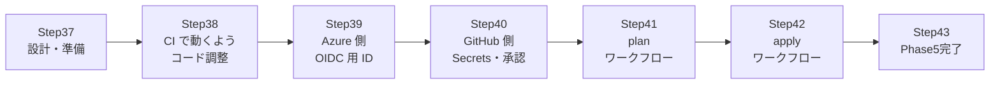

# Phase5 CI/CD 編 - GitHub Actions / OIDC / terraform plan・apply の自動化

Pull Request を出すと **`terraform plan` が自動で走り**、`main` にマージすると **承認を経て `terraform apply` が走る**仕組みを作る手順書です（Step37 〜 Step43）。Azure の認証には、パスワードを GitHub に置かない **OIDC 認証**を使います。

- 前の手順書：[Phase4 監視編](GETTING_STARTED_Phase4.md)（Step31 〜 Step36）
- 全体の目次：[GETTING_STARTED.md](GETTING_STARTED.md)

> 📌 本文中の「Step5 のコミット前チェックリスト」「Step7 の State 用ストレージ」は、[Phase0 準備編](GETTING_STARTED_Phase0.md)の内容を指します。



---

## 進捗チェックリスト

- [ ] Step37：Phase5 の設計を理解し、作業ブランチを作成する
- [ ] Step38：CI（GitHub 上）でも動くようにコードを調整する
- [ ] Step39：Azure に OIDC 用の ID（アプリ登録）を作成し、権限を付与する
- [ ] Step40：GitHub に Secrets・承認ルール（Environments）を設定する
- [ ] Step41：Pull Request で `terraform plan` が走るワークフローを作成する
- [ ] Step42：`main` マージ後に承認制で `terraform apply` が走るワークフローを作成する
- [ ] Step43：Phase5 を完了させる（記録・PR・削除）

---

### Phase5 完成イメージ

```text
開発者（自分）
  │ ① feature ブランチで push → Pull Request を作成
  ▼
GitHub Actions：terraform-plan.yml  ← PR のたびに自動実行
  ├─ fmt チェック
  └─ hub / test / dev それぞれ init → validate → plan  → 結果を画面に要約
  │ ② 内容を確認して main にマージ
  ▼
GitHub Actions：terraform-apply.yml ← main への push で起動
  ├─ hub  ── 【承認待ち】→ plan → 削除チェック → apply
  └─ test ── 【承認待ち】→ plan → 削除チェック → apply   （hub の後に実行）

認証：GitHub が発行する一時トークン（OIDC）を Entra ID に提示 → Azure の一時トークンを受け取る
      （パスワード・クライアントシークレットは、どこにも保存しない）
```

### Phase5 で学ぶこと

| 概念 | 一言で言うと | なぜ必要か |
| --- | --- | --- |
| GitHub Actions | GitHub 上でコマンドを自動実行する仕組み | 手元の PC に依存せず、誰が実行しても同じ手順で `plan` / `apply` できる |
| ワークフロー（YAML） | 「いつ・何を・どの順で実行するか」の設定書 | `.github/workflows/` に置くと GitHub が自動で読み込む |
| OIDC（OpenID Connect）認証 | GitHub が「このジョブは、このリポジトリから来た」と証明する一時トークン | パスワードを GitHub に置かずに済む（漏えいしても使い回せない） |
| フェデレーション資格情報 | 「この GitHub のジョブからのトークンなら、この ID として信頼する」という Entra ID の設定 | 信頼する条件（リポジトリ・ブランチ・環境）を細かく絞れる |
| アプリ登録 / サービスプリンシパル | Azure にとっての「プログラム用のアカウント」 | CI が Azure を操作するときの身元になる |
| 最小権限の分離 | `plan` 用と `apply` 用で別の ID を使う | `plan` は読み取りだけでよい。書き込み権限を持つ ID を使える場面を減らせる |
| Environments（承認ルール） | 特定のジョブの前に「人の承認」を挟む仕組み | `apply` を勝手に走らせない（CLAUDE.md の「apply 前に必ず確認」を CI でも守る） |

> 💡 **この Phase の肝は「自動化しても、人が確認する関所と、権限の絞り込みを残す」ことです。**
> 自動化は便利ですが、そのまま `apply` まで全自動にすると、間違いも全自動で本番に届きます。`plan` は自動・`apply` は承認制、という分け方を体験します。

---

## Step37：Phase5 の設計を理解し、作業ブランチを作成する

### 作るもの

| 種類 | 名前 | 場所 | 備考 |
| --- | --- | --- | --- |
| アプリ登録（plan 用） | `app-acp-github-plan-001` | Entra ID | 読み取り専用に近い権限。PR のジョブが使う |
| アプリ登録（apply 用） | `app-acp-github-apply-001` | Entra ID | 書き込み権限あり。承認済みの Environment のジョブだけが使える |
| カスタムロール | `role-acp-terraform-plan` | サブスクリプション | Reader に足りない「キーの取得」だけを許可する |
| ワークフロー | `terraform-plan.yml` | `.github/workflows/` | PR で fmt / validate / plan |
| ワークフロー | `terraform-apply.yml` | `.github/workflows/` | main への push で hub → test の順に apply |
| ワークフロー（部品） | `terraform-apply-env.yml` | `.github/workflows/` | 1 つの環境を apply する共通部品（呼び出される側） |
| Environment | `hub` / `test` | GitHub | 承認ルールを付ける |

> ⚠️ CAF（Cloud Adoption Framework）の略称では、アプリ登録は `app`、カスタムロールの略称は明確な定義がありません。上記の名前は**暫定の命名**です。Step43 で CLAUDE.md の命名規則に追記します。

### 設計の判断（なぜこの構成か）

| 判断 | 内容 | 理由 |
| --- | --- | --- |
| 認証方式 | **OIDC**（クライアントシークレットは使わない） | シークレットは期限切れ・漏えいのリスクがある。OIDC は GitHub が毎回発行する短時間のトークンだけを使う |
| ID の分け方 | **plan 用と apply 用の 2 つ** | PR は誰でも（自分のブランチなら）ワークフローを書き換えて出せる。PR から使える ID は、書き込み権限を持たせない |
| plan 用の権限 | **Reader ＋ カスタムロール（キー取得のみ）** | `plan` は、Storage のアクセスキーと Log Analytics のキーを取得する（リフレッシュ時）。これは Reader では許可されず、失敗する。そのため、この 2 つの操作だけを追加する |
| apply 用の権限 | **サブスクリプションの Contributor** | hub / test では、Resource Group 自体の作成と、Hub 側への Peering 作成がある。RG 単位に絞ると、作り直し時に権限が足りなくなる。個人の学習用サブスクリプションなので、まずは簡単さを優先する（絞り込みは発展課題） |
| State への権限 | 両方の ID に **State 用ストレージの Storage Blob Data Contributor** | `plan` でも State のロック（Blob のリース）を取るため、書き込み権限が必要 |
| 自動化する範囲 | **hub / test は plan・apply とも自動。dev は plan のみ自動（`-refresh=false`）、apply は自宅 PC** | 下の「dev を自動 apply しない理由」を参照 |
| apply の関所 | **GitHub Environments の承認** | CLAUDE.md の「apply の前に必ず確認」を CI でも守る。承認するまで、apply 用の ID は発行されない |
| 削除の検知 | plan に **delete が含まれたら apply を止める** | CLAUDE.md の「`destroy` / `must be replaced` は特に強調」を自動化する。続行するときは手動実行で明示的に許可する |
| 値の渡し方 | `terraform.tfvars` の代わりに **`TF_VAR_*` 環境変数**（GitHub Secrets から） | `tfvars` は Git に入らないため、CI にはない。環境変数でも同じ変数に値を渡せる |
| Terraform のバージョン | 手元と**同じ版に固定** | 新しい版で書かれた State は、古い版では読めない |

#### dev を自動 apply しない理由

Phase2 で、dev の Key Vault と Storage に**ファイアウォール**（自宅 IP と Subnet のみ許可）を設定しました。GitHub のランナーは、毎回違う IP のサーバーで動くため、この壁に阻まれます。

```text
GitHub のランナー ──✖ 403 ForbiddenByFirewall ──▶ Key Vault / Storage（dev）
```

Terraform は `plan` のとき、既存リソースの状態を読みに行きます（リフレッシュ）。その中には Key Vault のシークレットや Storage のプロパティなど、**ファイアウォールの対象になる読み取り**があります。先日の `403` と同じエラーです。

| 選択肢 | 内容 | 採用 |
| --- | --- | --- |
| A. dev は `plan -refresh=false`、apply は自宅 PC | リフレッシュを省略して、コードと State の差分だけ見る。実際のリソースとの差（ドリフト）は検知できないが、PR のチェックには十分 | ✅ **採用** |
| B. 実行中だけ、ランナーの IP をファイアウォールに追加 | 追加と削除を `az` で行う。Terraform の State とずれる（毎回差分が出る）うえ、反映に時間がかかり、失敗時に穴が残る | ❌ |
| C. VNet 内に Self-hosted Runner を置く | VM をランナーにする。VM が毎晩停止する、B1s のメモリが足りない、公開リポジトリでは危険、など課題が多い | 発展課題 |
| D. ファイアウォールを緩める | 「Any 開放しない」方針に反する | ❌ |

> 💡 **学びどころ：セキュリティ設計と自動化はトレードオフです。** ネットワークを絞るほど、外部（クラウドの CI）から触りにくくなります。実務でも、この問題の解決のために Self-hosted Runner や、プライベートネットワーク内で動くパイプラインを用意します。今回は、あえて **Step で壁にぶつかることを体験し、A で割り切る**構成にしています。

### コストの目安

| 項目 | 月額の目安 | 備考 |
| --- | --- | --- |
| Azure 側（アプリ登録・ロール・OIDC） | **0 円** | 課金されない |
| GitHub Actions | **0 円**（無料枠内） | パブリックリポジトリは無料。プライベートは Free プランで月 2,000 分まで。1 回の PR で 3〜5 分ほど |
| **Phase5 で増える合計** | **0 円** | 目標（月 5,000 円以内）への影響なし |

> ✅ 今回は、高額リソースは作りません。

### 事前に確認すること

```powershell
gh repo view --json nameWithOwner,visibility
```

| 確認項目 | 意味 | 影響 |
| --- | --- | --- |
| `nameWithOwner` | `Taiyaki64/Azure-Common-Platform` のような名前 | Step39 のフェデレーション資格情報に使う。**1 文字違うと認証に失敗する** |
| `visibility` が `PUBLIC` | 実行ログが誰でも見られる | Secrets に登録した値は `***` に隠れる。ただし、Secrets にしていない値（リソース ID・出力値のパブリック IP など）は見える。**値は必ず Secrets に入れる** |
| `visibility` が `PRIVATE` かつ GitHub Free | 承認ルール（Required reviewers）とブランチ保護が使えない | Step40 の「承認なしの代替案」を参照 |

> ⚠️ **フォーク元からの PR では、Secrets も OIDC も使えません**（GitHub の仕様で、悪用を防ぐため）。自分のリポジトリ内のブランチから出す PR だけを前提にします。`pull_request_target` というトリガーは、悪用の危険があるため使いません。

### 作業ブランチを作成

```powershell
git checkout main
git pull origin main
git checkout -b feature/phase5-cicd
```

### ファイル構成（Phase5 完了時）

```text
.github/
└─ workflows/
    ├─ terraform-plan.yml        # 新規：PR で fmt / validate / plan
    ├─ terraform-apply.yml       # 新規：main への push で hub → test を apply
    └─ terraform-apply-env.yml   # 新規：1 環境を apply する共通部品

environments/
├─ hub/ test/                    # 変更なし（.terraform.lock.hcl のみ更新）
└─ dev/
    ├─ variables.tf              # 変更：ssh_public_key を追加
    ├─ locals.tf                 # 変更：公開鍵を決めるローカル値を追加
    ├─ main.tf                   # 変更：VM に渡す公開鍵を local に差し替え
    └─ .terraform.lock.hcl       # 変更：Linux 用のハッシュを追加
```

---

## Step38：CI（GitHub 上）でも動くようにコードを調整する

### なぜ必要か

手元の PC で動いているコードでも、GitHub のランナー（Ubuntu の使い捨てサーバー）では、**手元にあるものが無い**ため失敗します。先に、その差を埋めます。

| 手元にあるもの | CI にあるか | 対処 |
| --- | --- | --- |
| `terraform.tfvars`（値の指定） | ❌（Git に入れていない） | `TF_VAR_*` 環境変数で渡す（Step41 で設定） |
| SSH 公開鍵ファイル（`~/.ssh/acp_dev_rsa.pub`） | ❌ | 鍵の**内容**を変数でも渡せるようにする（この Step） |
| Windows 用の `.terraform.lock.hcl` | △（Linux 用のハッシュが無いと `init` が失敗する） | Linux 用のハッシュを追加する（この Step） |

### 1. dev：SSH 公開鍵を「内容」でも渡せるようにする

dev の VM は、公開鍵を `file(pathexpand(var.ssh_public_key_path))` で**ファイルから読んでいます**。CI にはこのファイルがないため、内容を直接渡せる変数を足します。**ファイルでも渡せる形を残す**ので、手元の動きは変わりません。

`environments/dev/variables.tf`（追記）

```hcl
variable "ssh_public_key" {
  description = "VM に登録する SSH 公開鍵の内容。CI など鍵ファイルが無い環境で指定する。未指定なら ssh_public_key_path のファイルを読む"
  type        = string
  default     = null
}
```

`environments/dev/locals.tf`（追記）

```hcl
locals {
  # 変数で渡されていればそれを、無ければ手元の鍵ファイルを使う。
  # 末尾の改行の有無で差分が出ないよう、前後の空白は取り除く
  ssh_public_key = trimspace(
    var.ssh_public_key != null ? var.ssh_public_key : file(pathexpand(var.ssh_public_key_path))
  )
}
```

`environments/dev/main.tf`：`module "vm"` の 1 行を差し替えます。

```hcl
# 変更前
  ssh_public_key     = file(pathexpand(var.ssh_public_key_path))
# 変更後
  ssh_public_key     = local.ssh_public_key
```

```powershell
cd environments/dev
terraform fmt -recursive
terraform validate
terraform plan        # 必ず「No changes.」になることを確認
```

> 🚨 **ここは重要な確認ポイントです。** VM の `admin_ssh_key`（公開鍵）が変わると、**VM が作り直し（`must be replaced`）になります。**
> `plan` に `vm-acp-dev-001` の `replace` / `destroy` が出たら、**`apply` せずに止めて、`plan` の内容を確認してください。** 末尾の改行や空白の違いが原因の可能性があります。「No changes.」になるまで進まないでください。

### 2. 全環境：`.terraform.lock.hcl` に Linux 用のハッシュを追加する

`.terraform.lock.hcl` には、Provider の**改ざん検知用のハッシュ**が記録されます。ハッシュは OS ごとに別なので、Windows で作ったロックファイルだけだと、Linux のランナーで `terraform init` が次のように失敗します。

```text
Error: Failed to install provider
the current package for registry.terraform.io/hashicorp/azurerm doesn't match any of the checksums recorded in the dependency lock file
```

Windows と Linux の両方のハッシュを記録します。

#### この Step でやることの要約

- やること：`terraform providers lock` を hub / test / dev の 3 環境で 1 回ずつ実行し、ロックファイルに Linux 用のハッシュを**書き足す**
- 変わるもの：`.terraform.lock.hcl` の `hashes = [ ... ]` の行が増えるだけ（Azure には何も影響しない。課金もなし）
- 変わらないもの：Provider のバージョン（`version = "4.x.x"` の行）は変わらない

#### 手順

**① リポジトリの一番上のフォルダに移動する**

下の手順は、リポジトリのルート（`README.md` があるフォルダ）で実行する前提です。`environments/dev` にいる場合は戻ってください。

```powershell
cd C:\Users\tfsdt\GitHub\Azure-Common-Platform
```

**② 変更前の状態を確認する（任意）**

```powershell
git status                                  # 作業中の変更を把握しておく
Select-String -Path environments/dev/.terraform.lock.hcl -Pattern '"h1:|"zh:' | Measure-Object
# → 行数（Count）を覚えておく。実行後に増えていれば成功
```

**③ 3 環境分のハッシュを追加する**

```powershell
foreach ($e in "hub","test","dev") {
  terraform -chdir="environments/$e" providers lock "-platform=windows_amd64" "-platform=linux_amd64"
}
```

- 各環境で `Success! Terraform has updated the lock file.` と表示されれば成功です（3 回出ます）
- Provider を Terraform Registry からダウンロードして照合するため、1 環境あたり数十秒かかります。インターネット接続が必要です
- `terraform init` 済みでなくても実行できます

**④ 結果を確認する**

```powershell
git status
git diff --stat
```

- `environments/hub/.terraform.lock.hcl` / `environments/test/.terraform.lock.hcl` / `environments/dev/.terraform.lock.hcl` の 3 つが `modified` になっていればOK
- `git diff environments/dev/.terraform.lock.hcl` を見て、`+` の行（`"h1:..."` や `"zh:..."`）が追加されるだけで、`version` の行に変更がないことを確認する

**⑤ 手元の動作に影響がないことを確認する（dev）**

```powershell
cd environments/dev
terraform init
terraform validate
cd ../..
```

- エラーなく通ればOK。Windows 用のハッシュも残っているので、手元の `init` は今まで通り動きます

**⑥ コミットは Step38 の他の変更とまとめて行う**

この時点ではコミットしません（ブランチ作成後に、Step38 全体の区切りでまとめます）。`.terraform.lock.hcl` は**コミットする**ファイルです。

#### うまくいかないとき

| 症状 | 原因と対処 |
| --- | --- |
| `Error: Failed to query available provider packages` | ネットワークに接続できていない。接続を確認して再実行する |
| `terraform: The term 'terraform' is not recognized` | Terraform が PATH にない。新しい PowerShell を開き直す |
| 差分が 1 つも出ない | すでに Linux 用のハッシュが入っている（実行済み）。問題なし |
| `-platform=...` で `Too many command line arguments` | 引用符を付け忘れている。`"-platform=linux_amd64"` のように囲む |

> 💡 引用符で `-platform=...` を囲むのは、PowerShell が `.` や `=` で引数を分割してしまうためです（`-target` と同じ）。
> Mac を使うことがあれば、`darwin_arm64` なども追加します。

### 3. 値の整理（Secrets に入れるもの）

CI に渡す値の一覧です。実際の登録は Step40 で行います。**この値をチャットやコードに書かないでください。**

| Secret 名 | 中身 | 使う場面 |
| --- | --- | --- |
| `AZURE_TENANT_ID` | Entra ID のテナント ID | OIDC 認証 |
| `AZURE_SUBSCRIPTION_ID` | サブスクリプション ID | OIDC 認証、`TF_VAR_subscription_id` |
| `AZURE_PLAN_CLIENT_ID` | plan 用アプリの ID | plan ワークフロー |
| `AZURE_APPLY_CLIENT_ID` | apply 用アプリの ID | apply ワークフロー |
| `ALLOWED_SSH_SOURCE_IP` | 自宅 IP（`/32` 付き） | dev の plan（`TF_VAR_allowed_ssh_source_ip`） |
| `ALERT_EMAIL` | アラート通知先メール | dev の plan（`TF_VAR_alert_email`） |
| `SSH_PUBLIC_KEY` | SSH **公開鍵**の内容 | dev の plan（`TF_VAR_ssh_public_key`） |

> ⚠️ **自宅 IP が変わったら、`terraform.tfvars` だけでなく `ALLOWED_SSH_SOURCE_IP` も更新してください。** 更新しないと、CI の dev の `plan` に「古い IP に戻す」という差分が出ます。
> SSH の**秘密鍵**は、どこにも登録しません（CI には不要です）。

---

## Step39：Azure に OIDC 用の ID（アプリ登録）を作成し、権限を付与する

### なぜ必要か

GitHub Actions が Azure を操作するには、Azure 側に「CI 用の ID」が必要です。OIDC では、**「この GitHub のリポジトリ（と条件）から来たトークンなら、この ID として扱ってよい」** という信頼関係（フェデレーション資格情報）を登録します。

```text
GitHub のジョブ ── ① OIDC トークンを要求 ──▶ GitHub
       │                                         │ トークン（誰が・どのリポジトリ・どの条件）
       │ ② トークンを提示                         ▼
       └──────────────▶ Entra ID：フェデレーション資格情報と一致するか確認
                              │ ③ 一致したら Azure のアクセストークンを発行
                              ▼
                        Azure（RBAC の権限の範囲で操作できる）
```

| ID | 信頼する条件（subject） | 権限 |
| --- | --- | --- |
| `app-acp-github-plan-001` | `repo:<リポジトリ>:pull_request`（PR のジョブ） | Reader ＋ カスタムロール ＋ State への書き込み |
| `app-acp-github-apply-001` | `repo:<リポジトリ>:environment:hub` / `:environment:test`（承認済みの環境のジョブ） | Contributor ＋ State への書き込み |

> ⚠️ **この Step の `az` コマンドは Azure に直接作成・変更を行います。** CLAUDE.md の方針により、Claude に任せず、**自分で内容を確認して実行**してください（Step7 の State 用ストレージと同じく、Terraform で管理しない「土台」です。Terraform で管理すると、CI の ID を CI が書き換えることになるため、避けます）。
> 作成するのはアプリ登録・ロール・ロール割り当てのみで、**課金は発生しません。**

### 1. 変数の準備

```powershell
az login                                   # 済みなら不要
$SUB_ID    = az account show --query id -o tsv
$TENANT_ID = az account show --query tenantId -o tsv
$REPO      = "Taiyaki64/Azure-Common-Platform"   # Step37 で確認した nameWithOwner に合わせる
$ST_ID     = az storage account show --name stacptfstate55814 --resource-group rg-acp-tfstate-jpe-001 --query id -o tsv
```

> 💡 State 用ストレージ名（`stacptfstate55814`）は、`environments/hub/main.tf` の backend に書いてあるものです。

### 2. plan 用のアプリ登録とフェデレーション資格情報

```powershell
$PLAN_APP_ID = az ad app create --display-name "app-acp-github-plan-001" --query appId -o tsv
az ad sp create --id $PLAN_APP_ID | Out-Null          # アプリに対応するサービスプリンシパルを作る
$PLAN_SP_ID  = az ad sp show --id $PLAN_APP_ID --query id -o tsv

# 「このリポジトリの Pull Request のジョブ」を信頼する
@{
  name      = "github-pull-request"
  issuer    = "https://token.actions.githubusercontent.com"
  subject   = "repo:${REPO}:pull_request"
  audiences = @("api://AzureADTokenExchange")
} | ConvertTo-Json | Set-Content -Path "$env:TEMP\cred-plan.json" -Encoding ascii

az ad app federated-credential create --id $PLAN_APP_ID --parameters "$env:TEMP\cred-plan.json"
```

> 💡 `-Encoding ascii` は、PowerShell 5.1 の `utf8` が BOM（先頭の目印）を付けて、`az` が JSON として読めなくなるのを避けるためです。
> 💡 `subject`（信頼する条件）は**完全一致**です。ここを間違えると、Step41 で `AADSTS70021: No matching federated identity record` になります。

### 3. apply 用のアプリ登録とフェデレーション資格情報

```powershell
$APPLY_APP_ID = az ad app create --display-name "app-acp-github-apply-001" --query appId -o tsv
az ad sp create --id $APPLY_APP_ID | Out-Null
$APPLY_SP_ID  = az ad sp show --id $APPLY_APP_ID --query id -o tsv

# 「hub / test の Environment（承認済み）のジョブ」だけを信頼する
foreach ($e in "hub","test") {
  @{
    name      = "github-environment-$e"
    issuer    = "https://token.actions.githubusercontent.com"
    subject   = "repo:${REPO}:environment:$e"
    audiences = @("api://AzureADTokenExchange")
  } | ConvertTo-Json | Set-Content -Path "$env:TEMP\cred-apply-$e.json" -Encoding ascii
  az ad app federated-credential create --id $APPLY_APP_ID --parameters "$env:TEMP\cred-apply-$e.json"
}
```

> 💡 apply 用は `pull_request` を**信頼しません。** つまり、PR のジョブがワークフローを書き換えても、apply 用の ID は発行されません。発行されるのは、**Environment の承認を通ったジョブだけ**です。

### 4. plan 用のカスタムロールを作る

`terraform plan` は、リフレッシュのときに次の 2 つを取得します。**Reader にはこの権限がない**ため、足りない分だけを許可するロールを作ります。

| 操作 | 理由 |
| --- | --- |
| `Microsoft.Storage/storageAccounts/listKeys/action` | `azurerm_storage_account` が、アクセスキーを読む |
| `Microsoft.OperationalInsights/workspaces/sharedKeys/action` | `azurerm_log_analytics_workspace`（data）が、ワークスペースキーを読む |

```powershell
@{
  Name             = "role-acp-terraform-plan"
  Description      = "terraform plan 用。Reader に足りない、リソースのキー取得だけを許可する"
  Actions          = @(
    "Microsoft.Storage/storageAccounts/listKeys/action",
    "Microsoft.OperationalInsights/workspaces/sharedKeys/action"
  )
  NotActions       = @()
  AssignableScopes = @("/subscriptions/$SUB_ID")
} | ConvertTo-Json | Set-Content -Path "$env:TEMP\role-plan.json" -Encoding ascii

az role definition create --role-definition "$env:TEMP\role-plan.json"
```

> ⚠️ このロールを持つ ID は、**Storage と Log Analytics のキーを取得できます。** 実際は PR のジョブからしか使えないため、自分のリポジトリ内に限定すれば許容できますが、**完全な読み取り専用ではない**ことは理解しておいてください。
> 💡 もし Step41 で `AuthorizationFailed ... does not have authorization to perform action 'XXXX'` が出たら、その `XXXX` をこのロールの `Actions` に足す（`az role definition update`）のが基本の直し方です。

### 5. ロールを割り当てる

```powershell
# --- plan 用 ---
az role assignment create --assignee-object-id $PLAN_SP_ID --assignee-principal-type ServicePrincipal `
  --role "Reader" --scope "/subscriptions/$SUB_ID"
az role assignment create --assignee-object-id $PLAN_SP_ID --assignee-principal-type ServicePrincipal `
  --role "role-acp-terraform-plan" --scope "/subscriptions/$SUB_ID"
az role assignment create --assignee-object-id $PLAN_SP_ID --assignee-principal-type ServicePrincipal `
  --role "Storage Blob Data Contributor" --scope $ST_ID

# --- apply 用 ---
az role assignment create --assignee-object-id $APPLY_SP_ID --assignee-principal-type ServicePrincipal `
  --role "Contributor" --scope "/subscriptions/$SUB_ID"
az role assignment create --assignee-object-id $APPLY_SP_ID --assignee-principal-type ServicePrincipal `
  --role "Storage Blob Data Contributor" --scope $ST_ID
```

| 割り当て | 範囲 | 理由 |
| --- | --- | --- |
| Reader / Contributor | サブスクリプション | リソースの読み取り / 作成・変更 |
| カスタムロール | サブスクリプション | キーの取得（plan のみ） |
| Storage Blob Data Contributor | **State 用ストレージのみ** | `use_azuread_auth = true` の State を読み書き・ロックするため。サブスクリプション全体には付けない |

> 💡 `--assignee-object-id` と `--assignee-principal-type` を使うのは、作ったばかりの ID が Entra ID に反映される前でも、確実に割り当てるためです（Phase2 の `skip_service_principal_aad_check` と同じ理由）。
> 💡 apply 用に **User Access Administrator は付けていません。** hub / test の Terraform は、ロール割り当て（`azurerm_role_assignment`）を作らないためです。dev を自動化するときは別途必要になります。

### 6. 登録内容を確認する

```powershell
az role assignment list --assignee $PLAN_SP_ID  --all --query "[].{role:roleDefinitionName, scope:scope}" -o table
az role assignment list --assignee $APPLY_SP_ID --all --query "[].{role:roleDefinitionName, scope:scope}" -o table
az ad app federated-credential list --id $PLAN_APP_ID  --query "[].{name:name, subject:subject}" -o table
az ad app federated-credential list --id $APPLY_APP_ID --query "[].{name:name, subject:subject}" -o table
```

**確認ポイント**
- [ ] plan 用に、Reader・`role-acp-terraform-plan`・Storage Blob Data Contributor（State 用ストレージのみ）の 3 件がある
- [ ] apply 用に、Contributor・Storage Blob Data Contributor（State 用ストレージのみ）の 2 件がある
- [ ] plan 用の `subject` が `repo:...:pull_request` になっている
- [ ] apply 用の `subject` が `repo:...:environment:hub` と `...:environment:test` の 2 件になっている

> ⚠️ ここで表示された**アプリケーション ID（`$PLAN_APP_ID` など）は、このあと Step40 で使います。** ターミナルを閉じる前に Step40 を実施するか、`az ad app list --display-name "app-acp-github-plan-001" --query "[0].appId" -o tsv` で再取得できます。

---

## Step40：GitHub に Secrets・承認ルール（Environments）を設定する

### なぜ必要か

ワークフローは、Azure の ID や、`terraform.tfvars` の代わりの値を、**GitHub Secrets** から受け取ります。Secrets はログに出ても `***` に隠され、あとから値を見ることもできません。また、`apply` の前に人の承認を挟む **Environments** を作ります。

### 1. Secrets を登録する

```powershell
gh secret set AZURE_TENANT_ID       --body $TENANT_ID
gh secret set AZURE_SUBSCRIPTION_ID --body $SUB_ID
gh secret set AZURE_PLAN_CLIENT_ID  --body $PLAN_APP_ID
gh secret set AZURE_APPLY_CLIENT_ID --body $APPLY_APP_ID

# 値をコマンドに書かないよう、プロンプトに入力する（履歴に残らない）
gh secret set ALLOWED_SSH_SOURCE_IP    # 例：自宅 IP/32（terraform.tfvars と同じ値）
gh secret set ALERT_EMAIL              # terraform.tfvars の alert_email と同じ値

# SSH「公開鍵」の内容（秘密鍵ではない）
gh secret set SSH_PUBLIC_KEY --body (Get-Content "$HOME\.ssh\acp_dev_rsa.pub" -Raw)

gh secret list    # 7 つ並んでいること（値は表示されない）
```

> ⚠️ 秘密鍵（`acp_dev_rsa`、拡張子 `.pub` が付かない方）は、**登録しません。** 間違えないでください。
> 💡 `gh secret set NAME --body 値` の形は、シェルの履歴に値が残ります。IP やメールのように**自分で入力する値**は、プロンプトに入力する形にしています。変数（`$SUB_ID` など）を渡すものは、画面に出ないのでこの形で問題ありません。

### 2. Environments を作る（apply の関所）

`terraform-apply.yml` の各ジョブは、`environment: hub` / `environment: test` を指定します。Environment に**必須レビュアー（自分）** を付けると、ジョブは承認されるまで開始されません（OIDC のトークンも、承認後に初めて発行されます）。

```powershell
$UID_GH = gh api user --jq .id
foreach ($e in "hub","test") {
  @{ reviewers = @(@{ type = "User"; id = [int]$UID_GH }) } | ConvertTo-Json -Depth 5 |
    gh api --method PUT "repos/$REPO/environments/$e" --input -
}
```

**確認ポイント（GitHub）**
- [ ] 「Settings → Environments」に `hub` と `test` がある
- [ ] それぞれに **Required reviewers**（自分）が設定されている

> ⚠️ **プライベートリポジトリ ＋ GitHub Free プランでは、Required reviewers が使えません**（上のコマンドも失敗します）。その場合の代替案です。
>
> | 代替案 | 内容 |
> | --- | --- |
> | apply は手動実行のみ | `terraform-apply.yml` の `on:` から `push` を外し、`workflow_dispatch`（Actions 画面の「Run workflow」ボタン）だけにする。**自分でボタンを押すこと自体が承認**になる |
> | リポジトリをパブリックにする | 機密情報が入っていないことを十分に確認してから。Secrets 以外の値（リソース名・ID）が公開される |
>
> Environment 自体は承認なしでも作れます。OIDC の `subject`（`environment:hub`）に使うため、**作成だけは必要**です。

---

## Step41：Pull Request で `terraform plan` が走るワークフローを作成する

### なぜ必要か

`main` にマージする前に、**「このコードで、Azure に何が起きるか」** を自動で見せるためです。手元で `plan` を実行し忘れても、PR を出せば必ず確認できます。

### 1. `.github/workflows/terraform-plan.yml`（新規）

```yaml
name: terraform-plan

on:
  pull_request:
    branches: [main]
    # paths で絞らない：必須チェックにする場合、絞ると「実行されない＝永遠に待ち」になるため

# id-token: write は OIDC のトークンを発行してもらうために必要。リポジトリの中身は読むだけ
permissions:
  id-token: write
  contents: read

# 同じブランチで続けて push したら、古い実行は中止する
concurrency:
  group: terraform-plan-${{ github.ref }}
  cancel-in-progress: true

jobs:
  fmt:
    name: fmt
    runs-on: ubuntu-latest
    steps:
      - uses: actions/checkout@v4
      - uses: hashicorp/setup-terraform@v3
        with:
          terraform_version: "1.16.6" # 手元の `terraform version` と同じ版にする
          terraform_wrapper: false
      - run: terraform fmt -check -recursive -diff

  plan:
    name: plan (${{ matrix.env }})
    runs-on: ubuntu-latest
    strategy:
      fail-fast: false # 1 つの環境が失敗しても、他の環境の結果は見る
      matrix:
        include:
          - env: hub
            refresh: "true"
          - env: test
            refresh: "true"
          # dev は Key Vault / Storage のファイアウォールに阻まれるため、リフレッシュしない（Step37 参照）
          - env: dev
            refresh: "false"
    defaults:
      run:
        working-directory: environments/${{ matrix.env }}
    env:
      # Terraform の azurerm backend / provider を OIDC で認証する設定
      ARM_USE_OIDC: "true"
      ARM_CLIENT_ID: ${{ secrets.AZURE_PLAN_CLIENT_ID }}
      ARM_TENANT_ID: ${{ secrets.AZURE_TENANT_ID }}
      ARM_SUBSCRIPTION_ID: ${{ secrets.AZURE_SUBSCRIPTION_ID }}
      # terraform.tfvars の代わり（宣言されていない変数への TF_VAR_* は無視されるので、hub / test でも問題ない）
      TF_VAR_subscription_id: ${{ secrets.AZURE_SUBSCRIPTION_ID }}
      TF_VAR_allowed_ssh_source_ip: ${{ secrets.ALLOWED_SSH_SOURCE_IP }}
      TF_VAR_alert_email: ${{ secrets.ALERT_EMAIL }}
      TF_VAR_ssh_public_key: ${{ secrets.SSH_PUBLIC_KEY }}
    steps:
      - uses: actions/checkout@v4

      - uses: hashicorp/setup-terraform@v3
        with:
          terraform_version: "1.16.6"
          terraform_wrapper: false # 出力をそのまま扱うため、ラッパーは使わない

      - name: init
        run: terraform init -input=false

      - name: validate
        run: terraform validate

      - name: plan
        run: terraform plan -input=false -lock-timeout=60s -refresh=${{ matrix.refresh }} -out=tfplan

      - name: 結果を画面に要約する
        run: |
          # plan.json には機密値が含まれるため、ログに出さず・保存（artifact）もしない
          terraform show -json tfplan > plan.json
          add=$(jq '[.resource_changes[]? | select(.change.actions == ["create"])] | length' plan.json)
          chg=$(jq '[.resource_changes[]? | select(.change.actions == ["update"])] | length' plan.json)
          del=$(jq '[.resource_changes[]? | select(.change.actions | index("delete"))] | length' plan.json)
          {
            echo "### ${{ matrix.env }}：追加 ${add} / 変更 ${chg} / 削除（作り直しを含む） ${del}"
            if [ "${{ matrix.refresh }}" = "false" ]; then
              echo "> ℹ️ このplanはリフレッシュなし（実際のリソースとのずれは検知しません）"
            fi
            if [ "$del" -gt 0 ]; then
              echo "> ⚠️ **削除または作り直しを含みます。内容を必ず確認してください**"
            fi
            echo '```'
            terraform show -no-color tfplan
            echo '```'
          } >> "$GITHUB_STEP_SUMMARY"
```

> 💡 **主な設定の意味**
> - `permissions.id-token: write`：これが無いと、OIDC トークンを要求できず、`Unable to get ACTIONS_ID_TOKEN_REQUEST_URL` で失敗します。
> - `matrix`：同じ手順を hub / test / dev で繰り返す仕組み。環境ごとに別のジョブとして並行して動きます。
> - `ARM_USE_OIDC` ほか：Terraform が `ARM_*` 環境変数を見て、**パスワード無し**で Azure にログインします。`az login` の手順は不要です。
> - `terraform show -no-color tfplan`（画面表示用）は**機密値が `(sensitive value)` に隠れます。** 一方 `show -json` は**隠れません**（実際、State にはアクセスキーが入っていました）。そのため、JSON は件数の集計にだけ使い、**ログに出さず、artifact にもアップロードしません。**
> - `-out=tfplan` の `tfplan` も同様に機密値を含みます。保存・共有しないでください（`.gitignore` に `*.tfplan` があります）。

### 2. コミットして Pull Request を作成する

```powershell
git add .github/workflows/terraform-plan.yml environments/
git status   # Step5 のコミット前チェックリストを確認（terraform.tfvars・*.tfstate・秘密鍵が含まれていないこと）
git commit -m "feat: PR で terraform plan を実行する GitHub Actions を追加"
git push origin feature/phase5-cicd
gh pr create --title "Phase5: CI の追加（plan）" --body "PR で hub / test / dev の plan を自動実行する"
```

PR を作成すると、「Checks」に `fmt`・`plan (hub)`・`plan (test)`・`plan (dev)` が並び、実行されます。

### 3. 結果を確認する

「Actions」タブ → 該当の実行 → 画面下部の **Summary** に、環境ごとの要約が出ます。

**確認ポイント**
- [ ] `fmt` が成功している
- [ ] `plan (hub)` と `plan (test)` が成功し、**0 追加 / 0 変更 / 0 削除**（`No changes`）になっている
- [ ] `plan (dev)` が成功している（リフレッシュなしの注記が出ている）
- [ ] ログの中で、サブスクリプション ID・IP・メールアドレスが `***` に隠れている

> 💡 hub / test / dev のどれかに差分が出た場合は、その内容が「手元の最後の `apply` からのずれ」です。意図した変更か、確認してください。Phase4 の作業中のコードがあれば、ここで見えます。

### 4. ブランチ保護を設定する（`plan` が成功しない限りマージできないようにする）

#### これは何をするものか

`main` に「入るための条件」を GitHub に覚えさせる設定です。CLAUDE.md の「`main` は動作確認済みのコードのみ」を、人間の注意力ではなく**仕組みで守らせます**。

| 設定 | 守ってくれること |
| --- | --- |
| Require a pull request before merging | `main` への直接 push を禁止する（必ず PR を通る） |
| Require status checks to pass | `fmt` と `plan` が成功しない PR は、マージのボタンが押せない |
| Restrict deletions / Block force pushes | `main` の削除と、履歴の書き換え（`push --force`）を禁止する |

> 💡 GitHub では、この設定を **Ruleset（ルールセット）** と呼びます。以前の「Branch protection rule」の新しい形式で、画面の入口が違うだけで、できることはほぼ同じです。

#### 前提の確認

- [ ] リポジトリが **Public**、または有料プランである（Public なら Free で使えます。`gh repo view --json visibility` で確認できます）
- [ ] PR で `fmt` / `plan (...)` のチェックが**一度は実行された**（実行履歴がないと、チェック名を検索しても出てきません）
- [ ] リポジトリの管理者（Owner）のアカウントで GitHub にログインしている

> ⚠️ **チェックが失敗したままでも、チェック名は選べます。** ただし、設定後は失敗している PR をマージできなくなります。**先に OIDC のエラー（Step41-3）を直してから**設定すると、PR #12 を無理なく進められます。

#### 手順

**① ルールセットの作成画面を開く**

1. GitHub のリポジトリ（`Taiyaki64/Azure-Common-Platform`）を開く
2. 上部のタブ **Settings** をクリック（Settings が見えない場合は、管理者権限がありません）
3. 左メニューの **Rules** → **Rulesets** をクリック
4. 右上の **New ruleset** → **New branch ruleset** をクリック

**② 基本情報を入力する**

| 項目 | 設定する値 |
| --- | --- |
| Ruleset Name | `protect-main` |
| Enforcement status | **Active**（`Disabled` のままだと何も起きません） |
| Bypass list | **空のまま**（誰も例外にしない。下の注意を参照） |

**③ 対象のブランチを指定する**

1. 「Target branches」の **Add target** をクリック
2. **Include default branch** を選ぶ（`main` が対象になります）
3. 一覧に `Default` と表示されれば OK

**④ ルールを選ぶ**（「Branch rules」の一覧でチェックを付ける）

| チェックを付ける | 付けない（既定のまま） |
| --- | --- |
| ✅ **Restrict deletions** | ☐ Require linear history |
| ✅ **Block force pushes** | ☐ Require signed commits |
| ✅ **Require a pull request before merging** | ☐ Require deployments to succeed |
| ✅ **Require status checks to pass** | |

「Require a pull request before merging」を付けると、詳細設定が開きます。

| 項目 | 値 | 理由 |
| --- | --- | --- |
| Required approvals | **0** | 自分一人の開発では、自分の PR を自分で承認できないため。1 以上にすると、自分でマージできなくなる |
| 他のチェック（Dismiss stale approvals など） | 付けない | 承認者がいないので意味がない |

「Require status checks to pass」を付けると、詳細設定が開きます。

1. **Add checks** をクリックし、検索欄に名前を入れて、次の 4 つを 1 つずつ追加する

   - [ ] `fmt`
   - [ ] `plan (hub)`
   - [ ] `plan (test)`
   - [ ] `plan (dev)`

2. 追加すると、右側に GitHub Actions のアイコンが付く（チェックの提供元が「GitHub Actions」であることの確認）
3. **Require branches to be up to date before merging** は、**付けない**（付けると、他の PR が先にマージされるたびに、ブランチの更新と再実行が必要になり、一人開発では手間が増えるだけ）

> 💡 **チェック名が検索に出てこない場合**：直近 7 日以内に実行されたものしか候補に出ません。PR の「Checks」に表示されている名前（`plan (hub)` のように、**空白とカッコも含めて**）と一致しているかも確認してください。

**⑤ 保存する**

画面の一番下の **Create** をクリックします。

**⑥ 設定を確認する**

画面で確認：

- [ ] Rulesets の一覧に `protect-main` が **Active** で表示される
- [ ] PR の画面を開くと、チェックが失敗している間は、マージのボタンが押せず「Merging is blocked」と表示される

コマンドで確認（読み取りのみ）：

```powershell
gh api repos/Taiyaki64/Azure-Common-Platform/rulesets --jq '.[] | {name, enforcement}'
```

`"name":"protect-main","enforcement":"active"` が出れば OK です。

**⑦ 動作確認（任意）**

`main` に直接 push が拒否されることを確かめられます。ただし、`main` を汚さないよう、**何も変更していない状態**で試してください。

```powershell
git switch main
git push origin main      # 変更がなければ "Everything up-to-date" と出るだけで、確認にはなりません
```

実際に拒否されるかを見るには、PR を経由しない小さなコミットを作る必要があり、手間の割に得られるものが少ないため、**画面の「Merging is blocked」の確認だけで十分**です。

#### 注意

- ⚠️ **Bypass list は空のままにしてください。** 自分（管理者）を例外にすると、「チェックを飛ばしてマージする」ことが可能になり、設定の意味がなくなります。
- ⚠️ Step42 以降で `terraform-apply.yml` を追加すると、**マージ直後に apply が起動します。** このルールは、その前に有効にしておくのが安全です。
- 🔧 **ルールを間違えて、PR がマージできなくなったら**：Settings → Rules → Rulesets → `protect-main` を開き、**Enforcement status を `Disabled`** に切り替えて修正し、再度 `Active` にします（ルール自体の編集は管理者ならいつでもできます）。
- 🔧 ワークフローのジョブ名を後から変えたとき（例：`plan` → `terraform-plan`）は、ルールセット側のチェック名も更新が必要です。名前が合わないと、**永久に「Expected — Waiting for status to be reported」のまま**マージできなくなります。

---

## Step42：`main` マージ後に承認制で `terraform apply` が走るワークフローを作成する

### なぜ必要か

`main` に入ったコードを、手元の PC を使わずに Azure へ反映するためです。ただし、全自動ではなく、**承認** と **削除の検知** という 2 つの関所を置きます。

```text
main へ push
  └─ hub ── ① 承認待ち ──▶ init → plan → ② 削除チェック → apply
       └─ test ── ① 承認待ち ──▶ init → plan → ② 削除チェック → apply
                                       （hub が成功したら、test が始まる）
```

| 関所 | 内容 | 守っているルール |
| --- | --- | --- |
| ① 承認 | Environment の Required reviewers が承認するまで、ジョブも OIDC トークンも始まらない | CLAUDE.md「apply の前に必ず確認」 |
| ② 削除チェック | plan に `delete`（作り直しを含む）があると、apply せずに失敗する | CLAUDE.md「destroy / must be replaced は特に強調」 |

### 1. `.github/workflows/terraform-apply-env.yml`（新規・1 環境を apply する共通部品）

hub と test で同じ手順を使うため、**呼び出される側のワークフロー（`workflow_call`）** として切り出します。

```yaml
name: terraform-apply-env

on:
  workflow_call:
    inputs:
      env:
        description: "apply する環境（hub / test）"
        type: string
        required: true
      allow_destroy:
        description: "削除・作り直しを含む plan も apply する"
        type: boolean
        default: false

permissions:
  id-token: write
  contents: read

jobs:
  apply:
    name: apply (${{ inputs.env }})
    runs-on: ubuntu-latest
    # この指定で、Environment の承認ルールが働く。OIDC の subject は「environment:<名前>」になる
    environment: ${{ inputs.env }}
    defaults:
      run:
        working-directory: environments/${{ inputs.env }}
    env:
      ARM_USE_OIDC: "true"
      ARM_CLIENT_ID: ${{ secrets.AZURE_APPLY_CLIENT_ID }}
      ARM_TENANT_ID: ${{ secrets.AZURE_TENANT_ID }}
      ARM_SUBSCRIPTION_ID: ${{ secrets.AZURE_SUBSCRIPTION_ID }}
      TF_VAR_subscription_id: ${{ secrets.AZURE_SUBSCRIPTION_ID }}
    steps:
      - uses: actions/checkout@v4

      - uses: hashicorp/setup-terraform@v3
        with:
          terraform_version: "1.16.6"
          terraform_wrapper: false

      - name: init
        run: terraform init -input=false

      - name: plan
        run: terraform plan -input=false -lock-timeout=60s -out=tfplan

      - name: 削除・作り直しのチェック
        run: |
          terraform show -json tfplan > plan.json
          del=$(jq '[.resource_changes[]? | select(.change.actions | index("delete"))] | length' plan.json)
          echo "削除または作り直し：${del} 件"
          if [ "$del" -gt 0 ] && [ "${{ inputs.allow_destroy }}" != "true" ]; then
            echo "::error::plan に削除または作り直し（${del} 件）が含まれるため、apply を中止しました。内容を確認し、手動実行（allow_destroy）で明示的に許可してください"
            terraform show -no-color tfplan
            exit 1
          fi

      - name: apply
        run: terraform apply -input=false tfplan
```

### 2. `.github/workflows/terraform-apply.yml`（新規・起動と順番）

```yaml
name: terraform-apply

on:
  push:
    branches: [main]
    # 関係のない変更（ドキュメントだけ）の merge で、承認を求めないようにする
    paths:
      - "environments/hub/**"
      - "environments/test/**"
      - "modules/**"
      - ".github/workflows/terraform-apply*.yml"
  # Actions 画面の「Run workflow」ボタンから手動でも実行できる
  workflow_dispatch:
    inputs:
      allow_destroy:
        description: "削除・作り直しを含む plan も apply する（内容を確認した場合のみ true）"
        type: boolean
        default: false

# 呼び出す側にも権限の指定が必要（呼ばれる側はこの範囲でしか使えない）
permissions:
  id-token: write
  contents: read

# apply は同時に 2 つ走らせない。実行中のものは中止せず、順番に待たせる
concurrency:
  group: terraform-apply
  cancel-in-progress: false

jobs:
  hub:
    uses: ./.github/workflows/terraform-apply-env.yml
    with:
      env: hub
      allow_destroy: ${{ inputs.allow_destroy || false }}
    secrets: inherit

  # test は Hub の VNet を参照して Peering を作る。そのため、hub が先（適用順は hub → test）
  test:
    needs: hub
    uses: ./.github/workflows/terraform-apply-env.yml
    with:
      env: test
      allow_destroy: ${{ inputs.allow_destroy || false }}
    secrets: inherit
```

> 💡 **dev が無い理由は Step37 のとおりです。** dev の変更は、これまでどおり**自宅 PC から `plan` → 確認 → `apply`** で反映します。CI の dev の `plan` は「PR の差分の事前確認」に使います。
> 💡 `concurrency` は、Terraform の State ロックと同じ考え方です。同じ環境に 2 つの `apply` が同時に走るのを防ぎます。
> 💡 `paths` を使うのは `apply` のほうだけです。`plan` 側で使わない理由は、Step41 のコメントを参照してください。

### 3. コミットして Pull Request を作成する

```powershell
git add .github/workflows/
git status
git commit -m "feat: main への merge で承認制の terraform apply を実行する GitHub Actions を追加"
git push origin feature/phase5-cicd
```

PR の `plan` が全部成功したら、GitHub で内容を確認し、`main` にマージします。

> ⚠️ このマージで `terraform-apply.yml` 自身が変更されたため、**マージ直後に apply が起動します**（`paths` に `.github/workflows/terraform-apply*.yml` を含めているため）。承認待ちになるので、**承認する前に「Review pending deployments」の内容と plan を確認**してください。差分がなければ、`No changes.` で何も起きません。

### 4. 動作確認：わざと小さな変更を入れて、一連の流れを体験する

安全で課金に影響しない変更として、Hub の Log Analytics の**日次上限**を変更します。

```powershell
git checkout main
git pull origin main
git checkout -b feature/phase5-cicd-trial
```

`environments/hub/main.tf` の `module "log_analytics"` を編集します。

```hcl
  daily_quota_gb      = 0.4   # 0.5 → 0.4（取り込み上限を少し下げるだけ。課金は増えない）
```

> ⚠️ `retention_in_days` を 30 より大きくするのは**やめてください**（30 日を超えると課金が発生します）。

```powershell
git add environments/hub/main.tf
git commit -m "chore: 動作確認のため Log Analytics の日次上限を 0.4GB に変更"
git push origin feature/phase5-cicd-trial
gh pr create --title "動作確認: 日次上限の変更" --body "CI の plan / apply の一連の流れを確認する"
```

| 順番 | 確認すること |
| --- | --- |
| ① PR を作る | `plan (hub)` の Summary に **「追加 0 / 変更 1 / 削除 0」** と `daily_quota_gb` の差分が出る。test・dev は変更なし |
| ② マージする | `terraform-apply` が起動し、`hub` ジョブが **「Waiting for review」** で止まる |
| ③ 承認する | Actions 画面の「Review pending deployments」で `hub` にチェックを入れて承認。`apply` が成功する |
| ④ test が続く | `test` ジョブが承認待ちになる。承認すると `No changes.` で成功する |
| ⑤ Portal で確認 | `log-acp-hub-jpe-001` の日次上限が **0.4 GB** になっている |

確認できたら、**元の値（0.5）に戻す PR** を作り、同じ流れでマージ・承認します。

```powershell
# environments/hub/main.tf の daily_quota_gb を 0.5 に戻して、同様に PR → merge → 承認
```

**確認ポイント**
- [ ] PR の `plan` で、変更が 1 件だけ出た
- [ ] マージ後、承認するまで `apply` が始まらなかった
- [ ] 承認後に `apply` が成功し、Portal の値が変わった
- [ ] 元の値に戻した（hub / test の `plan` が `No changes.` に戻った）
- [ ] 実行ログの中に、IP・サブスクリプション ID・メールアドレスが平文で出ていない

### 確認結果のまとめ

- [ ] ① PR で `plan`（hub / test / dev）が自動で動いた
- [ ] ② `main` へのマージ後、承認するまで `apply` が止まった
- [ ] ③ 承認後に `apply` が成功し、変更が Azure に反映された
- [ ] ④ ブランチ保護で、`plan` が通らない PR はマージできない（設定した場合）

### トラブルシューティング

| 症状 | 原因と対処 |
| --- | --- |
| `AADSTS70021: No matching federated identity record found` | フェデレーション資格情報の `subject` と、実際のジョブが合っていない。`pull_request` / `environment:hub` の綴りと、**リポジトリ名の大文字小文字**を確認する。`az ad app federated-credential list` で見直す |
| `Unable to get ACTIONS_ID_TOKEN_REQUEST_URL` | ワークフローに `permissions: id-token: write` が無い。**呼び出す側（`terraform-apply.yml`）にも必要** |
| `doesn't match any of the checksums recorded in the dependency lock file` | `.terraform.lock.hcl` に Linux 用のハッシュが無い。Step38 の `providers lock -platform=linux_amd64` を実行し、コミットする |
| `AuthorizationFailed ... to perform action 'Microsoft.Storage/.../listKeys/action'` | カスタムロールが割り当たっていない、または反映待ち（数分）。割り当てを確認する |
| `AuthorizationFailed` で、別の action が出る | その action を `role-acp-terraform-plan` に追加する（plan 用）。apply 用で出たら、Contributor で足りない操作（ロール割り当てなど）がある |
| `This request is not authorized to perform this operation using this permission`（State の読み書き） | 該当の ID に、**State 用ストレージの Storage Blob Data Contributor** が付いていない |
| `Error acquiring the state lock` | 別の `plan` / `apply` が実行中、または前回が異常終了した。待つか、`terraform force-unlock`（影響を理解してから） |
| dev の `plan` で `403 ForbiddenByFirewall` | `-refresh=false` が効いていない。`matrix.refresh` が `"false"` になっているか確認 |
| dev の `plan` に、`allowed_ssh_source_ip` の差分が出る | 自宅 IP が変わり、`terraform.tfvars` と `ALLOWED_SSH_SOURCE_IP`（Secret）がずれた。Secret を更新する |
| dev の `plan` で、VM の `replace` が出る | 公開鍵の内容が一致していない。`SSH_PUBLIC_KEY`（**公開鍵**であること）を確認する。Step38 の手元の `plan` が `No changes.` であることも再確認 |
| `apply` が「Waiting」のまま進まない | Environment の承認待ち。Actions 画面で承認する。通知が来ていなければ、GitHub の通知設定を確認 |
| 承認ルールが設定できない（`422`） | プライベート ＋ Free プラン。Step40 の代替案（手動実行のみ）を使う |
| `plan` が PR で動かない | フォーク元の PR は Secrets / OIDC が使えない。リポジトリ内のブランチから PR を出す |
| 承認したのに `apply` が「削除チェック」で失敗した | plan に削除が含まれている。内容を確認し、問題なければ Actions の「Run workflow」で `allow_destroy` を `true` にして手動実行する |

---

## Step43：Phase5 を完了させる

### 完了チェックリスト

- [ ] PR のたびに、`fmt` と hub / test / dev の `plan` が自動で動く
- [ ] `main` へのマージ後、承認制で hub → test の `apply` が動く
- [ ] Step42 の動作確認で変更した値を、元に戻した
- [ ] hub / test / dev の各ディレクトリで、手元でも `terraform plan` の差分が出ない（`No changes.`）
- [ ] GitHub の Secrets に、**秘密鍵・パスワード・クライアントシークレットが入っていない**（`gh secret list` で名前を確認）
- [ ] `terraform.tfvars`・秘密鍵・`*.tfstate`・`*.tfplan` が GitHub に上がっていない（`git status` で確認）
- [ ] `environments/dev/terraform.tfvars.example` に、`ssh_public_key` の説明が追記されている（値は伏せてある。**任意**）
- [ ] 実行ログに、サブスクリプション ID・IP・メールアドレスが平文で出ていない

### ドキュメントを残す

| 保存先 | 内容 |
| --- | --- |
| `ProjectOverAll/01_Architecture/` | `architecture-final.drawio` の Phase5 部分（点線の箱）を、実際の構成に更新する。**実線に変更**し、plan 用・apply 用の 2 つのアプリ登録、承認（Environments）、`dev` は plan のみ自動、を反映 |
| `ProjectOverAll/02_Lecture/` | 学習ログ（例：`YYYY-MM-DD_Phase5_CICD設計.md`）。OIDC の仕組み、`plan`/`apply` で ID を分けた理由、ハマった点 |
| `ProjectOverAll/03_RunBook/` | 「自宅 IP が変わったときの更新手順（`terraform.tfvars` ＋ GitHub Secret ＋ `apply -target`）」「apply の承認手順」「CI が失敗したときの確認順」「アプリ登録の作り直し方」 |
| `ProjectOverAll/04_CostManagement/` | Phase5 追加分の実績（Azure 側は 0 円。GitHub Actions の使用分数） |

> 💡 **学習ログに残したいこと**
> - OIDC 認証と、クライアントシークレット方式の違い（何を保存しなくて済むのか）
> - `subject` で「どの条件のジョブを信頼するか」を絞れること
> - `plan` 用と `apply` 用で ID を分けた理由（PR から使える ID は、書き込めない）
> - **dev を自動 apply できなかった理由**（ファイアウォールと CI の相性）と、実務での解決策（Self-hosted Runner など）
> - `terraform show -json` / `tfplan` に**機密情報が含まれる**ので、ログや artifact に出さないこと
> - `.terraform.lock.hcl` に OS ごとのハッシュが必要なこと

### README と進捗を更新して Pull Request を作成

1. `README.md` の「構築フェーズ」で Phase5 を `✅ 完了` に更新します。
2. `CLAUDE.md` の「現在の進捗」を更新します。
3. `CLAUDE.md` の命名規則に、次を追記します。

   | リソース | 略称 | 例 |
   | --- | --- | --- |
   | アプリ登録 | app | `app-acp-github-plan-001` |
   | カスタムロール | role | `role-acp-terraform-plan` |

4. `CLAUDE.md` の「安全ルール」に、**CI での `terraform apply` は GitHub Environments の承認を経て実行する**ことを追記します。

```powershell
git checkout feature/phase5-cicd
git add .
git status   # Step5 のコミット前チェックリストを確認（terraform.tfvars・*.tfstate・*.tfplan・秘密鍵が含まれていないこと）
git commit -m "docs: Phase5 CI/CD の記録と進捗を更新"
git push origin feature/phase5-cicd
```

GitHub で Pull Request の差分を確認し、`main` にマージします（このマージでも `plan` が動きます）。

### 使わない期間は

CI は、PR や push が無ければ**何も動かず、課金もありません。** 停止のために削除する必要はありません。

完全に片付ける場合は、次の順で行います（Azure への変更を伴うため、内容を確認してから実行します）。

```powershell
# ワークフローを使わなくする：.github/workflows の 3 ファイルを削除して push
# Azure 側の ID を消す
az ad app delete --id $APPLY_APP_ID
az ad app delete --id $PLAN_APP_ID
az role definition delete --name "role-acp-terraform-plan"
# GitHub 側
gh secret delete AZURE_PLAN_CLIENT_ID    # ほかの Secret も同様
```

> 💡 アプリ登録を削除すると、そのロール割り当てが「不明なプリンシパル」として残ることがあります。Portal の「アクセス制御（IAM）」で確認し、不要なら削除します。

---

## 次のステップ

Phase5 が完了したら、次のような拡張に進めます。

| 順番 | 内容 |
| --- | --- |
| 1 | dev の CI 化：VNet 内の **Self-hosted Runner**、または CI 用の Subnet を許可する設計。ロール割り当てを作るため、apply 用の ID に **User Access Administrator**（または RBAC Administrator）も必要になる |
| 2 | 最小権限の見直し：apply 用 ID の Contributor を、RG 単位や、カスタムロールに絞る |
| 3 | `plan` の結果を PR のコメントに投稿する（現状は Actions の Summary）。ただし、公開リポジトリでは機密に注意 |
| 4 | 定期的な `plan`（ドリフト検知）：毎朝 `plan` を走らせ、手動変更がないか確認する |
| 5 | Test の VM・Private DNS リンク、Prod-VNet（`10.3.0.0/16`）の追加。環境が増えたら `matrix` に追記する |
| 6 | 診断設定の拡張や Azure Policy によるガバナンス（タグの強制など） |

> 💡 **自動化の出発点は「手作業で何をしていたか」** です。Phase1〜4 で手作業の `plan` / `apply` を経験したからこそ、「どこに関所を置くか」「どの権限が本当に必要か」を判断できます。
